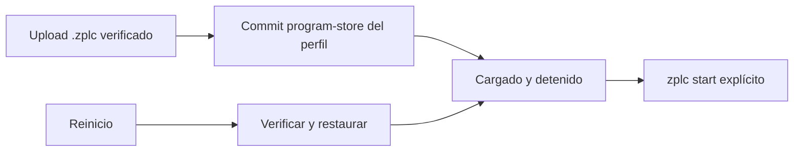

# Persistencia y Memoria Retenida

Para perfiles con un backend program-store habilitado y operativo, ZPLC puede
confirmar transaccionalmente un artefacto `.zplc` desplegado y verificado. El
restore publica el artefacto como lógicamente detenido/READY. El comportamiento
de las salidas antes de ejecutar es específico del perfil de target y requiere
evidencia registrada. Una persona debe ejecutar explícitamente `zplc start`.

## Backends de Plataforma

El core del runtime ZPLC depende de una Capa de Abstracción de Hardware (HAL) abstracta para las operaciones de persistencia. Esto permite que el sistema se adapte sin problemas a las capacidades de almacenamiento de distintos entornos:

| Plataforma | Backend de Almacenamiento |
|---|---|
| **Perfil Zephyr** | Backend program-store cuando está habilitado y operativo; NVS es una implementación, no una garantía universal de placa. Los registros `RETAIN` usan las mismas llamadas HAL. |
| **Simulación Nativa (PC)** | Archivos en el directorio de persistencia (`ZPLC_PERSIST_ROOT`, por defecto `~/.zplc`): el program store y los registros `RETAIN`. |
| **Simulador WASM** | `localStorage` del navegador, mediante las mismas llamadas HAL. El simulador todavía no lo usa para `RETAIN`. |

## Persistencia de Programa en Hardware

Cuando un perfil dispone de un backend program-store operativo, una carga
`.zplc` verificada puede confirmarse mediante ese backend.



Al iniciar, un program store habilitado puede proporcionar un artefacto válido
para verificación y restore lógicamente detenido/READY. El comportamiento de
las salidas antes de ejecutar es específico del perfil de target y requiere
evidencia registrada. El deploy termina al completar la carga verificada; nunca
arranca la máquina. El arranque es una operación humana separada y explícita.
La evidencia target, power-cut, HIL y eléctrica sigue siendo específica del
perfil exacto y no se ejecutó aquí.

### Cómo guarda el store un programa

El store tiene dos slots, A y B, y un registro activo pequeño que nombra el slot que debe ejecutarse. Un slot es el
artefacto, un pie de 8 bytes (`ZPE1` y la longitud del artefacto) y un registro de metadatos de 32 bytes; todos los
registros llevan un CRC-32 y la versión de formato. El runtime host y el firmware ejecutan el mismo código
(`zplc_program_store.c`) sobre las llamadas de persistencia de la HAL, de modo que el orden de las escrituras que
sigue es el que ejercitan las pruebas del host.

Un deploy escribe el slot que no está activo, lo relee y lo verifica, escribe los metadatos como preparados y los
relee, y sólo entonces escribe el registro activo: esa escritura es el único punto en que el programa nuevo pasa a
ser el que se restaura. Después los metadatos se reescriben como confirmados.

| Un corte de energía ... | Qué encuentra el siguiente restore |
|---|---|
| antes de escribir el registro activo | El programa anterior. Un store que nunca tuvo uno está vacío. |
| a mitad del payload nuevo | El programa anterior: un slot mitad viejo y mitad nuevo no pasa el CRC-32 de su artefacto y nunca se acepta. |
| después del registro activo y antes de reescribir los metadatos | El programa nuevo: el slot se releyó antes de mover el puntero. |
| que daña el registro activo | El slot confirmado completo más reciente. |

Los registros que existen y no verifican nunca se toman por un store vacío: el restore los informa como no
verificables y un deploy se niega a escribir encima. Un store escrito por el primer firmware (una clave, `code_len`
y `code`) se restaura tal cual y se migra en el siguiente deploy.

Un almacén clave-valor en flash guarda una entrada dentro de un sector de borrado, así que el payload se corta en
trozos de `CONFIG_ZPLC_PROGRAM_STORE_CHUNK_SIZE` bytes (1024 por defecto), cada uno bajo su propia clave. El mayor
artefacto es un único número, `CONFIG_ZPLC_CODE_SIZE_MAX`: es la región de código, el mayor artefacto que acepta el
loader, el tamaño de los buffers de recepción y de restore, el tamaño que informa `zplc sys info`
(`max_artifact_size`) y el tamaño que se comunica al IDE para la placa (RT-028). La compilación falla si dos slots
de ese tamaño, en trozos, no caben en la partición de almacenamiento. Por eso el perfil Raspberry Pi Pico fija 24576
bytes (su partición de 64 KB), el perfil STM32F746G Discovery 16384 y el perfil Arduino Opta WiFi 32768 (su RAM), y
el perfil ESP32-S3 mantiene sus 8192; los demás perfiles mantienen 45056. El program store (como memoria de trabajo
de su comprobación de rollback), el buffer de staging de carga y la VM guardan cada uno un programa en RAM, así que
un perfil gasta tres veces su tamaño de código. No hay una cuarta copia residente: el buffer de staging conserva el
artefacto cargado, y `zplc reset` recarga el programa desde el store, que guarda el mismo (un reset cancela una
carga en curso).

Lo que se ha demostrado: un corte de energía inyectado en cada operación de un deploy y una escritura truncada en
cada registro, en el host (`test_program_store`), y un corte de energía en cada operación de un deploy del tamaño
máximo sobre el simulador de flash de NVS en `native_sim` (`program_store_nvs`), restaurado en el mismo buffer que
usó el deploy. Lo que no: un corte de energía en una placa. El driver de flash, el
tiempo de borrado y el comportamiento de la alimentación de cada perfil necesitan el registro de hardware de ese
perfil (HIL-010).

## Memoria Retentiva (`RETAIN`)

El compilador acepta `VAR RETAIN` y `VAR_GLOBAL RETAIN`, coloca esas variables
en la región retentiva de la memoria de proceso (dirección `0x4000`, 4 KB por
defecto) y aplica sus valores iniciales declarados solo cuando la región no
contiene estado guardado. El runtime guarda esa región y la restaura cuando se
vuelve a cargar el mismo programa. Todo lo de esta página es evidencia de host,
de simulador y de compilación: ninguna placa se ha medido y ninguna placa ha
pasado por un corte de energía bajo prueba.

### Qué se guarda y cuándo

| Momento | Qué ocurre |
|---|---|
| Carga de programa y restore al arrancar | La región se restaura desde los registros guardados antes del primer scan, o se inicializa en cero cuando ningún registro coincide. El estado dice cuál. |
| `STOP` (comandado) | La región se guarda con los valores del último scan completo. Un stop de un runtime en falla no guarda nada. |
| Mientras corre | La región se guarda como máximo una vez por intervalo, en un límite de scan, y solo si cambió desde el último registro guardado. |
| Apagado limpio del runtime host | Se guarda como un `STOP`. |
| Reset (`execution.reset`) | Un reinicio en frío: la región se inicializa y esa región inicializada se guarda, de modo que los valores anteriores no vuelven. |

En el firmware un guardado periódico corre en su propia cola de trabajo, fuera
del scan, y mantiene el bloqueo de memoria solo durante la copia de la región,
nunca durante la escritura al almacenamiento. En el host corre en el bucle
principal entre dos scans. Un corte de energía entre dos guardados pierde los
cambios desde el último registro; esa es la razón del intervalo, que el
presupuesto de flash de abajo acota desde el otro lado.

### El registro

Dos registros se alternan, de modo que un corte de energía durante un guardado
nunca destruye el último bueno. Un guardado escribe el slot más antiguo con un
número de secuencia uno por encima del más nuevo. Cada registro se corta en
fragmentos de como máximo `CONFIG_ZPLC_RETAIN_CHUNK_SIZE` bytes (1024 por
defecto), guardados bajo las claves `retain_a0`, `retain_a1`, ... y
`retain_b0`, ..., porque una entrada del almacenamiento puede ser menor que la
región (NVS en un sector de 4 KB).

| Offset | Tamaño | Campo |
|---|---|---|
| 0 | 4 | magic `ZRTN` |
| 4 | 2 | versión de formato, 1 |
| 6 | 2 | reservado, cero |
| 8 | 4 | número de secuencia, nunca 0 |
| 12 | 4 | identidad del programa: la palabra CRC32 de la cabecera del artefacto |
| 16 | 4 | identidad del programa: la palabra de tamaño de código de la cabecera del artefacto |
| 20 | 4 | hash de layout |
| 24 | 4 | longitud del payload, el tamaño de la región `RETAIN` |
| 28 | n | payload, los bytes de la región |
| 28+n | 4 | CRC-32 de todos los bytes anteriores |

El hash de layout es un CRC-32 sobre el tamaño de la región, la dirección de la
región, la versión de la ISA, el contador de draft del contrato y la identidad
del programa. Un programa que cambia en un byte tiene otra identidad, de modo
que una recompilación descarta los valores retenidos; el runtime no tiene un
layout a nivel de variable para llevarlos a través de un cambio.

### Qué hace un reinicio

El restore toma el registro válido con la secuencia más alta cuya identidad y
layout coinciden. Si un registro falla su checksum, se prueba el otro. Si
ninguno coincide, la región se pone en cero y el estado dice por qué:

| `reason` | Significado |
|---|---|
| `restored` | Se restauró un registro válido de este programa y layout. |
| `none` | Ningún registro en ninguno de los dos slots: primer arranque, almacenamiento borrado, o sin backend de almacenamiento. |
| `identity_mismatch` | Existen registros válidos, escritos por otro programa. |
| `layout_mismatch` | El mismo programa, pero otro tamaño de región, dirección o layout del runtime. |
| `corrupt` | Existen registros y ninguno pasa las comprobaciones de formato y checksum. |
| `io_error` | El backend de almacenamiento falló en ambos slots. Los guardados se rechazan hasta que un restore lea de nuevo el backend. |
| `reset` | Un comando de reset inicializó la región. |
| `not_restored` | No hay programa cargado. |

El estado del runtime nativo lleva esto junto a los campos existentes:

```json
"retain": {"reason": "restored", "restored": true, "sequence": 12, "saves": 3, "save_errors": 0, "saved_at_ms": 94000}
```

`saved_at_ms` es el uptime del runtime del último registro escrito en esta
sesión, o `null` cuando no hubo ninguno. En el firmware los mismos valores están
en `zplc sched status` y `zplc sched status --json`.

### Runtimes host y WASM

El host POSIX aplica el mismo módulo y las mismas reglas. Su intervalo de
guardado periódico es de 30 segundos por defecto y se puede fijar con la
variable de entorno `ZPLC_RETAIN_SAVE_INTERVAL_MS`: `0` desactiva los guardados
periódicos (un `STOP` y un apagado siguen guardando), un valor de 100 a
86400000 fija el intervalo, y cualquier otro valor se ignora con un mensaje en
la salida de error estándar. Los programas que corren en el simulador host
conservan por eso sus valores `RETAIN` de una sesión a la siguiente, como lo
hace un controlador; usa `execution.reset`, u otro directorio de persistencia,
para partir de los valores declarados.

El simulador WASM todavía no aplica estas reglas. Su almacenamiento es
`localStorage` y el módulo portable solo necesita las llamadas HAL, pero el
módulo no está enlazado en la compilación WASM y su adaptador no llama a un
guardado en stop ni a un restore en la carga. Mientras eso no esté conectado, un
programa en el simulador WASM parte de los valores declarados en cada carga.

### Activarlo en una placa de firmware

`CONFIG_ZPLC_RETAIN_PERSIST` está desactivado por defecto. La ruta de escritura está cubierta por la
suite `retain_persist` en `native_sim` (ambos anchos de palabra) y por la aserción de desgaste en tiempo
de compilación; ninguna placa fue medida: una escritura en flash puede detener la captura de instrucciones
en partes que ejecutan desde la misma flash, y en varias placas la partición de almacenamiento también la
usa otro sistema de archivos. Se establece `CONFIG_ZPLC_RETAIN_PERSIST=y` en el archivo de la placa, con
los números de resistencia de la sección siguiente, cuando esa placa haya superado su registro de hardware
(HIL-010). Hasta entonces la región `RETAIN` se inicializa en cada arranque en el firmware y el estado no
incluye el campo `retain`.

### Presupuesto de desgaste de flash por placa

Cada guardado de una región modificada cuesta borrados de flash. El peor caso es
una región que cambia en cada intervalo. Para una placa:

- un guardado escribe el registro más la sobrecarga de entrada de cada
  fragmento (unos 64 bytes cada uno, una estimación que cubre un bloque de
  escritura de 32 bytes);
- la partición de almacenamiento absorbe los bytes de desgaste de la tabla por
  cada borrado de todos los sectores: los sectores menos el que NVS mantiene
  libre, menos unos 8300 bytes de los dos slots de programa que la recolección
  de basura copia en cada rotación;
- la flash está especificada para un número de ciclos de borrado por sector.

Guardados que aguanta la flash = ciclos de borrado x bytes de desgaste / bytes
por guardado. Vida = guardados x intervalo. La compilación falla cuando el
intervalo hace esa vida más corta que `CONFIG_ZPLC_RETAIN_LIFE_YEARS` (10 por
defecto), de modo que una placa no puede salir con un intervalo que sus propios
números no sostienen.

Todos los números de abajo son estimaciones de ingeniería a partir de la clase
de datasheet de la pieza y del layout de particiones del archivo de la placa.
Ninguna placa se midió.

| Placa | Partición de almacenamiento | RETAIN | Ciclos nominales | Bytes de desgaste | Intervalo | Vida estimada en el peor caso |
|---|---|---|---|---|---|---|
| Raspberry Pi Pico (RP2040) | 64 KB de la NOR QSPI de la placa, 16 sectores de 4 KB | 4 KB | 100.000 | 53.000 | 300 s | 11,3 años |
| Arduino GIGA R1 (STM32H747 M7) | 7 MB de la NOR QSPI externa, sectores de 4 KB supuestos | 4 KB | 100.000 | 7.300.000 | 60 s | más de 100 años |
| Arduino Opta WiFi (STM32H747 M7) | 7 MB de la NOR QSPI externa, sectores de 4 KB supuestos | 4 KB | 100.000 | 7.300.000 | 60 s | más de 100 años |
| STM32F746G Discovery | 15 MB de la NOR QSPI externa, subsectores de 4 KB supuestos | 4 KB | 100.000 | 15.700.000 | 60 s | más de 100 años |
| ESP32-S3 DevKitC | 192 KB de la NOR SPI del módulo, 48 sectores de 4 KB | 1 KB | 100.000 | 184.000 | 60 s | 29,5 años |
| STM32 Nucleo-H743ZI | 128 KB, un sector de la flash interna: NVS no puede montar | 4 KB | ninguno | ninguno | ninguno | no se persiste |
| Una placa sin números | cualquiera | cualquiera | 10.000 | 40.000 | 3600 s | 10,3 años para 4 KB |

La fila de la Pico es la que hay que leer dos veces: a 30 segundos, el valor por
defecto del host, la misma placa agotaría su almacenamiento en unos 1,1 años. El
intervalo es un mínimo: una región que no cambia nunca se escribe, de modo que un
programa cuyos valores retenidos cambian poco desgasta la flash mucho menos de
lo que dice esta tabla.

Un `STOP` de una región modificada es un guardado más y no forma parte del
presupuesto: es una orden de una persona. Un script que detiene y arranca el
controlador cada pocos segundos, con valores retenidos que cambian en cada
ejecución, gasta el presupuesto de un año en días.

### Límites

- No medido: los números de resistencia de arriba salen de la clase de datasheet
  de las piezas, no de una medición, y los layouts de partición de GIGA, Opta y
  F746G se leen de la descripción de la placa, no de una placa.
- No demostrado: que un guardado sobreviva a un corte de energía en alguna
  placa. El formato del registro y el orden de las escrituras se prueban con
  fallas inyectadas en cada paso en el host y en `native_sim`, y nada más.
- No medido: cuánto tiempo detiene al procesador una escritura de flash. En
  piezas que ejecutan código desde la misma flash una escritura puede retener
  la captura de instrucciones durante un borrado; el guardado periódico corre en
  su propia cola de trabajo, pero que un scan se retrase depende del driver de
  flash y no se ha medido en ninguna placa.
- La Nucleo-H743ZI no puede montar su backend de almacenamiento (un sector de
  128 KB, por encima del límite de 64 KB de NVS), de modo que su región `RETAIN`
  se inicializa en cada arranque y su estado dice `io_error`. El sistema de
  archivos de configuración de las placas STM32F746G, GIGA y Opta usa la misma
  partición que los registros NVS: que ambos convivan no está establecido.
- Una recompilación del programa, incluso una que solo mueve código, cambia su
  identidad y descarta los valores retenidos.
- El modo de firmware de una sola tarea (scheduler desactivado) no persiste
  `RETAIN`.
- No confíes en `RETAIN` para estado crítico de recuperación hasta que existan
  los registros de hardware del perfil exacto: un corte de energía en el momento
  equivocado pierde los valores desde el último guardado.
