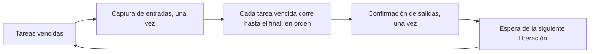

# Ciclo de escaneo y tareas

Un PLC no ejecuta un programa una sola vez. Repite un ciclo de escaneo: lee las entradas, ejecuta las tareas y escribe las salidas. Esta página explica cómo lo hace ZPLC, en qué orden corren las tareas, qué ocurre cuando una llega tarde y qué hacen las salidas siempre que el programa no tiene el control. Léala antes de confiar en un tiempo, en la prioridad de una tarea o en el comportamiento de un programa detenido.

## Un ciclo, paso a paso



1. Una o más tareas vencen. Las tareas liberadas juntas forman un **lote**.
2. El runtime toma la imagen de entradas una sola vez, y todas las tareas del lote leen esa misma imagen.
3. Las tareas corren una tras otra, cada una hasta su final. Nada interrumpe a una tarea.
4. La imagen de salidas se confirma una vez, después de la última tarea, y los pines se escriben a partir de ella.

La lógica que usted escribe ve un conjunto coherente de entradas durante todo el ciclo, y las salidas cambian juntas al final. Por eso importa el orden de los peldaños o de las instrucciones dentro de una tarea, y por eso un valor asignado tarde en un ciclo no llega a los pines hasta la confirmación.

## Modelo de tareas

Las tareas se declaran en `zplc.json` y se compilan dentro del programa `.zplc`. Esta versión tiene un solo tipo de tarea, la tarea cíclica. El modelo es el mismo en simulación y en un destino; las diferencias están en [Qué no es idéntico en simulación](#qué-no-es-idéntico-en-simulación).

| Propiedad | Significado |
| --- | --- |
| **Tipo** | Solo cíclica. `trigger: "cyclic"` es una tarea cíclica. `trigger: "freewheeling"` se compila como una tarea cíclica del intervalo que declara y nunca corre más rápido. Las tareas de evento y de interrupción no existen en esta versión: la compilación falla en la definición de la tarea y nombra la tarea, su campo `trigger` y los disparadores admitidos, y ambos runtimes rechazan un artefacto que contenga una tarea de evento. |
| **Intervalo** | Milisegundos enteros, de 1 a 3 600 000. Cada tarea tiene su propio intervalo. Un programa tiene como máximo 16 tareas, y una compilación de firmware registra tantas como permita `CONFIG_ZPLC_MAX_TASKS` (8 por defecto). El intervalo es el período de liberación y el plazo del ciclo, no un tiempo de ciclo medido. |
| **Prioridad** | El número menor corre primero. La prioridad solo ordena tareas liberadas juntas; nunca interrumpe una tarea en ejecución ni da más tiempo a ninguna. |
| **Punto de entrada** | La ubicación del programa o de la función dentro del programa compilado. |

De ahí salen cinco reglas:

1. **Liberación.** Un arranque o una reanudación inicia la programación de todas las tareas en el mismo instante, y después una tarea se libera una vez por intervalo. Una liberación que llega mientras la tarea sigue ejecutándose no se encola, y un host que despacha tarde ejecuta la tarea una vez, no una vez por cada liberación perdida.
2. **Orden.** Un lote corre por liberación más temprana primero, luego por prioridad (el número menor primero) y luego por ID de tarea (el menor primero).
3. **Sin apropiación.** Las tareas de un lote corren una tras otra, cada una hasta el final de su ciclo. Solo un punto de parada detiene un ciclo antes de su final; véase [Pausa, reanudación, paso y parada](#pausa-reanudación-paso-y-parada).
4. **Una captura y una confirmación por lote.** Una tarea que no se libera en un lote no se ejecuta, y la imagen de proceso conserva lo que escribió.
5. **Plazo.** El plazo de un ciclo es el intervalo de su tarea contado desde la liberación de su lote. Una tarea que termina después lo incumple; véase [Plazos](#plazos).

## Un solo núcleo del planificador

Todas las decisiones anteriores se toman en un solo lugar, `zplc_sched_core` (`firmware/lib/zplc_core/src/core/zplc_sched_core.c`), y cada runtime aporta solo lo que depende de su plataforma (RT-008, RT-018):

| En el núcleo, igual en todas partes | En el adaptador |
| --- | --- |
| Qué tareas vencen y en qué orden | El reloj, los temporizadores y los hilos que llaman al núcleo |
| El control del plazo, la cuenta de incumplimientos y la retención de la falla | Los cerrojos de la imagen de proceso y de la E/S de salida |
| La captura de entradas, la confirmación de salidas y el estado seguro | Los pines y el watchdog de hardware |
| La causa de la falla: se conserva la primera, y una falla de la VM gana a un incumplimiento de plazo en el mismo ciclo | El protocolo de depuración y el shell |

Lo usan tres adaptadores: la sesión POSIX del runtime de host (`native_runtime_session.c`), el planificador de Zephyr (`zplc_scheduler_zephyr.c`) y la configuración de una sola tarea (`zplc_single_task.c`). La prueba de host `test_sched_equivalence` y la suite de Zephyr `scheduler_equivalence` ejecutan los mismos escenarios, un programa de tres tareas y uno de una tarea, y comparan las decisiones con una traza de referencia, de modo que un cambio de la regla en un runtime hace fallar al otro. La comparación es de decisiones, no de tiempo. El runtime WebAssembly de la aplicación ZPLC ejecuta el mismo núcleo y la misma prueba de traza; véase [el runtime de software](./browser-runtime.md).

**Firmware de una sola tarea.** Una compilación con `CONFIG_ZPLC_SCHEDULER=n` ejecuta una tarea de un intervalo sobre el mismo núcleo, con la misma captura, el mismo control de plazo (`CONFIG_ZPLC_DEADLINE_MISS_LIMIT`), la misma retención de la falla y el mismo estado seguro. Dos cosas difieren: su bucle mantiene el cerrojo del runtime durante todo el ciclo, así que una orden del shell espera a que el ciclo termine, y no tiene intercambio de instantáneas, así que otro hilo lee y escribe la imagen de proceso bajo ese cerrojo.

### Los cerrojos alrededor de un ciclo (RT-010, RT-012)

En un destino un lote son tres pasos. Las entradas se leen del HAL sin ningún cerrojo. Después, bajo el cerrojo de la imagen de proceso, se aplican las escrituras que otros hilos dejaron en cola, las muestras pasan a la imagen de entradas, las tareas corren y la imagen se publica como instantánea. Por último, con el cerrojo de la imagen liberado y bajo un cerrojo aparte para la E/S de salida, se escriben los pines y se alimenta el watchdog de hardware. El cerrojo de la imagen nunca se mantiene mientras se escribe un pin, se imprime una línea o corre una llamada que pueda bloquear.

Un hilo ajeno al ciclo lee la instantánea de la última confirmación y deja sus escrituras en cola para la siguiente captura de entradas; véase [Acceso desde fuera del ciclo](./memory-model.md#acceso-desde-fuera-del-ciclo-rt-010-rt-011). Un cerrojo que no se puede crear o tomar es un error que ve quien llama (RT-030): una llamada de control devuelve `ZPLC_SCHED_ERR_LOCK` y no cambia nada, y un ciclo que no puede tomar el cerrojo de la imagen lleva los pines a su estado seguro y retiene la falla.

### Prioridades y orden de arranque (RT-013, RT-024)

El coordinador del ciclo corre con un número de prioridad menor que todos los hilos de comunicación (`CONFIG_ZPLC_COMM_THREAD_PRIORITY`, 8 por defecto) y que los hilos del shell y del registro, y la compilación falla si no se cumple. Las placas con pila de red fijan `CONFIG_NET_TC_THREAD_PREEMPTIVE=y`, porque los hilos de red de Zephyr son cooperativos por defecto y superarían en prioridad al ciclo.

El firmware arranca el runtime antes que cualquier servicio: la capa de hardware, el núcleo, el planificador con el almacén de programas y la restauración del programa almacenado. La red, el servicio de hora, los servidores de bus de campo y el aprovisionamiento MQTT o de nube arrancan después, y cada uno puede fallar sin detener el runtime que ya está en marcha. El registro de arranque nombra cada paso en el orden en que corrió.

## Plazos

Un ciclo incumple su plazo cuando su tarea termina más de un intervalo después de la liberación de su lote, porque la tarea se liberó otra vez antes de terminar o porque las tareas que la preceden usaron su intervalo. Un incumplimiento tiene estos efectos, en este orden:

1. Se levanta el indicador de **advertencia**.
2. El incumplimiento se **cuenta**, para la tarea y en total.
3. Se registra el **exceso**, cuánto después del plazo terminó la tarea.
4. Cuando la misma tarea incumple `N` veces seguidas, la falla se **retiene**: las salidas pasan a su estado seguro, la sesión queda en `error` y el estado informa la causa y la tarea. Un reinicio o un programa nuevo la borra.

Un ciclo que termina a tiempo corta la racha de esa tarea y borra su parte de la advertencia; la cuenta se conserva hasta cargar un programa o reiniciar. Un paso del depurador y un ciclo detenido en un punto de parada no se comprueban.

`N` vale **3** por defecto en todos los runtimes, de modo que una activación tardía, que puede causar una ráfaga de comunicación o una escritura en flash, se advierte y se cuenta, y una tarea que sigue incumpliendo detiene el programa. Es un valor por defecto de diseño; las versiones anteriores retenían la falla en el primer incumplimiento. En simulación `N` es la variable de entorno `ZPLC_DEADLINE_MISS_LIMIT`, un entero de 1 a 1 000 000 que se lee al iniciar la sesión (un valor fuera del rango se ignora con un mensaje en la salida de error estándar). En un destino es `CONFIG_ZPLC_DEADLINE_MISS_LIMIT`, en el mismo rango, fijo al compilar el firmware.

La simulación informa un incumplimiento en el resultado de `status.get` y en cada evento `status.changed`, y una falla retenida también como evento `runtime.error` con el código `DEADLINE_MISS`. Un destino informa los mismos campos en `zplc sched status --json`, como los objetos `deadline` y `fault`.

| Campo | Significado |
| --- | --- |
| `stats.overruns` | Incumplimientos de plazo de todas las tareas desde que se cargó o se reinició el programa. |
| `tasks[].overruns` | Incumplimientos de esa tarea. |
| `deadline.warning` | `true` mientras alguna tarea tenga una racha de incumplimientos que ningún ciclo a tiempo haya cortado. |
| `deadline.misses` | La misma cuenta que `stats.overruns`. |
| `deadline.consecutive_misses` | La racha de incumplimientos más larga que sigue en curso. |
| `deadline.miss_limit` | `N`. |
| `deadline.last_overrun_us` | Cuánto después de su plazo terminó la última tarea tardía, en microsegundos. El reloj del host cuenta milisegundos, de modo que allí es múltiplo de 1000. |
| `fault.reason` | `none`, `deadline_miss`, `vm_fault` o `runtime_failure`. |
| `fault.task_id` | La tarea que retuvo la falla, o `null` si no hay ninguna. |

El objeto `host_cadence`, aparte, informa cuánto tardó el host en despachar un lote después de que sus tareas vencieran y las liberaciones que saltó. En simulación ese retraso no es un incumplimiento de plazo.

## Qué no es idéntico en simulación

Las cinco reglas son las mismas en simulación y en un destino. Estos puntos no lo son, y ninguno se midió en una placa:

| Tema | Simulación | Destino (planificador de Zephyr) |
| --- | --- | --- |
| Fuente de tiempo | El reloj monotónico del host en milisegundos enteros, de modo que un plazo y un exceso son múltiplos de 1 ms. | El contador de ciclos, leído en microsegundos. |
| Instante de una liberación | El instante en que el host despacha el lote. La espera entre el vencimiento y el despacho se informa en `host_cadence` y no es un incumplimiento. | El temporizador marca la liberación cuando expira, así que un coordinador que inicia el lote tarde gasta el plazo de sus tareas. |
| Siguiente liberación | Las tareas de intervalos distintos mantienen una cuadrícula fija desde el arranque común. Las tareas de un mismo intervalo se liberan un intervalo después del despacho anterior, así que un despacho tardío desplaza las liberaciones que le siguen. | Un temporizador periódico sobre una cuadrícula fija: un lote tardío no desplaza la siguiente liberación. |
| Primera liberación | Todas las tareas se liberan en el arranque mismo. | Cada tarea se libera por primera vez un intervalo después del arranque o de la reanudación. |
| Dos tareas del mismo tick | Se liberan en el mismo instante, así que se ordenan por prioridad y luego por ID de tarea. | La comparación es la misma, pero cada temporizador marca su propia liberación; no se afirma qué orden obtienen dos temporizadores de un mismo tick en una placa. |
| Una escritura en la imagen de entradas mientras corre el programa | Se encola (32 escrituras como máximo) y se aplica al inicio del ciclo siguiente, en orden y con la escritura que respeta los forzados, de modo que ningún ciclo ve cambiar la imagen. Una cola llena rechaza la escritura con `RUNTIME_FAILURE`; una parada, un reinicio o una carga vacían la cola. Mientras el programa está detenido o en pausa, la escritura se aplica de inmediato. | La cola de escrituras del intercambio aplica todas las escrituras en cola, en orden, en la captura de entradas del ciclo siguiente (RT-010). |
| Velocidad y jitter | La VM corre en un procesador de host bajo un sistema operativo de propósito general. | La VM corre en el procesador de la placa. Un programa que cumple a tiempo en simulación puede incumplir en un destino, y a la inversa. |

## Pausa, reanudación, paso y parada

El runtime separa dos cosas: las **salidas físicas** (los pines) y el **estado lógico del programa** (la imagen de salidas, la tabla de forzados y el contador de programa y las pilas de cada tarea). Una pausa deja seguros los pines y conserva el estado lógico, de modo que una reanudación o un paso continúan donde el programa se detuvo (RT-017). `STOP` termina la ejecución y descarta ambos.

| Operación | Salidas físicas | Imagen de salidas | Tabla de forzados | Ciclos de las tareas |
| --- | --- | --- | --- | --- |
| Pausa (`zplc dbg pause`) | Seguras (apagadas) antes de que retorne la llamada | Se conserva | Se conserva | Pausa entre ciclos: el lote en curso termina primero |
| Punto de parada | Seguras (apagadas); el lote hace una confirmación y luego los pines se llevan al estado seguro | Se conserva, con el ciclo parcial | Se conserva | El ciclo se detiene en el punto de parada con su contador de programa y sus pilas |
| Paso (`zplc dbg step`) | El ciclo se confirma y luego los pines se llevan al estado seguro | Se conserva, muestra el ciclo ejecutado | Se conserva | Termina el ciclo detenido en un punto de parada, o ejecuta un ciclo completo, y se detiene en el siguiente límite de ciclo o punto de parada |
| Reanudación (`zplc dbg resume`) | No las energiza la reanudación misma | Se conserva | Se conserva | Un ciclo detenido en un punto de parada continúa ahí en la siguiente liberación; una pausa entre ciclos empieza un ciclo nuevo |
| `STOP` | Seguras (apagadas) | Se pone a cero | Se borra | Cada tarea vuelve a su punto de entrada; se descarta el ciclo interrumpido |
| Falla | Seguras (apagadas) | Se pone a cero | Se borra | Queda retenida; la tarea con falla conserva su contador de programa y su error hasta cargar un programa |

- Seguro significa apagado, salvo que el proyecto declare otro valor ([Estado seguro de una salida](#estado-seguro-de-una-salida)). Los pines se llevan a ese estado por política, nunca desde la imagen, de modo que una imagen en pausa con un bit en uno no lo energiza.
- La primera confirmación normal después de una reanudación copia a los pines la imagen de salidas, con la tabla de forzados aplicada. Una reanudación no energiza nada por sí sola, y una salida forzada en uno permanece apagada durante la pausa y se enciende en esa confirmación.
- Un ciclo que continúa después de una reanudación o un paso conserva lo que vio su primera parte: las instrucciones ya ejecutadas, la pila de evaluación, el indicador de primer ciclo y su ID de tarea. Las entradas se vuelven a capturar al inicio del lote que lo continúa.
- Nivel de evidencia: destino emulado. Las suites de Zephyr `scheduler_run_control` y `scheduler_admission` corren en `native_sim` y QEMU, y el nivel del pin se observa con el emulador GPIO de `native_sim`. No se midió ninguna placa, y el tiempo entre la confirmación y la escritura segura es del controlador.

## Estado seguro de una salida

Una salida está **apagada** siempre que el programa no la controla: en STOP, en pausa o en un punto de parada, en una falla retenida, desde el arranque hasta el primer ciclo y mientras un despliegue está en curso. Una sola función, `zplc_io_drive_safe`, decide el nivel (RT-023):

1. El valor que **declara el programa cargado** para esa salida, cuando declara uno.
2. Si no, **apagado**, salvo que la descripción de la placa (`firmware/app/boards/boards.json`) dé a ese canal otro nivel seguro, como necesita un relé activo en bajo.

Un proyecto declara el valor en `zplc.json`, en una fila de `io.outputs`:

```json
{
  "io": {
    "outputs": [
      { "name": "Brake", "address": "%QX0.0", "type": "BOOL", "safe": true },
      { "name": "Valve", "address": "%QX0.1", "type": "BOOL" }
    ]
  }
}
```

Aquí `Brake` está energizada siempre que el programa no la maneja, y `Valve` está apagada. La declaración viaja dentro del artefacto, en su segmento `SAFE`, de modo que un programa y su estado seguro son una sola unidad: un dispositivo que restaura el programa restaura la declaración, y un despliegue interrumpido no puede dejar el programa de una compilación con los valores seguros de otra (véase [Valores seguros declarados](./isa.md#valores-seguros-declarados)). La confirmación del despliegue muestra cada salida declarada con el valor que toma, o dice que toda salida está apagada, antes de que se escriba el programa.

| Dónde | Qué se rechaza |
| --- | --- |
| La compilación (la aplicación ZPLC, la línea de comandos, MCP) | Un `safe` que no es `true` ni `false`; uno en una fila que no es un bit de salida digital (`%QW0`, `%QB0`), en una entrada o en una fila `virtual`; dos filas para una salida; una salida para la que la placa elegida no tiene un canal digital. El mensaje nombra la salida, la dirección y la placa, y no hay artefacto que desplegar. |
| El cargador | Un segmento que no son entradas completas, una entrada fuera de la imagen de salidas, un valor distinto de 0 o 1, una salida dos veces, o más de 64 entradas. |
| El firmware, al desplegar y al restaurar en el arranque | Una declaración para una salida que no es un canal de salida digital de la tabla de E/S de la placa, es decir, un proyecto de otra placa. El programa no se guarda ni se ejecuta. |

Los valores declarados rigen desde la carga que confirma el programa, antes del primer ciclo: un programa restaurado espera en STOP con sus salidas declaradas encendidas. La imagen de salidas es el estado lógico del programa y se pone en cero en STOP, sea cual sea el valor que muestre el pin. El tiempo entre el encendido y el instante en que el firmware maneja los pines es el estado de reinicio del componente; una placa que necesita un pin en uno ahí necesita hardware que lo haga (véase [Placas](../reference/boards.md)).

## Fallas, causa de reinicio y watchdog

Son los requisitos RT-019 a RT-022. Las decisiones que no dependen de una plataforma están en `zplc_failsafe` y se prueban en el host; lo que hace una plataforma (el registro de causa de reinicio, un registro en RAM que un reinicio no borra, el reinicio, el watchdog) es `zplc_failsafe_zephyr.c`.

**Una falla del procesador (RT-019).** Una falla del procesador, un desbordamiento de pila, una aserción o un pánico del kernel no deja las salidas donde las dejó el último ciclo. El manejador de error fatal (`CONFIG_ZPLC_FATAL_HANDLER`, activado por defecto) no toma ningún cerrojo ni reserva memoria: lleva cada salida digital a su nivel seguro, guarda la causa en un registro de 24 bytes en una RAM que un reinicio no borra y reinicia. El arranque siguiente informa el registro y lo consume, de modo que el reinicio que sigue no se llama falla. Un registro incompleto, o que no es de ZPLC, se ignora.

**Por qué se reinició el runtime (RT-021).** `zplc sys reset` (con `--json`) informa la causa del último reinicio: `power_on`, `brown_out`, `pin`, `software`, `watchdog`, `fault` o `unknown`, con el registro crudo, el registro de falla de la ejecución anterior y la política de arranque. Cuando un procesador informa varios bits el orden es fijo: primero un registro de falla, luego watchdog, encendido, brown-out, lock-up, software y, al final, el pin, porque casi todo reinicio lo activa. La causa es también la clave `reset_cause` de `zplc sched status --json`.

**Tras un reinicio el runtime espera en STOP (RT-022).** Sea cual sea la causa, el programa guardado se restaura en STOP con las salidas en sus valores seguros, y **RUN es una orden de una persona**: la función `zplc_reset_may_run` vale 0 para toda causa. Las variables retentivas se restauran solo cuando `CONFIG_ZPLC_RETAIN_PERSIST` está activado, y lo está en el perfil de cada placa distribuida. Un despliegue detiene el programa en ejecución antes de transferir un solo byte.

**El watchdog de hardware (RT-020).** La entrada `watchdog` de cada placa en `boards.json` dice si está habilitado, el tiempo de espera con el que se registró su tiempo de reinicio, el tiempo de espera más largo que acepta el componente y qué hace en STOP, en pausa y en una falla retenida. **Ninguna placa lo tiene habilitado**, y las opciones siguen desactivadas hasta que una placa y revisión exactas tengan un registro de hardware de su tiempo de reinicio y de sus pines (HIL-010). Cuando está habilitado:

- Se alimenta desde la finalización de un ciclo, nunca desde un temporizador, una interrupción, el shell o el hilo inactivo, de modo que un ciclo detenido corta la alimentación y la placa se reinicia.
- Su tiempo de espera es el del perfil, alargado cuando el conjunto de tareas lo necesita (más de dos intervalos de la tarea más lenta, hasta el máximo que acepta el componente); un conjunto de tareas que no cabe se rechaza al iniciar.
- La política por defecto es desarmado en STOP, alimentado desde la ruta de control en pausa para que un punto de parada largo no reinicie la placa, y dejado expirar en una falla retenida, de modo que la placa se reinicia en STOP con la causa registrada.

## Evidencia y límites

Las decisiones se prueban en el host (`test_failsafe`, `test_sched_core`) y los comportamientos en el emulador de Zephyr y en QEMU: `failsafe`, `failsafe_reboot` (una falla real de instrucción indefinida y un reinicio real en `qemu_cortex_m3`, donde el registro sobrevive al reinicio y la causa es `fault`), `scheduler_watchdog`, `program_boot_restore` y `scheduler_admission`. Nivel de evidencia: host y destino emulado.

No se muestra, y queda pendiente de un registro de hardware: el tiempo de ciclo y el jitter en cualquier placa, el tiempo que tarda un componente real en reiniciarse, el nivel del pin mientras se reinicia, que la RAM de un componente dado sobreviva a su reinicio por watchdog y el watchdog de cualquier placa. La simulación nativa solo comprueba el orden lógico y las transiciones de estado, así que mida el tiempo de ejecución en el peor caso, el jitter, los plazos y las salidas físicas en la placa y la revisión exactas antes de depender de ellos.
