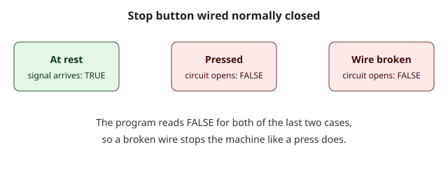

## Two kinds of contact, and one important button

In the first lessons you used a contact that asks "is this variable TRUE?". There is a second kind that asks the opposite question. Knowing which one to use, and why, is the first real skill of a PLC programmer. It also leads to one of the oldest safety habits in industry: wiring a stop button so that it fails safe.

## Normally open and normally closed

The words come from the electrical world. A switch is **normally open** (NO) when, at rest, its contacts are apart and no current flows. Pressing it closes the circuit. A switch is **normally closed** (NC) when, at rest, its contacts touch and current flows. Pressing it opens the circuit.

Ladder borrows the two words for the two contacts of a rung.

- A **normally open contact** passes power when its variable is TRUE.
- A **normally closed contact** passes power when its variable is FALSE. It is drawn with a slash across the bars.

The word "closed" here describes the contact on the screen, not the button in the field. The contact is a question about a variable. The variable gets its value from the input, and the input comes from the world.

## Why a stop button is wired normally closed

Imagine two ways to build a stop button for a motor.

- **Wired normally open.** At rest the circuit is open and the input is FALSE. Pressing the button closes the circuit and the input becomes TRUE, which tells the program to stop. If a wire comes loose, or a connector corrodes, the input stays FALSE forever. The program never learns that the stop button is dead. The next time somebody presses it, nothing happens.
- **Wired normally closed.** At rest the circuit is closed and the input is TRUE. Pressing the button opens the circuit and the input becomes FALSE. If a wire comes loose, the circuit opens by itself, the input becomes FALSE, and the machine stops.

The second way is **fail-safe**: the most common failure, a broken wire, produces the safe result, a stop. So stop buttons, guard switches and similar devices are wired normally closed.



## How an NC button looks to the program

This is the point that surprises beginners. The program does not read "pressed". It reads the **electrical state** of the input.

| Situation in the field         | Input value |
| :----------------------------- | :---------- |
| Nobody presses the stop button | TRUE        |
| The stop button is pressed     | FALSE       |
| The wire is broken             | FALSE       |

So the name of the button does not choose the contact. A beginner who thinks "stop, so I need a normally closed contact" chooses from the word, not from the value. Before you choose a contact, look up in the table the value the input has in the situation where the rung must pass power, and take the contact that passes power for that value.

A rung that must react to the opposite situation asks the opposite question about the same input.

## Worked example

A water tank is filled through a valve. The operator asks for water with a selector, FillRequest, and a float switch near the top, TankFull, is TRUE while the water reaches it. The float switch is an ordinary sensor: TRUE means "the tank is full". The valve must open while water is asked for and the tank is not full, and a lamp must show a full tank.

```ld-figure
src: reading/tank-fill.ld.json
caption: One sensor read with a normally closed contact in one rung and a normally open contact in the other
```

In the first rung, power needs FillRequest TRUE and TankFull FALSE, so FillRequest gets a normally open contact and TankFull a normally closed one, in series. In the second rung the lamp asks the opposite question about the same sensor, "is TankFull TRUE?", so it gets a normally open contact. Each contact was chosen from the value the input has when the rung must conduct.

```ld-try
src: reading/tank-fill.ld.json
inputs:
  - { name: FillRequest, kind: switch }
  - { name: TankFull, kind: switch }
outputs: [FillValve, FullLamp]
caption: Ask for water, then let the float switch report a full tank
```

Press Run. Switch FillRequest on: the valve opens. Now switch TankFull on, as if the water had reached the float: the valve closes and the lamp lights, although FillRequest is still on. Switch TankFull off again and the valve opens once more.

A stop button wired normally closed behaves differently from this float switch: its input is TRUE when nothing happens. The practice asks you to choose its contacts.

## Common mistakes

- Choosing the contact from the name of the button, not from the value of the input. Always ask: what value does the input have at rest?
- Wiring a stop button normally open to save a wire. You lose the fail-safe behavior and the broken-wire case goes unnoticed.
- Forgetting that a push button for starting is the opposite: a start button is normally open, so it reads FALSE at rest and TRUE when pressed.

> [!WARNING]
> Wiring a stop button normally closed is a good habit, but it does not make a program safe. An emergency stop is wired in hardware, so that it cuts the power to the machine even if the PLC fails, and it never waits for a PLC program.

## Check yourself

```quiz
question: A stop button is wired normally closed. What does the program read while nobody presses it?
options:
  - { text: 'TRUE', correct: true, feedback: 'Yes. The circuit is closed at rest, so the input is on.' }
  - { text: 'FALSE', feedback: 'FALSE is what the program reads when the button is pressed or the wire is broken.' }
  - { text: 'It changes on every scan', feedback: 'Nothing moves at rest: the closed circuit keeps the input TRUE scan after scan.' }
```

```quiz
question: A level switch LowLevel is TRUE while the water is below it. A pump must run only while LowLevel is FALSE. Which contact do you put on LowLevel in the pump rung?
options:
  - { text: 'A normally closed contact', correct: true, feedback: 'Yes. It passes power when its variable is FALSE.' }
  - { text: 'A normally open contact', feedback: 'That contact passes power when LowLevel is TRUE, so the pump would run only while the water is low.' }
  - { text: 'No contact is needed', feedback: 'Without the contact the program ignores the level switch entirely.' }
```

## What you will do in the practice

The starting program drives a motor and a lamp from a start button and a stop button wired normally closed, but both rungs read the stop input the wrong way, so the motor never runs and the lamp is lit with the stop circuit intact. You will make the motor run only while the stop circuit is closed and the lamp light only while it is open, then press {{ui:learn.check}}.
