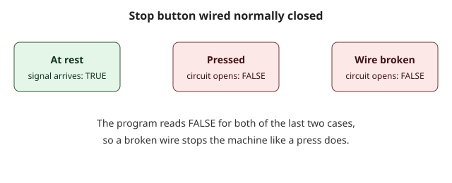

## Two kinds of contact, and one important button

In the first lessons you used a contact that asks "is this variable TRUE?". There is a second kind that asks the opposite question. Knowing which one to use, and why, is the first real skill of a PLC programmer. It also leads to one of the oldest safety habits in industry: wiring a stop button so that it fails safe.

## Normally open and normally closed

The words come from the electrical world. A switch is **normally open** (NO) when, at rest, its contacts are apart and no current flows. Pressing it closes the circuit. A switch is **normally closed** (NC) when, at rest, its contacts touch and current flows. Pressing it opens the circuit.

Ladder borrows the two words for the two contacts of a rung.

- A **normally open contact** passes power when its variable is TRUE.
- A **normally closed contact** passes power when its variable is FALSE. It is drawn with a slash across the bars.

The word "closed" here describes the contact on the screen, not the button in the field. The contact is a question about a variable. The variable gets its value from the input, and the input comes from the world.

## A door switch, read both ways

A guard door on a machine carries a switch: the signal DoorClosed is TRUE when the door is closed. We want the machine ready only with the door closed, and a warning lamp when the door is open.

```ld-figure
src: reading/door-ready.ld.json
caption: One signal read with a normally open contact and with a normally closed contact
```

The first rung uses a normally open contact: with DoorClosed TRUE, power reaches MachineReady. The second rung uses a normally closed contact: with DoorClosed FALSE, power reaches DoorOpenLamp. One variable, two opposite questions.

```ld-try
src: reading/door-ready.ld.json
inputs:
  - { name: DoorClosed, kind: switch }
outputs: [MachineReady, DoorOpenLamp]
caption: Switch the door closed and open again
```

Press Run. At first DoorClosed is FALSE, so the warning lamp is on. Switch it on: the machine becomes ready and the lamp goes off. Exactly one of the two lamps is on at any moment.

## Why a stop button is wired normally closed

Imagine two ways to build a stop button for a motor.

- **Wired normally open.** At rest the circuit is open and the input is FALSE. Pressing the button closes the circuit and the input becomes TRUE, which tells the program to stop. If a wire comes loose, or a connector corrodes, the input stays FALSE forever. The program never learns that the stop button is dead. The next time somebody presses it, nothing happens.
- **Wired normally closed.** At rest the circuit is closed and the input is TRUE. Pressing the button opens the circuit and the input becomes FALSE. If a wire comes loose, the circuit opens by itself, the input becomes FALSE, and the machine stops.

The second way is **fail-safe**: the most common failure, a broken wire, produces the safe result, a stop. So stop buttons, guard switches and similar devices are wired normally closed.



## How an NC button looks to the program

This is the point that surprises beginners. The program does not read "pressed". It reads the **electrical state** of the input.

| Situation in the field         | Input value |
| :----------------------------- | :---------- |
| Nobody presses the stop button | TRUE        |
| The stop button is pressed     | FALSE       |
| The wire is broken             | FALSE       |

So the program wants the motor to run when the stop input is TRUE. That means the motor rung needs a **normally open** contact on the stop input, which passes power when the input is TRUE. A beginner who thinks "stop, so I need a normally closed contact" gets the opposite of what they wanted: the motor would only run while the button is pressed or the wire is cut.

To light a lamp when the stop circuit is open, you ask the opposite question, "is the stop input FALSE?", and use a normally closed contact.

## Common mistakes

- Choosing the contact from the name of the button, not from the value of the input. Always ask: what value does the input have at rest?
- Wiring a stop button normally open to save a wire. You lose the fail-safe behavior and the broken-wire case goes unnoticed.
- Forgetting that a push button for starting is the opposite: a start button is normally open, so it reads FALSE at rest and TRUE when pressed.

> [!WARNING]
> Wiring a stop button normally closed is a good habit, but it does not make a program a safety function. An emergency stop is wired in hardware, so that it cuts the power to the machine even if the PLC fails, and it never depends on the PLC program. ZPLC makes no safety claim, and the lessons only show you how signals are read.

## Check yourself

```quiz
question: A stop button is wired normally closed. What does the program read while nobody presses it?
options:
  - { text: 'TRUE', correct: true, feedback: The circuit is closed at rest, so the input is on. }
  - { text: 'FALSE', feedback: FALSE is what the program reads when the button is pressed or the wire is broken. }
```

```quiz
question: The motor must run only while the stop input is TRUE. Which contact do you put on the stop input in the motor rung?
options:
  - { text: 'A normally open contact', correct: true, feedback: Yes. It passes power when the input is TRUE. }
  - { text: 'A normally closed contact', feedback: That contact passes power when the input is FALSE, so the motor would run only while the stop circuit is open. }
  - { text: 'No contact is needed', feedback: Without the contact the program ignores the stop button entirely. }
```

## What you will do in the practice

In the practice a small program drives a motor and a lamp from a start button and a stop button wired normally closed. Both rungs read the stop input with the wrong kind of contact. You will fix both, press Check, and see that the motor stops when the stop circuit opens and that the lamp lights at the same time.
