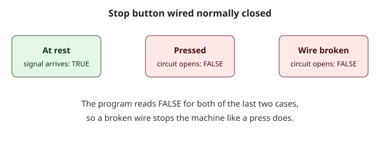

## Dos clases de contacto y un pulsador importante

En las primeras lecciones usó un contacto que pregunta "¿esta variable es TRUE?". Existe una segunda clase que hace la pregunta contraria. Saber cuál usar, y por qué, es la primera habilidad real de quien programa PLC. También lleva a uno de los hábitos de seguridad más antiguos de la industria: cablear un pulsador de parada de modo que falle en modo seguro.

## Normalmente abierto y normalmente cerrado

Las palabras vienen del mundo eléctrico. Un interruptor es **normalmente abierto** (NA) cuando, en reposo, sus contactos están separados y no circula corriente. Al pulsarlo se cierra el circuito. Un interruptor es **normalmente cerrado** (NC) cuando, en reposo, sus contactos se tocan y circula corriente. Al pulsarlo se abre el circuito.

El diagrama de escalera toma prestadas las dos palabras para los dos contactos de un peldaño.

- Un **contacto normalmente abierto** deja pasar la energía cuando su variable es TRUE.
- Un **contacto normalmente cerrado** deja pasar la energía cuando su variable es FALSE. Se dibuja con una raya diagonal sobre las barras.

La palabra "cerrado" aquí describe el contacto en la pantalla, no el pulsador en el campo. El contacto es una pregunta sobre una variable. La variable recibe su valor de la entrada, y la entrada viene del mundo.

## Por qué un pulsador de parada se cablea normalmente cerrado

Imagine dos maneras de construir un pulsador de parada para un motor.

- **Cableado normalmente abierto.** En reposo el circuito está abierto y la entrada es FALSE. Al pulsarlo se cierra el circuito y la entrada pasa a TRUE, lo que le dice al programa que se detenga. Si un cable se suelta, o un conector se corroe, la entrada queda en FALSE para siempre. El programa nunca se entera de que el pulsador de parada está muerto. La próxima vez que alguien lo pulse, no pasará nada.
- **Cableado normalmente cerrado.** En reposo el circuito está cerrado y la entrada es TRUE. Al pulsarlo se abre el circuito y la entrada pasa a FALSE. Si un cable se suelta, el circuito se abre solo, la entrada pasa a FALSE y la máquina se detiene.

La segunda manera es **a prueba de fallas**: la falla más común, un cable roto, produce el resultado seguro, una parada. Por eso los pulsadores de parada, los interruptores de protección y dispositivos similares se cablean normalmente cerrados.



## Cómo ve el programa un pulsador NC

Este es el punto que sorprende a los principiantes. El programa no lee "pulsado". Lee el **estado eléctrico** de la entrada.

| Situación en el campo             | Valor de la entrada |
| :-------------------------------- | :------------------ |
| Nadie pulsa el pulsador de parada | TRUE                |
| Se pulsa el pulsador de parada    | FALSE               |
| El cable está roto                | FALSE               |

Entonces el nombre del pulsador no elige el contacto. Un principiante que piensa "parada, entonces necesito un contacto normalmente cerrado" elige por la palabra, no por el valor. Antes de elegir un contacto, busque en la tabla el valor que tiene la entrada en la situación en que el peldaño debe dejar pasar la energía, y tome el contacto que deja pasar la energía con ese valor.

Un peldaño que debe reaccionar a la situación contraria hace la pregunta contraria sobre la misma entrada.

## Ejemplo resuelto

Un tanque de agua se llena por una válvula. El operador pide agua con un selector, FillRequest, y un interruptor de flotador cerca del borde, TankFull, es TRUE mientras el agua lo alcanza. El interruptor de flotador es un sensor común: TRUE significa "el tanque está lleno". La válvula debe abrirse mientras se pide agua y el tanque no está lleno, y una lámpara debe mostrar el tanque lleno.

```ld-figure
src: reading/tank-fill.ld.json
caption: Un mismo sensor leído con un contacto normalmente cerrado en un peldaño y con uno normalmente abierto en el otro
```

En el primer peldaño, la energía necesita FillRequest en TRUE y TankFull en FALSE, así que FillRequest lleva un contacto normalmente abierto y TankFull uno normalmente cerrado, en serie. En el segundo peldaño la lámpara hace la pregunta contraria sobre el mismo sensor, "¿TankFull es TRUE?", así que lleva un contacto normalmente abierto. Cada contacto se eligió por el valor que tiene la entrada cuando el peldaño debe conducir.

```ld-try
src: reading/tank-fill.ld.json
inputs:
  - { name: FillRequest, kind: switch }
  - { name: TankFull, kind: switch }
outputs: [FillValve, FullLamp]
caption: Pida agua y luego deje que el flotador indique el tanque lleno
```

Pulse Ejecutar. Active FillRequest: la válvula se abre. Ahora active TankFull, como si el agua hubiera llegado al flotador: la válvula se cierra y la lámpara se enciende, aunque FillRequest sigue activo. Desactive TankFull y la válvula vuelve a abrirse.

Un pulsador de parada cableado normalmente cerrado se comporta distinto de este flotador: su entrada es TRUE cuando no pasa nada. La práctica le pide elegir sus contactos.

## Errores comunes

- Elegir el contacto por el nombre del pulsador y no por el valor de la entrada. Pregunte siempre: ¿qué valor tiene la entrada en reposo?
- Cablear un pulsador de parada normalmente abierto para ahorrar un cable. Se pierde el comportamiento a prueba de fallas y el caso del cable roto pasa inadvertido.
- Olvidar que un pulsador de arranque es lo contrario: es normalmente abierto, así que lee FALSE en reposo y TRUE al pulsarlo.

> [!WARNING]
> Cablear un pulsador de parada normalmente cerrado es un buen hábito, pero no hace seguro un programa. Una parada de emergencia se cablea en hardware, para que corte la energía de la máquina aunque el PLC falle, y nunca espera a un programa de PLC.

## Compruébelo usted

```quiz
question: Un pulsador de parada está cableado normalmente cerrado. ¿Qué lee el programa mientras nadie lo pulsa?
options:
  - { text: 'TRUE', correct: true, feedback: 'Correcto. El circuito está cerrado en reposo, así que la entrada está activa.' }
  - { text: 'FALSE', feedback: 'FALSE es lo que lee el programa cuando alguien lo pulsa o el cable está roto.' }
  - { text: 'Cambia en cada ciclo', feedback: 'En reposo nada se mueve: el circuito cerrado mantiene la entrada en TRUE ciclo tras ciclo.' }
```

```quiz
question: Un interruptor de nivel LowLevel es TRUE mientras el agua está por debajo de él. Una bomba debe funcionar solo mientras LowLevel es FALSE. ¿Qué contacto pone sobre LowLevel en el peldaño de la bomba?
options:
  - { text: 'Un contacto normalmente cerrado', correct: true, feedback: 'Correcto. Deja pasar la energía cuando su variable es FALSE.' }
  - { text: 'Un contacto normalmente abierto', feedback: 'Ese contacto deja pasar la energía cuando LowLevel es TRUE, así que la bomba funcionaría solo con el agua baja.' }
  - { text: 'No hace falta ningún contacto', feedback: 'Sin el contacto, el programa ignora por completo el interruptor de nivel.' }
```

## Qué hará en la práctica

El programa inicial acciona un motor y una lámpara con un pulsador de arranque y un pulsador de parada cableado normalmente cerrado, pero los dos peldaños leen la entrada de parada de forma equivocada, así que el motor nunca funciona y la lámpara está encendida con el circuito de parada intacto. Usted hará que el motor funcione solo mientras el circuito de parada está cerrado y que la lámpara se encienda solo mientras está abierto, y después pulsará {{ui:learn.check}}.
