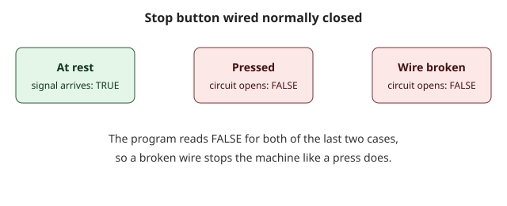

## Dos clases de contacto y un botón importante

En las primeras lecciones usó un contacto que pregunta "¿esta variable es TRUE?". Existe una segunda clase que hace la pregunta contraria. Saber cuál usar, y por qué, es la primera habilidad real de quien programa PLC. También lleva a uno de los hábitos de seguridad más antiguos de la industria: cablear un botón de parada de modo que falle en modo seguro.

## Normalmente abierto y normalmente cerrado

Las palabras vienen del mundo eléctrico. Un interruptor es **normalmente abierto** (NA) cuando, en reposo, sus contactos están separados y no circula corriente. Al pulsarlo se cierra el circuito. Un interruptor es **normalmente cerrado** (NC) cuando, en reposo, sus contactos se tocan y circula corriente. Al pulsarlo se abre el circuito.

El diagrama de escalera toma prestadas las dos palabras para los dos contactos de un peldaño.

- Un **contacto normalmente abierto** deja pasar la energía cuando su variable es TRUE.
- Un **contacto normalmente cerrado** deja pasar la energía cuando su variable es FALSE. Se dibuja con una raya diagonal sobre las barras.

La palabra "cerrado" aquí describe el contacto en la pantalla, no el botón en el campo. El contacto es una pregunta sobre una variable. La variable recibe su valor de la entrada, y la entrada viene del mundo.

## Un interruptor de puerta, leído de las dos maneras

Una puerta de protección de una máquina lleva un interruptor: la señal DoorClosed es TRUE cuando la puerta está cerrada. Queremos la máquina lista solo con la puerta cerrada, y una lámpara de aviso cuando la puerta está abierta.

```ld-figure
src: reading/door-ready.ld.json
caption: Una misma señal leída con un contacto normalmente abierto y con uno normalmente cerrado
```

El primer peldaño usa un contacto normalmente abierto: con DoorClosed en TRUE, la energía llega a MachineReady. El segundo peldaño usa un contacto normalmente cerrado: con DoorClosed en FALSE, la energía llega a DoorOpenLamp. Una variable, dos preguntas opuestas.

```ld-try
src: reading/door-ready.ld.json
inputs:
  - { name: DoorClosed, kind: switch }
outputs: [MachineReady, DoorOpenLamp]
caption: Cierre la puerta y vuelva a abrirla con el interruptor
```

Pulse Ejecutar. Al principio DoorClosed es FALSE, así que la lámpara de aviso está encendida. Active el interruptor: la máquina queda lista y la lámpara se apaga. En cada momento hay encendida exactamente una de las dos lámparas.

## Por qué un botón de parada se cablea normalmente cerrado

Imagine dos maneras de construir un botón de parada para un motor.

- **Cableado normalmente abierto.** En reposo el circuito está abierto y la entrada es FALSE. Al pulsar el botón se cierra el circuito y la entrada pasa a TRUE, lo que le dice al programa que se detenga. Si un cable se suelta, o un conector se corroe, la entrada queda en FALSE para siempre. El programa nunca se entera de que el botón de parada está muerto. La próxima vez que alguien lo pulse, no pasará nada.
- **Cableado normalmente cerrado.** En reposo el circuito está cerrado y la entrada es TRUE. Al pulsar el botón se abre el circuito y la entrada pasa a FALSE. Si un cable se suelta, el circuito se abre solo, la entrada pasa a FALSE y la máquina se detiene.

La segunda manera es **a prueba de fallas**: la falla más común, un cable roto, produce el resultado seguro, una parada. Por eso los botones de parada, los interruptores de protección y dispositivos similares se cablean normalmente cerrados.



## Cómo ve el programa un botón NC

Este es el punto que sorprende a los principiantes. El programa no lee "pulsado". Lee el **estado eléctrico** de la entrada.

| Situación en el campo | Valor de la entrada |
| :-- | :-- |
| Nadie pulsa el botón de parada | TRUE |
| Se pulsa el botón de parada | FALSE |
| El cable está roto | FALSE |

Entonces el programa quiere que el motor funcione cuando la entrada de parada es TRUE. Eso significa que el peldaño del motor necesita un contacto **normalmente abierto** sobre la entrada de parada, que deja pasar la energía cuando la entrada es TRUE. Un principiante que piensa "parada, entonces necesito un contacto normalmente cerrado" obtiene lo contrario de lo que quería: el motor solo funcionaría mientras el botón está pulsado o el cable está cortado.

Para encender una lámpara cuando el circuito de parada está abierto, usted hace la pregunta contraria, "¿la entrada de parada es FALSE?", y usa un contacto normalmente cerrado.

## Errores frecuentes

- Elegir el contacto por el nombre del botón y no por el valor de la entrada. Pregunte siempre: ¿qué valor tiene la entrada en reposo?
- Cablear un botón de parada normalmente abierto para ahorrar un cable. Se pierde el comportamiento a prueba de fallas y el caso del cable roto pasa inadvertido.
- Olvidar que un pulsador de arranque es lo contrario: un botón de inicio es normalmente abierto, así que lee FALSE en reposo y TRUE al pulsarlo.

> [!WARNING]
> Cablear un botón de parada normalmente cerrado es un buen hábito, pero no convierte un programa en una función de seguridad. Una parada de emergencia se cablea en hardware, para que corte la energía de la máquina aunque el PLC falle, y nunca depende del programa del PLC. ZPLC no hace ninguna afirmación de seguridad, y las lecciones solo le muestran cómo se leen las señales.

## Compruébelo usted

```quiz
question: Un botón de parada está cableado normalmente cerrado. ¿Qué lee el programa mientras nadie lo pulsa?
options:
  - { text: 'TRUE', correct: true, feedback: El circuito está cerrado en reposo, así que la entrada está activa. }
  - { text: 'FALSE', feedback: FALSE es lo que lee el programa cuando se pulsa el botón o el cable está roto. }
```

```quiz
question: El motor debe funcionar solo mientras la entrada de parada es TRUE. ¿Qué contacto pone sobre la entrada de parada en el peldaño del motor?
options:
  - { text: 'Un contacto normalmente abierto', correct: true, feedback: Correcto. Deja pasar la energía cuando la entrada es TRUE. }
  - { text: 'Un contacto normalmente cerrado', feedback: Ese contacto deja pasar la energía cuando la entrada es FALSE, así que el motor funcionaría solo con el circuito de parada abierto. }
  - { text: 'No hace falta ningún contacto', feedback: Sin el contacto, el programa ignora por completo el botón de parada. }
```

## Qué hará en la práctica

En la práctica un programa pequeño acciona un motor y una lámpara con un botón de inicio y un botón de parada cableado normalmente cerrado. Los dos peldaños leen la entrada de parada con el tipo de contacto equivocado. Corregirá ambos, pulsará Comprobar y verá que el motor se detiene cuando el circuito de parada se abre y que la lámpara se enciende al mismo tiempo.
