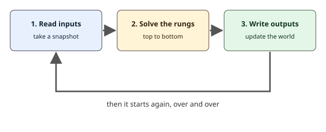

## A PLC never stops looking

A person who runs a machine can look at it, think, act, and look again. A PLC does the same thing, but without pause and very fast. It repeats one loop forever, from the moment it is switched on, and each pass of the loop is called a **scan**, or a **scan cycle**. On a real PLC one scan often takes a few milliseconds. In ZPLC simulation, the lessons use a fixed task of `T#10ms`, so every scan lasts exactly the same time and the result is the same every time you run it.

Understanding the scan is the most important idea in this module. Almost every surprise a beginner meets, "why did my lamp come on late?" or "why did my output ignore me?", is explained by it.

## The three steps of a scan



1. **Read the inputs.** At the start of the scan the PLC takes a snapshot of every input: which buttons are pressed, which sensors see something. For the rest of that scan, the program sees this snapshot, even if a button changes a moment later. A camera photo is a good picture: it freezes the scene.
2. **Solve the rungs.** The program runs from the first rung at the top to the last rung at the bottom, in that order. Each rung reads variables and writes the variables that its coil names.
3. **Write the outputs.** When the last rung is solved, the PLC copies the results to the real outputs: lamps, motors, valves.

Then the loop starts again with a new snapshot.

## Why the order of the rungs matters

The rungs are solved one after another, and a rung sees whatever the rungs above it have already calculated in the same scan. A rung below sees fresh values. A rung above sees the values from the end of the previous scan, because the rung that will change them has not been solved yet.

Here is a program that passes a part sensor through a memory bit to a horn, with the rungs in the wrong order.

```ld-figure
src: reading/lagging-order.ld.json
caption: The horn rung is solved before the rung that updates PartSeen
```

When a part arrives, the second rung sets PartSeen. But the first rung already ran in this scan, so the horn does not see it. In the next scan the first rung reads the new value of PartSeen, and only then the horn sounds. The horn is one scan late.

```timing
span: 60
signals:
  - { name: PartSensor, edges: [10, 30] }
  - { name: PartSeen, edges: [10, 30] }
  - { name: Horn, edges: [20, 40] }
marks:
  - { from: 10, to: 20, label: 'T#10ms' }
caption: With the rungs in the wrong order, Horn follows PartSeen one scan late
```

The diagram is a **timing diagram**. Time runs to the right, and each line goes up when the signal turns ON and down when it turns OFF. Compare PartSeen and Horn: the horn rises exactly one scan after the memory bit.

One scan is short, and a lag of one scan is often harmless. It becomes a real problem when many rungs depend on each other in a chain, or when a fast event, like a pulse, is missed because it came and went between two readings. Putting the rungs in a logical order, "calculate first, use later", avoids the problem for free.

## Try it right here

Rung order also decides who wins when two rungs write the same output. Here a SET rung is above a RESET rung. Press Run, then hold SetButton alone, then ResetButton alone, then both together.

```ld-try
src: reading/last-rung-wins.ld.json
inputs:
  - { name: SetButton, kind: push }
  - { name: ResetButton, kind: push }
outputs: [Lamp]
caption: Press SetButton, then ResetButton, then both together
```

When you press only SetButton, the lamp turns on and stays on, because a SET coil keeps its value. Pressing ResetButton turns it off. When both are pressed in the same scan, the SET rung is solved first and turns the lamp on, and then the RESET rung is solved and turns it off again. The rung lower in the program has the last word, so the lamp ends OFF. If you swapped the two rungs, the lamp would end ON.

## Common mistakes

- Expecting the program to react in the middle of a scan. The inputs are a snapshot, so a button pressed and released between two snapshots may not be seen at all.
- Putting a rung that uses a value above the rung that calculates it. The program works, but one scan late.
- Writing the same output with a plain coil in two rungs. ZPLC refuses this with an error, because it is almost always a mistake. Use SET and RESET coils, or combine the conditions in one rung.

> [!NOTE]
> A **memory bit** is a variable that is not connected to a real input or output. The program uses it to remember a result, such as ButtonSeen in the practice.

> [!WARNING]
> The scan time of a real PLC depends on the program and the model, and a machine that must react within a given time needs that time measured on the real controller. The simulation proves the order of the rungs, not the speed of any board. ZPLC makes no safety claim, and an emergency stop is wired in hardware and never depends on the order of rungs in a program.

## Check yourself

```quiz
question: A PLC solves rung 1 and then rung 2 in the same scan. Rung 2 changes a variable that rung 1 reads. When does rung 1 see the new value?
options:
  - { text: 'In the next scan', correct: true, feedback: Yes. Rung 1 was already solved in this scan, so it only sees the new value one scan later. }
  - { text: 'In the same scan, immediately', feedback: Rung 1 is solved before rung 2, so it cannot see what rung 2 calculates afterwards. }
  - { text: 'Never', feedback: The program repeats forever, so rung 1 reads the new value in the next scan. }
```

```quiz
question: What is the order of the three steps of a scan?
options:
  - { text: 'Read inputs, solve the rungs, write outputs', correct: true, feedback: Yes. The loop then starts again. }
  - { text: 'Solve the rungs, read inputs, write outputs', feedback: The rungs need the inputs first, so reading comes first. }
  - { text: 'Write outputs, read inputs, solve the rungs', feedback: The outputs are written last, with the results of the rungs. }
```

## What you will do in the practice

In the practice you get two rungs that already do the right thing, but in the wrong order. A button is copied into the memory bit ButtonSeen, and the lamp shows ButtonSeen. You will move one rung above the other, press Check, and see in the trace that the lamp now changes in the same scan as the button.
