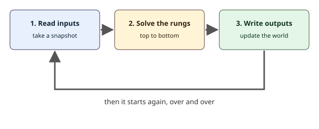

## Un PLC nunca deja de mirar

Una persona que opera una máquina puede mirarla, pensar, actuar y volver a mirar. Un PLC hace lo mismo, pero sin pausa y muy rápido. Repite un solo lazo para siempre, desde el momento en que se enciende, y cada pasada del lazo se llama **ciclo de escaneo**, o simplemente un **ciclo**. En un PLC real, un ciclo suele durar unos pocos milisegundos. En la simulación de ZPLC, las lecciones usan una tarea fija de `T#10ms`, de modo que todos los ciclos duran exactamente lo mismo y el resultado es igual cada vez que se ejecuta.

Entender el ciclo es la idea más importante de este módulo. Casi toda sorpresa que se lleva un principiante, "¿por qué mi lámpara se encendió tarde?" o "¿por qué mi salida no me hizo caso?", se explica con él.

## Los tres pasos de un ciclo



1. **Leer las entradas.** Al comienzo del ciclo, el PLC toma una instantánea de cada entrada: qué botones están pulsados, qué sensores ven algo. Durante el resto de ese ciclo, el programa ve esa instantánea, aunque un botón cambie un momento después. Una fotografía es una buena imagen: congela la escena.
2. **Resolver los peldaños.** El programa se ejecuta desde el primer peldaño, arriba, hasta el último, abajo, en ese orden. Cada peldaño lee variables y escribe las variables que nombra su bobina.
3. **Escribir las salidas.** Cuando se resuelve el último peldaño, el PLC copia los resultados a las salidas reales: lámparas, motores, válvulas.

Luego el lazo vuelve a empezar con una instantánea nueva.

## Por qué importa el orden de los peldaños

Los peldaños se resuelven uno tras otro, y un peldaño ve lo que los peldaños de arriba ya calcularon en el mismo ciclo. Un peldaño de abajo ve valores frescos. Un peldaño de arriba ve los valores del final del ciclo anterior, porque el peldaño que los cambiará todavía no se ha resuelto.

Este es un programa que pasa un sensor de pieza por un bit de memoria hasta una bocina, con los peldaños en el orden equivocado.

```ld-figure
src: reading/lagging-order.ld.json
caption: El peldaño de la bocina se resuelve antes que el peldaño que actualiza PartSeen
```

Cuando llega una pieza, el segundo peldaño activa PartSeen. Pero el primer peldaño ya se ejecutó en este ciclo, así que la bocina no lo ve. En el ciclo siguiente el primer peldaño lee el nuevo valor de PartSeen, y recién entonces suena la bocina. La bocina va un ciclo tarde.

```timing
span: 60
signals:
  - { name: PartSensor, edges: [10, 30] }
  - { name: PartSeen, edges: [10, 30] }
  - { name: Horn, edges: [20, 40] }
marks:
  - { from: 10, to: 20, label: 'T#10ms' }
caption: Con los peldaños en el orden equivocado, Horn sigue a PartSeen un ciclo tarde
```

El diagrama es un **diagrama de tiempos**. El tiempo corre hacia la derecha, y cada línea sube cuando la señal pasa a ON y baja cuando pasa a OFF. Compare PartSeen y Horn: la bocina sube exactamente un ciclo después del bit de memoria.

Un ciclo es corto, y un retraso de un ciclo suele ser inofensivo. Se vuelve un problema real cuando muchos peldaños dependen unos de otros en cadena, o cuando un evento rápido, como un pulso, se pierde porque apareció y desapareció entre dos lecturas. Poner los peldaños en un orden lógico, "primero se calcula, después se usa", evita el problema sin costo.

## Pruébelo aquí mismo

El orden de los peldaños también decide quién gana cuando dos peldaños escriben la misma salida. Aquí un peldaño SET está encima de un peldaño RESET. Pulse Ejecutar, luego mantenga SetButton solo, después ResetButton solo y por último los dos a la vez.

```ld-try
src: reading/last-rung-wins.ld.json
inputs:
  - { name: SetButton, kind: push }
  - { name: ResetButton, kind: push }
outputs: [Lamp]
caption: Pulse SetButton, luego ResetButton y luego los dos a la vez
```

Cuando pulsa solo SetButton, la lámpara se enciende y queda encendida, porque una bobina SET conserva su valor. Pulsar ResetButton la apaga. Cuando se pulsan los dos en el mismo ciclo, primero se resuelve el peldaño SET y enciende la lámpara, y luego se resuelve el peldaño RESET y la vuelve a apagar. El peldaño de más abajo en el programa tiene la última palabra, así que la lámpara queda en OFF. Si intercambiara los dos peldaños, la lámpara quedaría en ON.

## Errores frecuentes

- Esperar que el programa reaccione en la mitad de un ciclo. Las entradas son una instantánea, así que un botón pulsado y soltado entre dos instantáneas puede no verse nunca.
- Poner un peldaño que usa un valor encima del peldaño que lo calcula. El programa funciona, pero un ciclo tarde.
- Escribir la misma salida con una bobina simple en dos peldaños. ZPLC lo rechaza con un error, porque casi siempre es un error de programación. Use bobinas SET y RESET, o combine las condiciones en un solo peldaño.

> [!NOTE]
> Un **bit de memoria** es una variable que no está conectada a una entrada ni a una salida real. El programa lo usa para recordar un resultado, como ButtonSeen en la práctica.

> [!WARNING]
> El tiempo de ciclo de un PLC real depende del programa y del modelo, y una máquina que debe reaccionar dentro de un tiempo dado necesita que ese tiempo se mida en el controlador real. La simulación comprueba el orden de los peldaños, no la velocidad de ninguna placa. ZPLC no hace ninguna afirmación de seguridad, y una parada de emergencia se cablea en hardware y nunca depende del orden de los peldaños de un programa.

## Compruébelo usted

```quiz
question: Un PLC resuelve el peldaño 1 y luego el peldaño 2 en el mismo ciclo. El peldaño 2 cambia una variable que lee el peldaño 1. ¿Cuándo ve el peldaño 1 el nuevo valor?
options:
  - { text: 'En el ciclo siguiente', correct: true, feedback: Correcto. El peldaño 1 ya se resolvió en este ciclo, así que ve el nuevo valor un ciclo después. }
  - { text: 'En el mismo ciclo, de inmediato', feedback: El peldaño 1 se resuelve antes que el 2, así que no puede ver lo que el 2 calcula después. }
  - { text: 'Nunca', feedback: El programa se repite para siempre, así que el peldaño 1 lee el nuevo valor en el ciclo siguiente. }
```

```quiz
question: ¿Cuál es el orden de los tres pasos de un ciclo?
options:
  - { text: 'Leer entradas, resolver los peldaños, escribir salidas', correct: true, feedback: Correcto. Luego el lazo vuelve a empezar. }
  - { text: 'Resolver los peldaños, leer entradas, escribir salidas', feedback: Los peldaños necesitan primero las entradas, así que la lectura va primero. }
  - { text: 'Escribir salidas, leer entradas, resolver los peldaños', feedback: Las salidas se escriben al final, con los resultados de los peldaños. }
```

## Qué hará en la práctica

En la práctica recibirá dos peldaños que ya hacen lo correcto, pero en el orden equivocado. Un botón se copia en el bit de memoria ButtonSeen, y la lámpara muestra ButtonSeen. Moverá un peldaño por encima del otro, pulsará Comprobar y verá en la traza que la lámpara ahora cambia en el mismo ciclo que el botón.
