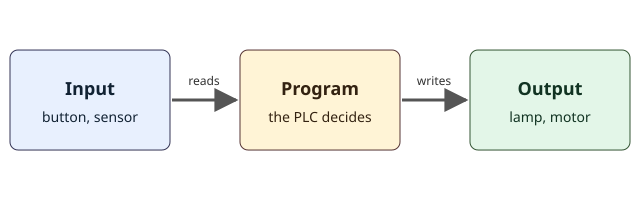

## Welcome: nothing is assumed

You do not need to know anything about PLCs to start. You only need this computer. Everything in this course runs in a simulated lab inside ZPLC, so no board, no wires and no tools are required.

A **PLC** (programmable logic controller) is a small, tough computer built to run machines: a conveyor belt, a packing station, a pump, a gate. It lives in a cabinet in a factory and does one job for years without a screen, a keyboard or a restart. What makes it special is that it is wired directly to the machine, so what the program decides really moves things.

## What a program is

A **program** is a list of instructions that a computer follows exactly. A recipe is a good picture: "if the water is boiling, add the pasta". A PLC program is made of many small rules like that one, for example "if the start button is pressed, light the lamp". The PLC never gets tired, never forgets a rule and checks every rule again and again, many times per second.

## Inputs, a program and outputs

Every PLC system has the same three parts.



- An **input** is a signal that comes into the PLC from the world: a button was pressed, a door is closed, a box has arrived.
- The **program** reads the inputs and decides what should happen.
- An **output** is a signal that goes out of the PLC to the world: a lamp turns on, a motor starts, a valve opens.

Think of the light switch on your wall. The switch is an input: it tells something that you want light. The wiring and the decision is the program. The lamp is the output. A house has no PLC, because the switch is wired straight to the lamp, but the three roles are the same.

## Sensors and actuators

Real machines use two kinds of devices that connect to the inputs and outputs.

- A **sensor** measures or detects something and gives the PLC an input. A push button, a limit switch that is touched by a moving part, and a photocell that sees a box on a conveyor are all sensors.
- An **actuator** does something when an output is switched on. A motor, a valve, a lamp and a horn are actuators.

In a packing plant, a photocell (sensor) sees a box, the PLC program decides that the box is in position, and a pusher (actuator) slides the box onto the next belt. The program sits in the middle and connects what is sensed with what is done.

## A relay panel versus a PLC

Before PLCs, factories used panels full of **relays**: small switches that a coil of wire opens and closes with a magnet. To make a machine do something, an electrician connected the relays with wire, and each rule was a piece of wiring. Changing a rule meant rewiring the panel, which took hours and often introduced mistakes.

A PLC replaces that wiring with a program. To change a rule, you change the program. The first PLC languages were drawn to look like the old relay diagrams so that electricians could read them, and one of them, **Ladder**, is the language of this course. You will see why it has that name in a moment.

## How it looks in Ladder

A Ladder program is drawn like a ladder lying on its side. Two vertical rails run down the sides. Between them go horizontal lines called **rungs**. Each rung is one rule. Power is imagined to flow from the left rail along the rung to the right. On the way it passes **contacts**, which read an input or a stored value, and it ends in a **coil**, which writes an output.

Here are two rungs of a small program.

```ld-figure
src: reading/doorbell-and-porch.ld.json
caption: Two independent rules, a doorbell and a porch light
```

The first rung says: if DoorbellButton is pressed, power reaches the coil Chime, and the chime sounds. The second rung says: if NightSwitch is on, the coil PorchLight turns on. A contact that is drawn as two vertical bars is a **normally open** contact: it lets power through only when its variable is TRUE.

## Try it right here

This is a small simulation inside the page. It runs the same program that you just saw. Press Run, then press and release the doorbell button, and switch the night switch on and off. Watch the power flow along the rungs and the lamps change.

```ld-try
src: reading/doorbell-and-porch.ld.json
inputs:
  - { name: DoorbellButton, kind: push }
  - { name: NightSwitch, kind: switch }
outputs: [Chime, PorchLight]
caption: Press and release the button, then switch the night switch
```

You will notice two things. The chime follows the button: it sounds only while you hold it. The porch light follows the switch: it stays on until you switch it off, because a switch stays where you put it, and a push button does not.

## What green, grey and red mean

ZPLC uses the same colors everywhere so that you can read a screen at a glance.

- **Green** means ON, or TRUE. Power is flowing, or the signal is active.
- **Grey** means OFF, or FALSE. Nothing is flowing.
- **Red** means a fault, and nothing else. For example, a check that failed.
- **Amber** means a value that was forced by hand, which you will meet in a later lesson.

Color never works alone. Every state also has a word, such as TRUE or FALSE, and a shape, so you can read it even if you do not see colors well.

## Common mistakes

> [!NOTE]
> A **variable** is a named place where the program stores a value, such as StartButton or Lamp. A value that is only TRUE or FALSE is called a **BOOL**.

- Thinking that the contact is a button. The contact is a drawing of a question: "is this variable TRUE?" The button is outside, in the world.
- Thinking that the program is run once. A PLC runs its program again and again. The next lesson shows how.
- Forgetting the coil. A rung without a coil does not drive anything.

> [!WARNING]
> In this course the simulated lab is safe to break. A real machine is not. An emergency stop button is wired into the machine's own circuit and never depends on the PLC program. ZPLC makes no safety claim, and nothing in these lessons replaces a certified safety design.

## Check yourself

```quiz
question: A photocell sees a box on a conveyor and tells the PLC. In PLC words, what is the photocell?
options:
  - { text: 'An input, because it sends a signal into the PLC', correct: true, feedback: Yes. A sensor gives the PLC an input. }
  - { text: 'An output, because it is at the end of the conveyor', feedback: An output goes out of the PLC. The photocell sends information in. }
  - { text: 'The program, because it decides about the box', feedback: The program is the list of rules inside the PLC. The photocell only reports what it sees. }
```

```quiz
question: In a Ladder rung, what does the coil on the right represent?
options:
  - { text: 'An output that the rung switches on or off', correct: true, feedback: Yes. When power reaches the coil, its output turns on. }
  - { text: 'A button that somebody presses', feedback: Buttons are read by contacts on the left. }
  - { text: 'The amount of time the program has been running', feedback: Time is handled by timers, which come later in the course. }
```

## What you will do in the practice

In the practice you will open a program that has the Lamp coil and a missing piece. You will add a normally open contact named StartButton, so that a button press lights the lamp. Then you will press Check and see the lab run your program and compare the result with the plan of the lesson. Your first rung will take only a few minutes.
