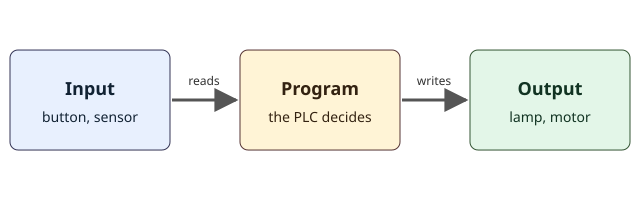

## Bienvenida: no se supone nada

No necesita saber nada de PLC para empezar. Solo necesita este computadora. Todo este curso se ejecuta en un laboratorio simulado dentro de ZPLC, así que no hacen falta placas, cables ni herramientas.

Un **PLC** (controlador lógico programable) es un computadora pequeño y resistente fabricado para manejar máquinas: una cinta transportadora, una estación de empaque, una bomba, un portón. Vive en un gabinete de una fábrica y hace un solo trabajo durante años, sin pantalla, sin teclado y sin reiniciarse. Lo que lo hace especial es que está conectado directamente a la máquina, de modo que lo que decide el programa realmente mueve cosas.

## Qué es un programa

Un **programa** es una lista de instrucciones que un computadora sigue al pie de la letra. Una receta de cocina es una buena imagen: "si el agua hierve, agregue la pasta". Un programa de PLC se compone de muchas reglas pequeñas como esa, por ejemplo "si el botón de inicio está pulsado, encienda la lámpara". El PLC nunca se cansa, nunca olvida una regla y revisa todas las reglas una y otra vez, muchas veces por segundo.

## Entradas, un programa y salidas

Todo sistema con PLC tiene las mismas tres partes.



- Una **entrada** es una señal que llega al PLC desde el mundo: se pulsó un botón, una puerta está cerrada, llegó una caja.
- El **programa** lee las entradas y decide qué debe pasar.
- Una **salida** es una señal que sale del PLC hacia el mundo: se enciende una lámpara, arranca un motor, se abre una válvula.

Piense en el interruptor de la luz de su pared. El interruptor es una entrada: avisa que usted quiere luz. El cableado y la decisión son el programa. La lámpara es la salida. Una casa no tiene PLC, porque el interruptor está cableado directo a la lámpara, pero los tres papeles son los mismos.

## Sensores y actuadores

Las máquinas reales usan dos clases de dispositivos que se conectan a las entradas y a las salidas.

- Un **sensor** mide o detecta algo y le da al PLC una entrada. Un pulsador, un final de carrera que toca una pieza en movimiento y una fotocélula que ve una caja en la cinta son sensores.
- Un **actuador** hace algo cuando se activa una salida. Un motor, una válvula, una lámpara y una bocina son actuadores.

En una planta de empaque, una fotocélula (sensor) ve una caja, el programa del PLC decide que la caja está en su lugar y un empujador (actuador) desliza la caja a la cinta siguiente. El programa queda en el medio y une lo que se detecta con lo que se hace.

## Un tablero de relés frente a un PLC

Antes de los PLC, las fábricas usaban tableros llenos de **relés**: interruptores pequeños que una bobina de alambre abre y cierra con un imán. Para que una máquina hiciera algo, un electricista conectaba los relés con cable, y cada regla era un trozo de cableado. Cambiar una regla significaba recablear el tablero, lo cual tomaba horas y con frecuencia introducía errores.

Un PLC reemplaza ese cableado por un programa. Para cambiar una regla, se cambia el programa. Los primeros lenguajes de PLC se dibujaron parecidos a los viejos diagramas de relés para que los electricistas pudieran leerlos, y uno de ellos, el **diagrama de escalera** (Ladder), es el lenguaje de este curso. En un momento verá por qué se llama así.

## Cómo se ve en diagrama de escalera

Un programa en diagrama de escalera se dibuja como una escalera acostada. Dos rieles verticales corren por los lados. Entre ellos van líneas horizontales llamadas **peldaños**. Cada peldaño es una regla. Se imagina que la energía fluye desde el riel izquierdo a lo largo del peldaño hasta el derecho. En el camino pasa por **contactos**, que leen una entrada o un valor guardado, y termina en una **bobina**, que escribe una salida.

Aquí hay dos peldaños de un programa pequeño.

```ld-figure
src: reading/doorbell-and-porch.ld.json
caption: Dos reglas independientes, un timbre y una luz de entrada
```

El primer peldaño dice: si DoorbellButton está pulsado, la energía llega a la bobina Chime y suena el timbre. El segundo peldaño dice: si NightSwitch está activado, la bobina PorchLight se enciende. Un contacto dibujado con dos barras verticales es un contacto **normalmente abierto**: deja pasar la energía solo cuando su variable es TRUE.

## Pruébelo aquí mismo

Esta es una simulación pequeña dentro de la página. Ejecuta el mismo programa que acaba de ver. Pulse Ejecutar, luego pulse y suelte el botón del timbre, y active y desactive el interruptor de noche. Observe cómo fluye la energía por los peldaños y cómo cambian las lámparas.

```ld-try
src: reading/doorbell-and-porch.ld.json
inputs:
  - { name: DoorbellButton, kind: push }
  - { name: NightSwitch, kind: switch }
outputs: [Chime, PorchLight]
caption: Pulse y suelte el botón, luego mueva el interruptor de noche
```

Notará dos cosas. El timbre sigue al botón: suena solo mientras usted lo mantiene pulsado. La luz de entrada sigue al interruptor: queda encendida hasta que usted lo apaga, porque un interruptor se queda donde usted lo deja, y un pulsador no.

## Qué significan el verde, el gris y el rojo

ZPLC usa los mismos colores en todas partes para que usted pueda leer una pantalla de un vistazo.

- El **verde** significa ON, o TRUE. La energía fluye, o la señal está activa.
- El **gris** significa OFF, o FALSE. No fluye nada.
- El **rojo** significa una falla, y nada más. Por ejemplo, una comprobación que no pasó.
- El **ámbar** significa un valor que se forzó a mano, algo que conocerá en una lección posterior.

El color nunca actúa solo. Cada estado tiene también una palabra, como TRUE o FALSE, y una forma, para que se pueda leer aunque no se distingan bien los colores.

## Errores frecuentes

> [!NOTE]
> Una **variable** es un lugar con nombre donde el programa guarda un valor, como StartButton o Lamp. Un valor que solo puede ser TRUE o FALSE se llama **BOOL**.

- Pensar que el contacto es un botón. El contacto es el dibujo de una pregunta: "¿esta variable es TRUE?". El botón está afuera, en el mundo.
- Pensar que el programa se ejecuta una sola vez. Un PLC ejecuta su programa una y otra vez. La lección siguiente muestra cómo.
- Olvidar la bobina. Un peldaño sin bobina no acciona nada.

> [!WARNING]
> En este curso el laboratorio simulado se puede romper sin riesgo. Una máquina real no. Un botón de parada de emergencia se cablea en el propio circuito de la máquina y nunca depende del programa del PLC. ZPLC no hace ninguna afirmación de seguridad, y nada de estas lecciones reemplaza un diseño de seguridad certificado.

## Compruébelo usted

```quiz
question: Una fotocélula ve una caja en una cinta y se lo avisa al PLC. En palabras de PLC, ¿qué es la fotocélula?
options:
  - { text: 'Una entrada, porque envía una señal al PLC', correct: true, feedback: Correcto. Un sensor le da una entrada al PLC. }
  - { text: 'Una salida, porque está al final de la cinta', feedback: Una salida sale del PLC. La fotocélula envía información hacia adentro. }
  - { text: 'El programa, porque decide qué hacer con la caja', feedback: El programa es la lista de reglas dentro del PLC. La fotocélula solo informa lo que ve. }
```

```quiz
question: En un peldaño de diagrama de escalera, ¿qué representa la bobina de la derecha?
options:
  - { text: 'Una salida que el peldaño enciende o apaga', correct: true, feedback: Correcto. Cuando la energía llega a la bobina, su salida se activa. }
  - { text: 'Un botón que alguien pulsa', feedback: Los botones los leen los contactos de la izquierda. }
  - { text: 'El tiempo que lleva ejecutándose el programa', feedback: El tiempo lo manejan los temporizadores, que vienen más adelante en el curso. }
```

## Qué hará en la práctica

En la práctica abrirá un programa que tiene la bobina Lamp y una pieza que falta. Agregará un contacto normalmente abierto llamado StartButton, de modo que pulsar el botón encienda la lámpara. Luego pulsará Comprobar y verá cómo el laboratorio ejecuta su programa y compara el resultado con el plan de la lección. Su primer peldaño le tomará solo unos minutos.
