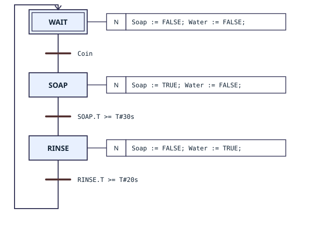

## A machine that works in steps

Many machines do one thing after another. A car wash soaps, then rinses, then waits for the next car. A mixing tank fills, then mixes, then waits. Each phase is a **step**, and the machine moves to the next step when something tells it to: a button, a sensor, or enough time spent in the step.

You can write such a machine with IF statements and memory bits, as the Ladder lesson on step bits did. A **sequential function chart**, SFC for short, draws the steps instead, so the order of the machine is the picture you see.

## Steps, actions and transitions

A chart has three kinds of element.

- A **step** is a phase of the machine. A step is either active or not. The **initial step**, drawn with a double border, is the one that is active when the program starts.
- An **action** belongs to a step and runs on every scan while its step is active. In ZPLC an action is a few statements of Structured Text, and the qualifier `N` means "while the step is active". When the step ends, its action stops running.
- A **transition** joins one step to the next and holds a **condition**. While the step before it is active, the condition is evaluated on every scan; when it is TRUE, the step before it ends and the step after it becomes active.

In a simple sequence exactly one step is active at a time. The activity moves down the chart, one transition at a time, and the last transition leads back to the top.

Every step also has its own clock: how long it has been active. You read it as the step's name followed by `.T`, for example `SOAP.T`; the step's id works too, as in `step_soap.T`. It is a value of type TIME, it starts from zero each time the step becomes active, and a condition such as `SOAP.T >= T#30s` is TRUE once the step has been active for thirty seconds. A timed step needs no timer block.

## Worked example

A small car wash starts when a coin drops. It soaps for thirty seconds, rinses for twenty seconds and then waits for the next coin. The outputs are `Soap` and `Water`, the input is `Coin`.

Three phases give three steps: WAIT, which is the initial step, SOAP and RINSE. Three changes give three transitions: a coin, the end of the soap time and the end of the rinse time. Each action writes both outputs, so each step says the whole state of the machine.



Follow a coin through the chart. WAIT is active and writes both outputs FALSE. The coin makes the first condition TRUE, so on the next scan SOAP becomes active and its action turns the soap on. Thirty seconds later `SOAP.T >= T#30s` is TRUE, SOAP ends and RINSE begins. After twenty seconds of RINSE the chart is back in WAIT, which turns the water off.

```timing
span: 60000
signals:
  - { name: Coin, edges: [1000, 2000] }
  - { name: WAIT, edges: [0, 1000, 51000] }
  - { name: SOAP, edges: [1000, 31000] }
  - { name: RINSE, edges: [31000, 51000] }
marks:
  - { from: 1000, to: 31000, label: 'T#30s' }
  - { from: 31000, to: 51000, label: 'T#20s' }
caption: One coin moves the activity from WAIT to SOAP, RINSE and back to WAIT
```

A step changes on the scan after its condition becomes TRUE. At a scan of a few milliseconds that delay is invisible in a car wash, but a lesson that checks every scan sees it, so remember it when you predict.

## Common mistakes

- Forgetting a transition, or writing a condition that never becomes TRUE. The step before it stays active for ever, and its action keeps running.
- Writing an output only in the step that turns it on. When the step ends its action stops running, and the output keeps its last value. Let every action write every output the sequence drives, or turn the output off in the next step.
- Expecting the next step in the same scan as the condition. The chart moves on the following scan.
- Using the clock of the wrong step. `SOAP.T` counts only while SOAP is active, and it starts from zero each time SOAP begins.

> [!NOTE]
> A chart shows the order of a machine, not its safety. A guard or an emergency stop is wired so that it stops the machine whatever step is active.

## Check yourself

```quiz
question: SOAP is active and its condition SOAP.T >= T#30s becomes TRUE on this scan. When does RINSE become active?
options:
  - { text: 'On the next scan', correct: true, feedback: 'Yes. The chart sees the condition on this scan and moves the activity on the next one.' }
  - { text: 'On this same scan', feedback: 'The condition is evaluated on this scan; the step changes on the following one.' }
  - { text: 'Thirty seconds later', feedback: 'The thirty seconds are already over: that is what the condition says.' }
```

```quiz
question: The action of SOAP writes Soap := TRUE and nothing else, and the action of RINSE writes Water := TRUE and nothing else. What is Soap while RINSE is active?
options:
  - { text: 'TRUE, because nothing turned it off', correct: true, feedback: 'Right. The action of SOAP stopped running but Soap kept its last value. Each action should write every output.' }
  - { text: 'FALSE, because SOAP is no longer active', feedback: 'An output is not reset when its step ends; it keeps the value it was given.' }
  - { text: 'It changes on every scan', feedback: 'No action writes Soap while RINSE is active, so it does not change.' }
```

## What you will do in the practice

The chart of the practice already has the steps IDLE, FILL and MIX, their actions, and the transitions out of IDLE and out of MIX. The transition out of FILL is missing, so the valve never closes. You will make the sequence leave FILL for MIX once FILL has been active for {{t:50}} ms, then press {{ui:learn.check}}.
