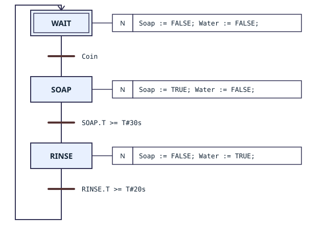

## Una máquina que trabaja por pasos

Muchas máquinas hacen una cosa después de otra. Un lavadero de autos enjabona, después enjuaga y después espera el auto siguiente. Un tanque de mezcla se llena, después mezcla y después espera. Cada fase es un **paso**, y la máquina pasa al paso siguiente cuando algo se lo indica: un pulsador, un sensor o el tiempo suficiente dentro del paso.

Una máquina así se puede escribir con instrucciones IF y bits de memoria. Un **diagrama funcional secuencial**, SFC por sus siglas, dibuja en cambio los pasos, de modo que el orden de la máquina es el dibujo que usted ve.

## Pasos, acciones y transiciones

Un diagrama tiene tres clases de elemento.

- Un **paso** es una fase de la máquina. Un paso está activo o no lo está. El **paso inicial**, dibujado con doble borde, es el que está activo cuando el programa arranca.
- Una **acción** pertenece a un paso y se ejecuta en cada ciclo mientras su paso está activo. En ZPLC una acción es unas pocas instrucciones de texto estructurado, y el calificador `N` significa "mientras el paso está activo". Cuando el paso termina, su acción deja de ejecutarse.
- Una **transición** une un paso con el siguiente y contiene una **condición**. Mientras el paso anterior está activo, la condición se evalúa en cada ciclo; cuando es TRUE, el paso anterior termina y el paso siguiente pasa a estar activo.

En una secuencia simple hay exactamente un paso activo a la vez. La actividad baja por el diagrama, una transición por vez, y la última transición vuelve arriba.

Cada paso tiene además su propio reloj: cuánto tiempo lleva activo. Se lee como el nombre del paso seguido de `.T`, por ejemplo `SOAP.T`; el id del paso también sirve, como en `step_soap.T`. Es un valor de tipo TIME, empieza de cero cada vez que el paso se activa, y una condición como `SOAP.T >= T#30s` es TRUE cuando el paso lleva treinta segundos activo. Un paso temporizado no necesita un bloque temporizador.

## Ejemplo resuelto

Un lavadero de autos pequeño arranca cuando cae una moneda. Enjabona durante treinta segundos, enjuaga durante veinte segundos y después espera la moneda siguiente. Las salidas son `Soap` y `Water`, la entrada es `Coin`.

Tres fases dan tres pasos: WAIT, que es el paso inicial, SOAP y RINSE. Tres cambios dan tres transiciones: una moneda, el fin del tiempo de jabón y el fin del tiempo de enjuague. Cada acción escribe las dos salidas, así que cada paso dice el estado completo de la máquina.



Siga una moneda por el diagrama. WAIT está activo y escribe FALSE en las dos salidas. La moneda hace TRUE la primera condición, así que en el ciclo siguiente SOAP pasa a estar activo y su acción enciende el jabón. Treinta segundos después `SOAP.T >= T#30s` es TRUE, SOAP termina y empieza RINSE. Tras veinte segundos de RINSE el diagrama vuelve a WAIT, que apaga el agua.

```timing
span: 60000
signals:
  - { name: Coin, edges: [1000, 2000] }
  - { name: WAIT, edges: [0, 1000, 51000] }
  - { name: SOAP, edges: [1000, 31000] }
  - { name: RINSE, edges: [31000, 51000] }
marks:
  - { from: 1000, to: 31000, label: 'T#30s' }
  - { from: 31000, to: 51000, label: 'T#20s' }
caption: Una moneda lleva la actividad de WAIT a SOAP, a RINSE y de vuelta a WAIT
```

Un paso cambia en el ciclo siguiente a aquel en que su condición se hace TRUE. Con un ciclo de unos pocos milisegundos esa demora no se nota en un lavadero, pero una lección que comprueba cada ciclo la ve, así que recuérdela cuando haga su predicción.

## Errores comunes

- Olvidar una transición, o escribir una condición que nunca se hace TRUE. El paso anterior queda activo para siempre y su acción sigue ejecutándose.
- Escribir una salida solo en el paso que la enciende. Cuando el paso termina su acción deja de ejecutarse, y la salida conserva su último valor. Haga que cada acción escriba todas las salidas que maneja la secuencia, o apague la salida en el paso siguiente.
- Esperar el paso siguiente en el mismo ciclo que la condición. El diagrama avanza en el ciclo siguiente.
- Usar el reloj del paso equivocado. `SOAP.T` cuenta solo mientras SOAP está activo, y empieza de cero cada vez que SOAP comienza.

> [!NOTE]
> Un diagrama muestra el orden de una máquina, no su seguridad. Una protección o una parada de emergencia se cablea para que detenga la máquina sea cual sea el paso activo.

## Compruébelo usted

```quiz
question: SOAP está activo y su condición SOAP.T >= T#30s se hace TRUE en este ciclo. ¿Cuándo pasa RINSE a estar activo?
options:
  - { text: 'En el ciclo siguiente', correct: true, feedback: 'Sí. El diagrama ve la condición en este ciclo y traslada la actividad en el siguiente.' }
  - { text: 'En este mismo ciclo', feedback: 'La condición se evalúa en este ciclo; el paso cambia en el siguiente.' }
  - { text: 'Treinta segundos después', feedback: 'Los treinta segundos ya pasaron: eso es lo que dice la condición.' }
```

```quiz
question: La acción de SOAP escribe Soap := TRUE y nada más, y la acción de RINSE escribe Water := TRUE y nada más. ¿Qué vale Soap mientras RINSE está activo?
options:
  - { text: 'TRUE, porque nada lo apagó', correct: true, feedback: 'Correcto. La acción de SOAP dejó de ejecutarse pero Soap conservó su último valor. Cada acción debería escribir todas las salidas.' }
  - { text: 'FALSE, porque SOAP ya no está activo', feedback: 'Una salida no se pone a cero cuando su paso termina; conserva el valor que se le dio.' }
  - { text: 'Cambia en cada ciclo', feedback: 'Ninguna acción escribe Soap mientras RINSE está activo, así que no cambia.' }
```

## Qué hará en la práctica

El diagrama de la práctica ya tiene los pasos IDLE, FILL y MIX, sus acciones y las transiciones que salen de IDLE y de MIX. Falta la transición que sale de FILL, así que la válvula nunca se cierra. Usted hará que la secuencia pase de FILL a MIX cuando FILL lleve {{t:50}} ms activo, y después pulsará {{ui:learn.check}}.
