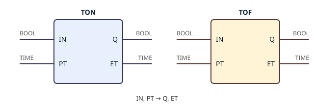

## Waiting without stopping

A PLC program never waits. Every scan it reads the inputs, runs every statement from top to bottom and writes the outputs, a few milliseconds later it does it all again, and nothing in between may pause. Yet machines need time all the time: a fan that keeps blowing for a moment after the heater stops, a pump that starts only if the tank stays empty, a sensor that must see a part for a moment before the program believes it.

A **timer** gives a program time without stopping it. It is a function block: a small piece of program that keeps its own memory from one scan to the next. On every scan you give it the newest value of its input, it looks at its clock and it answers with an output. The program goes on with the next statement at once.

## A timer is an instance you call

In Structured Text a timer is a variable. You declare an **instance** of the timer type in `VAR`, with a name of its own, and from then on that name is the timer:

```st
VAR
  FanDelay : TOF;
END_VAR
```

Then you **call** the instance, once on every scan, with its two inputs, and read its outputs after the call:



- **IN** is the signal the timer watches, a BOOL.
- **PT** is the preset, how long the timer counts. It is a value of type TIME, written with `T#`: `T#300ms`, `T#2s`, `T#1m30s`.
- **Q** is the answer, a BOOL. You read it as `FanDelay.Q`.
- **ET** is the elapsed time, how far the clock has counted, also a TIME. You read it as `FanDelay.ET`.

A call names each input with `:=`, as in `FanDelay(IN := HeaterOn, PT := T#5s);`. The call updates the clock and Q; the statements after it see the new Q in the same scan.

## TON delays the rise, TOF delays the fall

There are two timers you will use in almost every program, and they are mirror images.

- **TON**, the **on-delay timer**. When IN turns on, the clock starts. Q turns on only when IN has stayed on for the whole preset. If IN falls earlier, the clock goes back to zero and Q never rises. When IN falls, Q falls at once.
- **TOF**, the **off-delay timer**. When IN turns on, Q turns on at once. When IN falls, the clock starts, and Q stays on until the preset is over. If IN comes back first, Q never falls.

The timing diagram shows both timers watching the same input. Time runs to the right; a line is up while its signal is ON.

```timing
span: 5000
signals:
  - { name: IN, edges: [1000, 3000] }
  - { name: TON.Q, edges: [2000, 3000] }
  - { name: TOF.Q, edges: [1000, 4000] }
marks:
  - { from: 1000, to: 2000, label: PT }
  - { from: 3000, to: 4000, label: PT }
caption: The same input fed to a TON and to a TOF with the same preset
```

The TON adds the preset after the rise of IN, the TOF after its fall. One question picks the timer: must the output wait before it turns on (TON), or stay on after its input is gone (TOF)?

## Worked example

A hand dryer has a sensor, `HandsSeen`, that flickers while hands move under it. The fan must start only when hands have been seen for `T#300ms`, so that a sleeve passing by does not start it, and it must keep blowing for `T#2s` after the hands leave.

The two needs are one of each: "wait before turning on" is a TON, "stay on after" is a TOF. The output of the first becomes the input of the second.

```st
PROGRAM HandDryer
VAR_INPUT HandsSeen : BOOL; END_VAR
VAR_OUTPUT Fan : BOOL; END_VAR
VAR
  StartDelay : TON;
  RunOn : TOF;
END_VAR
StartDelay(IN := HandsSeen, PT := T#300ms);
RunOn(IN := StartDelay.Q, PT := T#2s);
Fan := RunOn.Q;
END_PROGRAM
```

Follow it on the diagram. The first flicker of `HandsSeen` is too short: StartDelay starts counting, the hands are gone before the preset is over, and nothing happens. The second time the hands stay, so StartDelay.Q rises after the preset, RunOn.Q rises with it, and the fan runs. When the hands leave, StartDelay.Q falls at once, and RunOn keeps the fan on for its own preset.

```timing
span: 5000
signals:
  - { name: HandsSeen, edges: [500, 600, 1000, 2500] }
  - { name: StartDelay.Q, edges: [1300, 2500] }
  - { name: Fan, edges: [1300, 4500] }
marks:
  - { from: 1000, to: 1300, label: 'T#300ms' }
  - { from: 2500, to: 4500, label: 'T#2s' }
caption: The short flicker never reaches the fan; the fan runs on after the hands leave
```

Both instances are called on every scan, whatever the inputs are doing, and the program never asks a timer to wait: it only reads its Q.

## Common mistakes

- Calling a timer inside an IF. When the condition is FALSE the instance is not called, so its clock and its Q freeze where they were. Call every timer on every scan and put the condition in IN.
- Reading Q before the call. A statement above the call sees the Q of the previous scan, one scan late.
- Calling one instance twice in a scan with different inputs. Each delay needs its own instance, declared once.
- Writing the wrong unit: `T#300s` is five minutes, not a third of a second.
- Expecting a TON to remember a short pulse. If IN falls before the preset, the count is lost.

> [!WARNING]
> A timer delays a signal in the program. It does not make a machine safe: a stop that protects people is wired in hardware and never waits for a timer in a program.

## Check yourself

```quiz
question: A program calls a timer only inside IF Enable THEN ... END_IF. Its Q is TRUE when Enable turns FALSE. What does Q do then?
options:
  - { text: 'It stays TRUE, because the instance is no longer called', correct: true, feedback: 'Yes. An instance changes only when it is called, so its clock and Q freeze.' }
  - { text: 'It turns FALSE at once', feedback: 'Nothing turns it off. The call that would update Q no longer runs.' }
  - { text: 'It turns FALSE when the preset is over', feedback: 'The clock only moves while the instance is called.' }
```

```quiz
question: A level switch splashes ON for a moment as the liquid moves. A pump must start only when the switch stays ON for a full second. Which timer do you need?
options:
  - { text: 'A TON with PT := T#1s', correct: true, feedback: 'Right. A TON raises Q only after IN has stayed ON for the whole preset, so a splash never starts the pump.' }
  - { text: 'A TOF with PT := T#1s', feedback: 'A TOF passes every splash at once and stretches it by a second.' }
  - { text: 'No timer: the switch is enough', feedback: 'Then every splash starts the pump.' }
```

## What you will do in the practice

The starting program declares two timers, HoldTimer (TOF) and FilterTimer (TON), and copies the button and the sensor straight to their outputs. You will make Light stay on after Button is released, and make Confirmed ignore the short Sensor blip that starts at {{t:100}} ms but believe the Sensor when it stays on from {{t:500}} ms. Then press {{ui:learn.check}}.
