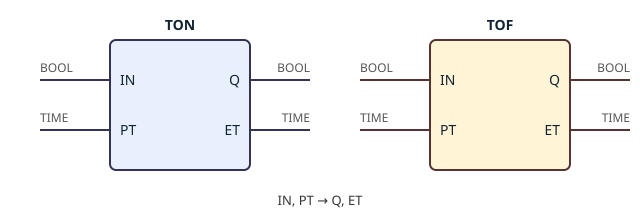

## Esperar sin detenerse

Un programa de PLC nunca espera. En cada ciclo lee las entradas, ejecuta todas las instrucciones de arriba abajo y escribe las salidas; unos milisegundos después lo hace todo otra vez, y nada en el medio puede hacer una pausa. Sin embargo, las máquinas necesitan tiempo todo el tiempo: un ventilador que sigue soplando un momento después de que se apaga el calefactor, una bomba que arranca solo si el tanque sigue vacío, un sensor que debe ver una pieza un momento antes de que el programa le crea.

Un **temporizador** le da tiempo a un programa sin detenerlo. Es un bloque de función: una pequeña parte del programa que guarda su propia memoria de un ciclo al siguiente. En cada ciclo usted le da el valor más reciente de su entrada, el bloque mira su reloj y responde con una salida. El programa sigue enseguida con la instrucción siguiente.

## Un temporizador es una instancia que se llama

En texto estructurado un temporizador es una variable. Se declara una **instancia** del tipo de temporizador en `VAR`, con un nombre propio, y desde entonces ese nombre es el temporizador:

```st
VAR
  FanDelay : TOF;
END_VAR
```

Después se **llama** a la instancia, una vez en cada ciclo, con sus dos entradas, y se leen sus salidas después de la llamada:



- **IN** es la señal que vigila el temporizador, un BOOL.
- **PT** es el valor preestablecido, cuánto tiempo cuenta el temporizador. Es un valor de tipo TIME y se escribe con `T#`: `T#300ms`, `T#2s`, `T#1m30s`.
- **Q** es la respuesta, un BOOL. Se lee como `FanDelay.Q`.
- **ET** es el tiempo transcurrido, cuánto lleva contado el reloj, también un TIME. Se lee como `FanDelay.ET`.

Una llamada nombra cada entrada con `:=`, como en `FanDelay(IN := HeaterOn, PT := T#5s);`. La llamada actualiza el reloj y Q; las instrucciones que siguen ven la Q nueva en el mismo ciclo.

## TON retrasa la subida, TOF retrasa la bajada

Hay dos temporizadores que usará en casi todos los programas, y son uno el reflejo del otro.

- **TON**, el **temporizador con retardo a la conexión**. Cuando IN pasa a ON, el reloj arranca. Q pasa a ON solo cuando IN se mantuvo en ON durante todo el valor preestablecido. Si IN cae antes, el reloj vuelve a cero y Q nunca sube. Cuando IN cae, Q cae enseguida.
- **TOF**, el **temporizador con retardo a la desconexión**. Cuando IN pasa a ON, Q pasa a ON enseguida. Cuando IN cae, el reloj arranca, y Q sigue en ON hasta que termina el valor preestablecido. Si IN vuelve antes, Q nunca cae.

El diagrama de tiempos muestra los dos temporizadores vigilando la misma entrada. El tiempo avanza hacia la derecha; una línea está arriba mientras su señal está en ON.

```timing
span: 5000
signals:
  - { name: IN, edges: [1000, 3000] }
  - { name: TON.Q, edges: [2000, 3000] }
  - { name: TOF.Q, edges: [1000, 4000] }
marks:
  - { from: 1000, to: 2000, label: PT }
  - { from: 3000, to: 4000, label: PT }
caption: La misma entrada en un TON y en un TOF con el mismo valor preestablecido
```

El TON agrega el valor preestablecido después de la subida de IN, el TOF después de su bajada. Una pregunta elige el temporizador: ¿la salida debe esperar antes de pasar a ON (TON), o seguir en ON después de que su entrada se fue (TOF)?

## Ejemplo resuelto

Un secador de manos tiene un sensor, `HandsSeen`, que parpadea mientras las manos se mueven debajo. El ventilador debe arrancar solo cuando las manos se vieron durante `T#300ms`, para que una manga que pasa no lo arranque, y debe seguir soplando `T#2s` después de que las manos se retiran.

Las dos necesidades son una de cada tipo: "esperar antes de encender" es un TON, "seguir encendido después" es un TOF. La salida del primero es la entrada del segundo.

```st
PROGRAM HandDryer
VAR_INPUT HandsSeen : BOOL; END_VAR
VAR_OUTPUT Fan : BOOL; END_VAR
VAR
  StartDelay : TON;
  RunOn : TOF;
END_VAR
StartDelay(IN := HandsSeen, PT := T#300ms);
RunOn(IN := StartDelay.Q, PT := T#2s);
Fan := RunOn.Q;
END_PROGRAM
```

Sígalo en el diagrama. El primer parpadeo de `HandsSeen` es demasiado corto: StartDelay empieza a contar, las manos se van antes de que termine el valor preestablecido y no pasa nada. La segunda vez las manos se quedan, así que StartDelay.Q sube después del valor preestablecido, RunOn.Q sube con ella y el ventilador funciona. Cuando las manos se retiran, StartDelay.Q cae enseguida y RunOn mantiene el ventilador encendido durante su propio valor preestablecido.

```timing
span: 5000
signals:
  - { name: HandsSeen, edges: [500, 600, 1000, 2500] }
  - { name: StartDelay.Q, edges: [1300, 2500] }
  - { name: Fan, edges: [1300, 4500] }
marks:
  - { from: 1000, to: 1300, label: 'T#300ms' }
  - { from: 2500, to: 4500, label: 'T#2s' }
caption: El parpadeo corto nunca llega al ventilador; el ventilador sigue después de que las manos se retiran
```

Las dos instancias se llaman en cada ciclo, hagan lo que hagan las entradas, y el programa nunca le pide a un temporizador que espere: solo lee su Q.

## Errores comunes

- Llamar a un temporizador dentro de un IF. Cuando la condición es FALSE la instancia no se llama, así que su reloj y su Q quedan congelados donde estaban. Llame a cada temporizador en cada ciclo y ponga la condición en IN.
- Leer Q antes de la llamada. Una instrucción que está arriba de la llamada ve la Q del ciclo anterior, un ciclo tarde.
- Llamar a una misma instancia dos veces en un ciclo con entradas distintas. Cada retardo necesita su propia instancia, declarada una vez.
- Escribir la unidad equivocada: `T#300s` son cinco minutos, no un tercio de segundo.
- Esperar que un TON recuerde un pulso corto. Si IN cae antes del valor preestablecido, la cuenta se pierde.

> [!WARNING]
> Un temporizador retrasa una señal en el programa. No hace segura una máquina: una parada que protege a las personas se cablea en hardware y nunca espera a un temporizador de un programa.

## Compruébelo usted

```quiz
question: Un programa llama a un temporizador solo dentro de IF Enable THEN ... END_IF. Su Q está en TRUE cuando Enable pasa a FALSE. ¿Qué hace Q entonces?
options:
  - { text: 'Sigue en TRUE, porque la instancia ya no se llama', correct: true, feedback: 'Sí. Una instancia cambia solo cuando se la llama, así que su reloj y su Q quedan congelados.' }
  - { text: 'Pasa a FALSE enseguida', feedback: 'Nada la apaga. La llamada que actualizaría Q ya no se ejecuta.' }
  - { text: 'Pasa a FALSE cuando termina el valor preestablecido', feedback: 'El reloj solo avanza mientras se llama a la instancia.' }
```

```quiz
question: Un interruptor de nivel salpica a ON por un momento cuando el líquido se mueve. Una bomba debe arrancar solo cuando el interruptor se mantiene en ON durante un segundo entero. ¿Qué temporizador necesita?
options:
  - { text: 'Un TON con PT := T#1s', correct: true, feedback: 'Correcto. Un TON pone Q en ON solo después de que IN se mantuvo en ON durante todo el valor preestablecido, así que una salpicadura nunca arranca la bomba.' }
  - { text: 'Un TOF con PT := T#1s', feedback: 'Un TOF deja pasar cada salpicadura enseguida y la alarga un segundo.' }
  - { text: 'Ningún temporizador: el interruptor alcanza', feedback: 'Entonces cada salpicadura arranca la bomba.' }
```

## Qué hará en la práctica

El programa inicial declara dos temporizadores, HoldTimer (TOF) y FilterTimer (TON), y copia el pulsador y el sensor directamente a sus salidas. Usted hará que Light siga encendida después de soltar Button, y que Confirmed ignore el pulso breve de Sensor que empieza a los {{t:100}} ms pero le crea a Sensor cuando se mantiene en ON desde los {{t:500}} ms. Después pulse {{ui:learn.check}}.
