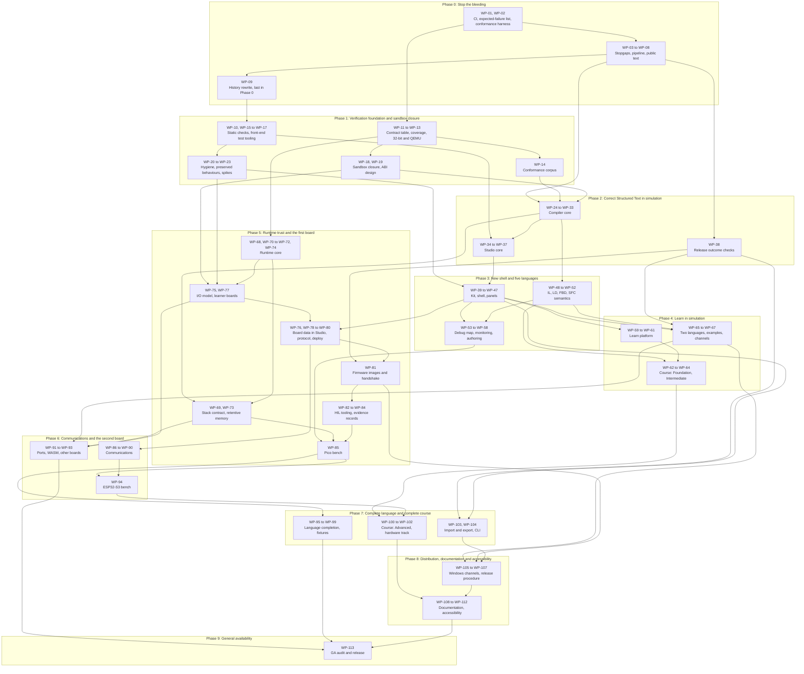

# Implementation Plan: ZPLC 2.0 Remediation

**Spec**: [spec.md](spec.md) (387 requirements in twelve workstreams)
**Research**: [research.md](research.md)
**Implementation branch**: `zplc-2.0-candidate` until it merges to `master` (decision D-12)
**Baseline**: commit `b379d82`, version `2.0.0-rc.3`
**Created**: 2026-10-08
**Status**: Draft for owner review

This plan orders, sizes and assigns every requirement of the remediation spec so that one maintainer, working with AI coding agents, can execute it. It has 113 work packages in ten phases. Nothing the spec assigns to 2.0 is dropped, deferred past GA or weakened. The plan only chooses the order.

Three facts to take away before reading further:

- **Scale.** The estimates add up to between 599 and 1,015 focused working days for one person, about 120 to 203 focused weeks (section 4.2). That is more than two years of undivided attention at the low end.
- **First usable points.** The product becomes honestly usable by a learner in simulation at the end of Phase 4, and by a professional on one board, the Raspberry Pi Pico, at the end of Phase 5 (section 4.3).
- **Start.** The first three packages are ready to start (section 11). Two owner actions come before them: keep the review's probe programs (OA-01) and run the two manual checks (OA-02).

## Contents
1. [Purpose and how to use this plan](#1-purpose-and-how-to-use-this-plan)
2. [Strategy](#2-strategy)
3. [Sizing scale](#3-sizing-scale)
4. [Phases and milestones](#4-phases-and-milestones): [0](#phase-0-stop-the-bleeding), [1](#phase-1-verification-foundation-and-sandbox-closure), [2](#phase-2-correct-structured-text-in-simulation), [3](#phase-3-new-shell-and-five-languages), [4](#phase-4-learn-in-simulation), [5](#phase-5-runtime-trust-and-the-first-board), [6](#phase-6-communications-and-the-second-board), [7](#phase-7-complete-language-and-complete-course), [8](#phase-8-distribution-documentation-and-accessibility), [9](#phase-9-general-availability)
5. [Work packages](#5-work-packages)
6. [Dependency view](#6-dependency-view)
7. [Owner actions and decisions timeline](#7-owner-actions-and-decisions-timeline)
8. [Hardware plan](#8-hardware-plan)
9. [Risk register](#9-risk-register)
10. [Progress measures](#10-progress-measures)
11. [First three work packages, ready to start](#11-first-three-work-packages-ready-to-start)
12. [Appendix: requirement coverage](#12-appendix-requirement-coverage)

## 1. Purpose and how to use this plan
The spec says what must be true at GA. This plan adds what the spec does not contain: order, size, dependency, risk and who must act. It does not restate requirements. It refers to them by ID.

**Reading path.**

| If you want | Read |
|---|---|
| The order of work and what each milestone gives a user | Section 4 |
| What to start tomorrow | Section 11 |
| What only the owner can do, and by when | Section 7 |
| Where a given requirement is scheduled | Section 12 |
| What may go wrong | Sections 8 and 9 |

**How a work package is executed.**

1. When a package starts, create its feature document at `odd/tasks/<work-package-slug>.md`. The slug is the package ID and a short title, for example `odd/tasks/wp-02-conformance-harness.md`. One package, one document.
2. Copy into it from section 5: the requirement IDs, the dependencies, the "verified by execution" entry and the owner actions. Add the objective, the scope, a task checklist with stable task IDs (`WP-02-T1`, `WP-02-T2`, and so on), the acceptance criteria and the checks to run. Section 11 shows the level of detail.
3. Work test-first where a runnable deterministic test exists: write the test, watch it fail for the stated reason, then make it pass. The "failing test first" column of section 5 says whether such a test exists. Where it does not (a spike, a manual check, a one-off repository operation), the feature document names the check that replaces it.
4. Deliver as work-unit commits on a feature branch, each commit carrying its tests and docs, and as chained pull requests when the package is large. About 400 authored changed lines (additions plus deletions) per task or pull-request slice is a planning heuristic. It is not an acceptance criterion, a hard cap or a reason to split artificially. When the correct solution is larger, say why in the feature document and continue.
5. Tick a task only after its check was observed. Record the commit identity and the observed result in the feature document.
6. Flash, deploy, RUN/STOP, force and serial actions are started by a person, never by an agent (`AGENTS.md` rule 7). Packages that need them say so in the "only the owner can" column.
7. Agents that work in parallel each use their own git worktree.

**Conventions.**

- **IDs.** Requirements keep the spec's IDs. Work packages are `WP-01` to `WP-113`. Open decisions are `D-01` and `D-03` to `D-13` (spec section 4.4). Owner actions are `OA-01` onward (section 7.3). Risks are `R-01` onward (section 9).
- **Owns and also advances.** Each requirement has exactly one owning package: the package that delivers the behaviour. A package that completes a leg of a requirement it does not own (a stopgap, a type that arrives later, a hardware record, a list that is emptied last) lists it under "Also advances". A requirement is closed for GA when its owner and every package that lists it have done their part; section 12 shows both columns. WP-113 verifies all of this and delivers only DOC-012, DOC-019 and DOC-030.
- **Evidence levels** are the constitution's: host, QEMU, target build, HIL, manual. A lower level never proves a higher one.
- **Design default.** A choice the spec made without an owner decision (spec section 4.6). The plan follows it, and section 7.2 lists each one for the owner to confirm.
- **Sizes** are estimates (section 3). There are no calendar dates in this plan.
- **Tracking.** This file names the location of unpatched defects at the same level of detail as the spec, so it follows the same tracking decision (D-09).

## 2. Strategy
### 2.1 What must exist before anything is fixed
The spec's root cause is that the project verifies itself by reading its own text instead of executing behaviour. A fix made without an executed, failing check repeats that failure. AI agents repeat it faster: an agent asked to "add a test" can produce a text assertion in seconds. So three things come before any behaviour fix.

| What must exist | Package | Why it comes first |
|---|---|---|
| CI that runs on the branch where the work happens, with one list of expected failures | WP-01 | Today CI does not run on the 2.0 branch at all, so no check, old or new, protects a change. The list keeps a red build honest: a listed failure names the requirement that will fix it, an unlisted one blocks the merge. |
| A conformance suite that compiles a program, loads it into the real VM and asserts memory | WP-02, then WP-14 | It turns the review's findings into about 55 failing cases. Those cases are the backlog of the compiler and language packages, and an oracle that an agent cannot satisfy by matching text. |
| The same for Studio and for the firmware: journeys on the real application, render tests, opcode coverage, a fuzzer that runs accepted programs, suites on 32-bit and QEMU | WP-17, WP-16, WP-12, WP-13 | Each later package in those areas needs a red check to start from. |

Phase 0 contains stopgap fixes and obeys the same rule. The conformance harness lands before the compiler stopgaps, and each Studio stopgap starts from a failing step in the existing desktop smoke or from a unit test.

### 2.2 Ordering rules
1. **An executed check before the fix.** No package starts a behaviour change without the red check named in section 5.
2. **Harm first.** Lost work, silent miscompilation, the sandbox escape and insecure defaults are closed before anything is added.
3. **One revision of the binary contract.** Every change that breaks the `.zplc` contract is designed together in WP-19. Until the conformance matrix is closed, each change increments a draft counter that firmware and Studio compare and refuse on a mismatch (CMP-052, a design default). The final version integer is assigned and frozen when WP-98 closes the matrix, at the exit of Phase 7, and a CI check then compares the generated contract with the frozen file. Until then every prerelease says that programs must be rebuilt and boards reflashed after an update.
4. **Host, then QEMU, then hardware.** A behaviour is proven on the host first. A short bench smoke (WP-22) happens in Phase 1 so that hardware unknowns surface early, not in Phase 5.
5. **Foundations before what builds on them.** One project root before the shell. The component kit before the shell. The shell before Learn's entry points. The scheduler core before the I/O model. The protocol before the hardware harness.
6. **Content after correctness.** A lesson is written only after the language it teaches passes its conformance cases.
7. **Requests to other parties start early**, because they wait on other people: the Microsoft Store submission, the SignPath Foundation application, the boards. Neither Windows application can hold GA (REL-007, REL-009, REL-038). Starting early only decides which channels are live on the day; both Windows packages (WP-105, WP-106) may start as soon as WP-47 is done, in Phase 3.
8. **Public text is true from Phase 0 and complete in Phase 8.**

### 2.3 Tracks and what can run in parallel
The packages fall into five tracks. A track is safe for agent work when it has a check that cannot be satisfied by text.

| Track | Packages | Focused days (estimate) | The check that makes agent work safe | What only a person can do |
|---|---|---|---|---|
| Language | 29: WP-02, WP-04, WP-14, WP-19, WP-24 to WP-33, WP-48 to WP-54, WP-57, WP-58, WP-69, WP-95 to WP-99 | 152 to 255 | The conformance suite | Decide what the IEC rule is when an expected value is in doubt |
| Studio | 24: WP-03, WP-08, WP-15 to WP-17, WP-21, WP-34 to WP-37, WP-39 to WP-46, WP-55, WP-56, WP-65, WP-80, WP-103, WP-112 | 120 to 202 | Journeys and render tests | Judge layout, wording and visual quality |
| Runtime and boards | 30: WP-05, WP-11 to WP-13, WP-18, WP-22, WP-68, WP-70 to WP-79, WP-82 to WP-94 | 169 to 289 | Sanitized host suites, QEMU, the native simulator | Every bench session |
| Course content | 10: WP-59 to WP-64, WP-66, WP-100 to WP-102 | 69 to 120 | Lesson CI | Write and review a course in two languages |
| Distribution and documentation | 20: WP-01, WP-06, WP-07, WP-09, WP-10, WP-20, WP-23, WP-38, WP-47, WP-67, WP-81, WP-104 to WP-111, WP-113 | 89 to 149 | Outcome checks in the pipeline, docs validators | Accounts, approvals, real machines, publishing |

One maintainer cannot review five tracks at once. The working pattern this plan assumes:

- **One lead package** that needs design attention.
- **At most one background package** from a different track, of the kind whose check is fully automatic (conformance cases, lint migrations, generated references).
- **Waiting items** that cost no attention: an application under review, nightly runs accumulating.
- **Bench sessions are serial and human.** They are planned as blocks, not interleaved.

Two packages of the same track in parallel collide in the same files and are not planned.

Where parallel work is safe from the start:

- In Phase 0, the Studio stopgaps (WP-03), the firmware defaults (WP-05), the release pipeline (WP-06) and the public text (WP-07) touch disjoint files.
- In Phases 2 to 4, the Language track and the Studio track meet only at the compile entry point (WP-30) and the debug map (WP-31).
- The core of the Runtime track (WP-68, WP-70, WP-71, WP-72, WP-74) is independent of both and can start as soon as Phase 1 is done. It meets the Language track at retentive variables (WP-73 needs the memory layout of WP-30) and the Studio track when the protocol reaches Studio (WP-79).

### 2.4 Hard serial dependencies
These chains cannot be shortened by adding agents. Each step produces the check or the interface the next one starts from.

1. **Language.** WP-01, WP-02, WP-14, WP-24, WP-26, then WP-28 and WP-30. WP-48 follows WP-24. Then WP-49, WP-50, WP-51 and WP-52, then WP-53.
2. **Binary contract.** WP-11, WP-19, then every package that changes the contract and so bumps the draft counter: WP-18, WP-26, WP-27, WP-29, WP-31, WP-69, WP-73, WP-75, WP-86, WP-96, WP-97. The chain ends with WP-98, which assigns the final integer and adds the freeze check.
3. **Communication blocks.** WP-11, WP-18, WP-86, then WP-87 and WP-88, then WP-89.
4. **Runtime to hardware.** WP-70, WP-71, WP-78, WP-79, WP-83, WP-84, WP-85, WP-94.
5. **Boards.** WP-70, WP-75, WP-77, WP-85. The ESP32-S3 profile is corrected in WP-77 before WP-94 and before WP-101.
6. **Studio to Learn.** WP-34, WP-40, WP-41, WP-42, WP-60.
7. **Course.** WP-59, WP-62, WP-63, WP-64, WP-100. WP-101 also waits for WP-94.
8. **Release.** WP-06, WP-38, WP-81, WP-107, WP-113.
9. **Two repository-wide commits.** The history rewrite (WP-09) is the last package of Phase 0: it starts only when every other open Phase 0 branch is merged or abandoned and the owner approves it. The formatting commit (WP-10) is the first change of Phase 1 and lands with no branch open. Both therefore depend on the packages before them, and the table in section 5 and the chart in section 6.2 show it. If the owner declines the rewrite (D-05), WP-09 is not run and that dependency falls away.

### 2.5 What the spec settles, and what this plan still assumes
The points in the first table were open when planning began. The spec now settles each of them, and the plan follows it.

| Point | What the spec states | Where | What the plan does with it |
|---|---|---|---|
| Hardware records and the tagged commit | A record is bound to the image it tested: it names the commit that image reports and the image's hash. For GA the records are made on the firmware images of the draft release before it is published, and the record files are committed in the first commit after the tag. | Section 8 (introduction, gate 6); HIL-009; REL-016; REL-023; IO-015 | WP-84 builds the record on those rules and depends on WP-81, which owns the handshake it reads. WP-113 holds the draft until both boards have their records. Phase 8 repeats the bench command on the candidate's images, so the GA run is a repeat and the tagged manifest already references records. |
| Outside approvals | For each Windows channel the project owes the package, its test and its submission. A pending, refused or failed listing or application never delays GA. Until a channel is live the unsigned installers and their steps stay, in prereleases and at GA alike, and the release notes state each channel's state (live, submitted, refused or not yet submittable). The order of S-5 is unchanged. This is a design default of the spec, not an owner decision, and the owner may revise it. | Note under S-5; REL-007, REL-009, REL-038; section 4.6; section 8 gate 8 | WP-105 and WP-106 close on submission, not on approval. No exit gate in this plan waits for a third party. Section 7.2 lists the default for the owner to confirm (OA-17). |
| ABI counter, freeze and tag names | Until the conformance matrix is closed, every contract change increments a draft counter that the compiler records in each artifact and each firmware image reports in its handshake; the loader and Studio refuse a mismatch and show both numbers (a design default). The final version integer is assigned and frozen when the matrix is closed, and a CI check compares the generated contract with the frozen file. Tags continue the `rc` sequence (a design default), and each release title says how complete the prerelease is. | CMP-052; REL-031; section 4.6 | WP-19 builds the counter. Every package that changes the contract bumps it (section 2.4). WP-98 closes the matrix, assigns the integer and adds the freeze check, and the Phase 7 exit gate includes it. |
| VM operations the compiler needs | The 64-bit and double-precision operations, the bounds and null-reference faults and the indirect calls belong to CMP and are delivered with the compiler requirement that needs them. The RT rules still bind them. | CMP scope; RT scope | WP-27, WP-96 and WP-97 each include their VM work, designed once in WP-19. |
| Start policy after a reset | D-13 now recommends option A: after any reset or power-up, whatever its cause, the runtime is in STOP with safe outputs and RUN needs a person's command. Option B conflicts with constitution rule 4 and needs the owner to amend it first. | Section 4.4, D-13; RT-021 to RT-023 | WP-72 plans A. Under B it would also need the clean power-on cause, the per-device flag and the amendment. |
| Tracking the spec under D-09 | Under the default, the spec and this plan stay untracked until the device side of the protocol closes COM-022. The owner may choose an earlier point, for example once RT-001, RT-002, COM-001 and COM-016 are merged and the raw-memory command is disabled. DOC-025 (the pointer in spec 010) applies once the spec is tracked. | Section 4.4, D-09; DOC-025 | That earlier point is the exit of Phase 1: COM-016 and the stopgap come from WP-05 in Phase 0, the other three from WP-18 in Phase 1. The default point is WP-78, Phase 5. The owner adds the DOC-025 pointer in the commit that tracks the spec, and WP-113 verifies it. |
| Tracked files that stand in for the untracked spec | CI reads requirement IDs and progress counts from a tracked requirement index, and the suite, the language reference and the counts read a tracked `conformance/matrix.json`. Gate 2 asks for a recorded check for every requirement ID in a coverage index. | VF-003; VF-027; DOC-006; section 8 gate 2 | WP-01 creates the requirement index (`tools/ci/requirements-index.json`), which is the coverage index. WP-14 generates `conformance/matrix.json`. WP-113 audits all 387 IDs against the index. |
| The baseline SHA after a history rewrite | The mirror made before the rewrite keeps `b379d82` resolvable, the spec header records the new SHA, and every `path:line` citation stays valid. | Section 1 (conventions); section 4.4, D-05 | WP-09 makes the mirror first. |
| Fixtures and object-oriented features | HIL-005 closes after CMP-041, because six fixtures in `tools/hil/st_tests` use methods or inheritance. | HIL-005; HIL risks and dependencies | WP-99 depends on WP-97 and is in Phase 7. |
| Size of the course | The curriculum fixes modules, not lesson counts. The course outline is the first deliverable of the learning workstream and the basis for sizing. The floor is 17 lessons. | LRN curriculum; LRN-007 | The outline is the first task of WP-62. It needs only the curriculum table, so it can be written as early as Phase 1, and the four course packages are re-sized from it (section 3.1). |
| Simulation endpoints for module 10 | The simulation track of module 10 works offline against loopback Modbus and MQTT endpoints that Studio starts itself. This is new product code and an open owner question with no decision number. | COM-009; LRN-030; section 4.6; research question 11 | WP-86 builds the endpoints and the host handlers, and WP-100 uses them in module 10. Both sizes carry the uncertainty (section 3.1). The owner answers before WP-86 starts and before the outline is written (OA-18). |
| Dependencies between workstreams | CMP needs RT for CMP-029. LNG needs UX for LNG-012. IDE needs RT and IO for IDE-025. LRN needs COM, REL and HIL. HIL needs VF and CMP. | Section 5, workstream table | The package dependencies of section 5 agree: WP-73; WP-56; WP-92; WP-100 and WP-101; WP-82 and WP-99. |

Two assumptions remain. The spec leaves them to the plan.

| Topic | Spec location | What this plan assumes |
|---|---|---|
| Three requirements are conditional on a decision: IO-016 (D-06), REL-037 (D-07) and DOC-027 (D-05). | IO-016; REL-037; DOC-027 | IO-016 and REL-037 need no work under the recommended defaults and are recorded as decided. If the owner selects 2.0 for either, a new package is added (a second port: L to XL, not sized here). DOC-027 is planned as WP-09, because D-05's default is to rewrite; if the owner declines, the package is not run. |
| Gate 1 has several parts: the conformance matrix passes, the ABI is frozen and its freeze check passes, and the one expected-failure list of VF-027 is empty. That list holds known failures from every area, not only conformance. | Section 8 gate 1; VF-027; CMP-052 | The matrix closes, the ABI freezes and the freeze check passes at the exit of Phase 7 (WP-98), with no conformance case left on the list. Entries owned by Phase 8 packages, if any remain, are emptied by the last task of WP-112, where gate 1 is met in full. No Phase 8 package changes the binary contract, so both readings give the same frozen ABI. |

### 2.6 Constitution check
Reference: `.specify/memory/constitution.md`, governance version 1.0.

| Rule | How this plan honours it |
|---|---|
| 1. Core in C99, hardware through the HAL | The scheduler moves into portable C99 (WP-70); the core compiles without a Zephyr header (WP-74); no package adds a HAL bypass. |
| 2. Proportional TDD | Every package names its failing test, or says why none exists and what replaces it. |
| 3. Validate at trust boundaries | WP-18, WP-69, WP-78 and the IPC schemas of WP-34 come before features that depend on them. |
| 4. Outputs default safe | WP-72 and WP-71 implement it: safe values on a commanded STOP, at boot and across a deploy, and always STOP after any reset (D-13 default A). WP-85 and WP-94 prove it on hardware. |
| 5. Separate operations, human authorization | No package lets an agent start a physical operation. Section 8.3 states the bench rules. |
| 6. Electron deny-by-default | WP-03 does not loosen the permission handler; WP-37 proves the posture in the packaged application. |
| 7. Tiered evidence | The "verified by execution" column names the level. Hardware claims wait for records. |
| 8. English and Spanish parity; no dependency without a reason | WP-65 and WP-111; new dependencies are approved in WP-15 (OA-07). |
| 9. Limits on AI and MCP | Tests in WP-79, WP-83 and WP-59 prove that no MCP or AI path opens the device link, starts a hardware scenario or marks a lesson passed, and that the hardware scenario and bench commands exit with an error without an interactive terminal. |

## 3. Sizing scale
Every size in this plan is an estimate. None is a commitment, and none is a date.

| Size | Focused working days, one maintainer with AI assistance | Typical content |
|---|---|---|
| S | 1 to 2 | One small behaviour with its test, or a spike with a recorded answer |
| M | 3 to 5 | One behaviour area, a handful of tasks |
| L | 6 to 10 | Several related behaviours, usually a chain of pull requests |
| XL | 11 to 20 | A structural change. Anything larger is split into two packages |

- **A focused working day** is a day on which the maintainer gives this package full attention: directing agents, reviewing what they produce, running the checks, and doing the manual and bench steps. Agent time is not counted separately, because review is the limit, not typing.
- **Not counted:** waiting for third parties (Store certification, SignPath review), nightly runs that must accumulate (gate 4 needs seven), delivery of parts, and the time of other people (first-time users, reviewers).
- **Comparable with the reviews.** The scale is close to the ones the review reports used, which differ among themselves (L is one to three weeks in the Studio reports and up to six weeks in the runtime report). Where a report sized a finding, that size was the starting point, restated on this scale.
- **Splitting rule.** A package that would exceed XL is split. The shell rewrite is two packages for that reason (WP-41, WP-42), and the course is four (WP-63, WP-64, WP-100, WP-101). If the course outline shows that a course package exceeds XL, the smallest alternative is to move lessons between these four packages, because the plan does not add packages.
- **"(uncertain)"** marks a size the evidence cannot support. Each has a spike or a first task that settles it.

### 3.1 Uncertain sizes
| Package | Size (estimate) | Why the size is uncertain | What settles it |
|---|---|---|---|
| WP-06 Release pipeline unblock | M | Nobody has run ad-hoc signing with hardened runtime on the pinned electron-builder. | One rehearsal build (research open question 2) |
| WP-32 Standard library conformance | L | Most of the 83 entries have never been executed. | The first run of their cases, in the first task of the package |
| WP-63 Course Foundation, modules 0 to 3 | L | The curriculum fixes modules, not lesson counts. The spec's floor of 17 lessons for the whole course is a lower bound, not a size. | The course outline of LRN-007, the first task of WP-62 |
| WP-64 Course Intermediate, modules 4 to 7 | XL | The curriculum fixes modules, not lesson counts; the floor of 17 lessons is a lower bound. | The course outline of LRN-007, the first task of WP-62 |
| WP-72 Fail-safe: safe state, fatal handler, watchdog policy, reset cause, start policy | L | Watchdog behaviour in STOP, while paused and in a latched fault differs per board and nobody has measured it. | The first bench session of WP-85 |
| WP-73 Retentive memory end to end | L | The save interval comes from each part's flash endurance, which is not established. | The part data sheets, then a bench test (research open question 10) |
| WP-81 Firmware images, identity handshake and the flashing page | L | The ESP32-S3 merged binary and flasher manifest are unverified. | Producing them, as the first task of the package |
| WP-85 Raspberry Pi Pico bench: first hardware evidence | L | No board has ever produced evidence. | WP-22 is the early signal |
| WP-86 Function-block handshake, dispatcher and simulation endpoints | XL | The loopback endpoints and the host handlers are new product code that the spec does not size. | A design sketch of the endpoints and the host handlers, sized as the first task, and the owner's answer to the open question |
| WP-89 Communication and cloud blocks against local doubles | L | The doubles in `tools/connectivity/` are unverified. | Running each double once, as the first task of the package |
| WP-92 WASM runtime built, verified and shipped as the degraded fallback | L | The runtime exists as source only and has never been built in CI. | Building it once (research open question 9) |
| WP-93 Other board profiles and example targets | L | The Arduino Opta relay and input pins are not established. | The board documentation and, ideally, a board |
| WP-94 ESP32-S3 bench and fieldbus evidence on both boards | L | Nothing has run on the DevKitC-1, and its profile is corrected only in WP-77. | WP-22, then the corrected profile |
| WP-96 64-bit integers and LREAL | XL | The cost of 64-bit and double arithmetic on the Pico is unknown. | The measurement in WP-19 (research open question 8) |
| WP-97 Object-oriented features: dispatch, inheritance, access control | L | The dispatch mechanism does not exist yet. | A prototype of one interface call, made during WP-19 |
| WP-100 Course Advanced, modules 8 to 11 | XL | The curriculum fixes modules, not lesson counts; the floor of 17 lessons is a lower bound. Module 10 adds the integration with the loopback endpoints. | The course outline of LRN-007, the first task of WP-62 |
| WP-101 Hardware track of the course | XL | The number of hardware lessons, and so of wiring pages per board, comes from the course outline. | The course outline of LRN-007, then the first hardware lesson done end to end |
| WP-105 Microsoft Store channel: package, recorded test, submission | M | How much of the package must be reworked depends on whether Web Serial and the child process work inside it. | WP-23 |
| WP-106 SignPath Foundation signing and winget: conditions, application, pipeline | M | What SignPath Foundation asks for after the application is not known. | The application itself |

## 4. Phases and milestones
A phase is a gate, not a queue. A package belongs to the phase by whose exit it must be finished. It may start earlier, as soon as the packages it depends on are done. Tags are the prerelease a phase could ship as; the numbers shift if a phase ships more than one prerelease or if the optional one is skipped.

### 4.1 Overview
| Phase | Goal | Packages | Requirements closed | Sizes (estimate) | Focused days (estimate) | Could ship as |
|---|---|---|---|---|---|---|
| 0. Stop the bleeding | Make the defects visible to CI, stop the ones that lose work or mislead users, and make public text true. | 9: WP-01 to WP-09 | 29 | 3 S, 6 M | 21 to 36 | `2.0.0-rc.4` |
| 1. Verification foundation and sandbox closure | Put an executed check under every area of the product and close the sandbox defect. | 14: WP-10 to WP-23 | 36 | 2 S, 6 M, 6 L | 56 to 94 | `2.0.0-rc.5` (optional) |
| 2. Correct Structured Text in simulation | Make Structured Text compile correctly across a whole project and make the open, edit, build, simulate path work with no hidden step. | 15: WP-24 to WP-38 | 69 | 5 M, 10 L | 75 to 125 | `2.0.0-rc.6` |
| 3. New shell and five languages | Rebuild the Studio view layer on an owned kit and make IL, LD, FBD and SFC correct, debuggable and monitored. | 20: WP-39 to WP-58 | 57 | 5 M, 14 L, 1 XL | 110 to 185 | `2.0.0-rc.7` |
| 4. Learn in simulation | Give a learner with no hardware a course that opens from the Welcome screen and grades honestly, in English and Spanish. | 9: WP-59 to WP-67 | 41 | 1 M, 7 L, 1 XL | 56 to 95 | `2.0.0-rc.8` |
| 5. Runtime trust and the first board | Make the runtime safe and identical on simulator and target, and record the first hardware evidence on the Raspberry Pi Pico. | 18: WP-68 to WP-85 | 73 | 3 M, 12 L, 3 XL | 114 to 195 | `2.0.0-rc.9` |
| 6. Communications and the second board | Repair every communication and cloud block, finish the ports and the other boards, and record evidence on the ESP32-S3. | 9: WP-86 to WP-94 | 28 | 1 M, 7 L, 1 XL | 56 to 95 | `2.0.0-rc.10` |
| 7. Complete language and complete course | Close the conformance matrix and finish the course on both tracks. | 10: WP-95 to WP-104 | 23 | 3 M, 4 L, 3 XL | 66 to 115 | `2.0.0-rc.11` |
| 8. Distribution, documentation and accessibility | Deliver or submit every distribution channel, finish the documentation in two languages and close accessibility. | 8: WP-105 to WP-112 | 28 | 2 M, 6 L | 42 to 70 | `2.0.0-rc.12` |
| 9. General availability | Meet the twelve gates of spec section 8 on the tagged commit and publish. | 1: WP-113 | 3 | 1 M | 3 to 5 | `2.0.0` |
| **All** | | **113** | **387** | **5 S, 33 M, 66 L, 9 XL** | **599 to 1,015** | |

### 4.2 Scale, stated plainly
The estimates add up to between 599 and 1,015 focused working days: 5 S, 33 M, 66 L, 9 XL. At five focused days a week that is 120 to 203 weeks of one person's undivided attention.

The figure is large because the scope is large: a rewrite of the compiler's semantic middle, a rewrite of the Studio view layer, a portable scheduler and a new device protocol, a bilingual course in five languages, distribution on three operating systems with two outside applications, and first hardware evidence on two boards. Nothing in this plan makes it smaller. What the plan does is put usable milestones early and keep the largest unknowns visible (section 9).

| Through the end of | Focused days, cumulative (estimate) | Focused weeks of five days |
|---|---|---|
| Phase 0: Stop the bleeding | 21 to 36 | 4 to 7 |
| Phase 1: Verification foundation and sandbox closure | 77 to 130 | 15 to 26 |
| Phase 2: Correct Structured Text in simulation | 152 to 255 | 30 to 51 |
| Phase 3: New shell and five languages | 262 to 440 | 52 to 88 |
| Phase 4: Learn in simulation | 318 to 535 | 64 to 107 |
| Phase 5: Runtime trust and the first board | 432 to 730 | 86 to 146 |
| Phase 6: Communications and the second board | 488 to 825 | 98 to 165 |
| Phase 7: Complete language and complete course | 554 to 940 | 111 to 188 |
| Phase 8: Distribution, documentation and accessibility | 596 to 1,010 | 119 to 202 |
| Phase 9: General availability | 599 to 1,015 | 120 to 203 |

The only levers that do not touch scope are help from other people on the separable tracks (course content, Spanish text, bench runs) and wider use of parallel agents where the check is automatic. Neither is assumed.

### 4.3 Earliest honest points of use
| Who | From | What is true then | What is not yet true |
|---|---|---|---|
| A professional, in simulation only, writing Structured Text | End of Phase 2 (152 to 255 focused days) | A multi-file ST project builds with located errors and simulates, watches, forces and stops at breakpoints with correct results. | The other four languages are not trustworthy. No hardware claim. 64-bit types, interface dispatch, date and time arithmetic and RETAIN are rejected with a message. |
| **A learner with no hardware** | **End of Phase 4** (318 to 535 focused days) | Install, press Learn on the Welcome screen, and work through modules 0 to 7 in simulation, in English or Spanish, offline, with grading that cannot be bypassed by editing the scenario. | Advanced modules 8 to 11 and the hardware track. |
| **A professional on one board, the Raspberry Pi Pico** | **End of Phase 5** (432 to 730 focused days) | Flash the published image by hand, connect, deploy with a confirmation, run, watch, force and debug. Outputs go safe on a fault, the watchdog resets, RETAIN survives a power cycle. Each claim cites the Pico record. | Communication blocks and fieldbus. The ESP32-S3 and the other boards are still cross-build only. |
| Everything the spec assigns to 2.0 | Phase 9 (599 to 1,015 focused days) | The twelve gates of spec section 8. | |

**One reordering is open to the owner.** The packages of Phase 4 need 47 packages in total: the 9 of Phase 4 themselves and everything they depend on, directly or not (238 to 401 focused days). All 9 packages of Phase 0 are among them, because the formatting commit of WP-10 waits for the whole phase. The other 20 of the 67 packages in Phases 0 to 4 (WP-12, WP-18, WP-20, WP-22, WP-23, WP-25, WP-33, WP-35 to WP-37, WP-43, WP-46, WP-47, WP-49, WP-53 to WP-58) could be finished after the learner milestone instead of before it. That would bring the learner milestone forward by roughly a quarter. This plan does not do it by default, because several of those packages protect a learner too: data safety (WP-35), one undo step per drag (WP-55), the sandbox (WP-18). It is a reordering, not a reduction: every package still closes before GA.

### Phase 0: Stop the bleeding
- **Goal.** Make the defects visible to CI, stop the ones that lose work or mislead users, and make public text true.
- **Entry criteria.** None. The work starts at commit `b379d82`. OA-01 and OA-02 happen on the first day.
- **Order inside the phase.** WP-09 is the last package. It starts only when every other open Phase 0 branch is merged or abandoned and the owner approves the rewrite (D-05, OA-19). The table in section 5 and the chart in section 6.2 show this as a dependency on the rest of the phase. The Phase 0 tag is cut after it. If the owner declines the rewrite, WP-09 is not run and the dependency falls away.
- **Work packages.** WP-01 to WP-09 (9 packages; 3 S, 6 M; 21 to 36 focused days, estimate).
- **Exit gate.**
  1. CI runs on every push and pull request of the 2.0 branch, and of the default branch under D-12's default, and is green except for entries on the expected-failure list (VF-016, VF-027). CI reads requirement IDs and progress counts from the tracked requirement index, not from the spec (VF-027).
  2. The conformance suite runs in CI. On the baseline it reported the known compiler defects as failures (about 55 expected; the observed count is recorded), and each is on the list with its requirement (the acceptance rule of VF-001).
  3. Both manual checks are recorded with operating system, build and result.
  4. No published page fails the truncation validator (VF-019, DOC-001).
  5. A release draft for the phase tag is produced entirely by the pipeline: both macOS bundles report `Signature=adhoc` and pass `codesign --verify --deep --strict` in CI, the `.deb` installs and launches in clean Debian 13 and Ubuntu 24.04 containers, and no paid credential is referenced (REL-001 to REL-003, REL-011, REL-015, REL-016). The first-run check on a real Mac and a real Windows machine is recorded and includes opening a real folder through the real dialog (REL-016).
  6. The README and the release notes contain none of the claims the spec lists as false under REL and DOC (DOC-011). They carry the Windows run-anyway steps and the Smart App Control statement, and state each Windows channel as live, submitted, refused or not yet submittable (REL-038).
  7. D-05 is answered. The rewrite is done after the mirror is made, or it is declined and recorded.
  - Contributes to spec section 8 gates 1, 8 and 9. Closes none.
- **At the end a user can** install the prerelease from a `.deb` that installs; open it on macOS through Open Anyway instead of meeting a "damaged" bundle (to be confirmed by the manual first-run check); install the unsigned Windows build with documented steps; edit several files without undo corrupting another file; be asked before unsaved work is lost; and see the compiler's own message when a program uses an undeclared identifier. A user still cannot build without the hidden link step, cannot trust numeric results outside positive DINT and REAL, and gets no hardware claim.
- **Could ship as** `2.0.0-rc.4`, titled as a preview, with the expected-failure list published as its known issues.

### Phase 1: Verification foundation and sandbox closure
- **Goal.** Put an executed check under every area of the product and close the sandbox defect.
- **Entry criteria.** Phase 0 exit. Every Phase 0 package is merged and no other branch is open, because the formatting commit of WP-10 is the first change of this phase and lands only then (it waits for the whole of Phase 0, the history rewrite included when D-05 is A). Branches opened after it start from the formatted tree. D-04 is taken, or its default accepted, before WP-14 starts.
- **Work packages.** WP-10 to WP-23 (14 packages; 2 S, 6 M, 6 L; 56 to 94 focused days, estimate).
- **Exit gate.**
  1. All TypeScript in the repository passes the type-checker with zero errors; the formatter and `clang-tidy` are enforced (VF-010, VF-011, VF-017, VF-018).
  2. Opcodes, formats and layouts are generated from one file and CI fails on drift (VF-012). Opcode coverage computed from that table is 100% (VF-013). Both fuzz targets gate pull requests and one long nightly run is recorded (VF-014).
  3. The core, loader and scheduler suites pass on `qemu_cortex_m3`, a 32-bit `native_sim` and the 64-bit host, and the alignment-sensitive subset also passes on `qemu_cortex_m0`, or, if the trial run shows that the core does not fit its 16 KB of RAM, in a host run with the sanitizer's alignment check (VF-005, VF-015; research open question 12). Every board has a size report and a recorded budget (VF-025).
  4. The conformance corpus has at least one case for each of the 94 rows of the tracked `conformance/matrix.json` whose 2.0 target is "works", and one negative case for each construct 2.0 rejects (VF-003). Passing is not required yet; every red case is on the list.
  5. The 14 journeys of VF-008 exist and run on Linux for every pull request, in a packaged build made for the suite whose main-process dialog hook is absent from release builds. Each journey fails on the baseline for the reason its finding gives, or passes.
  6. RT-001, RT-002 and COM-001 are verified under the address sanitizer, and the run fuzzer has no finding.
  7. The list of contract-breaking changes and the draft-counter scheme are approved. The loader and Studio refuse an artifact whose draft counter differs from their own and show both numbers (CMP-052); images join in Phase 5. The cost of 64-bit arithmetic on the Pico is measured (WP-19). The three spikes have recorded answers (WP-15, WP-22, WP-23).
  - Contributes to gates 1, 3 and 4.
- **At the end a user can** see nothing new on screen. What changed is underneath: a downloaded program can no longer read or write outside PLC memory (host-level evidence), and every later change is guarded by an executed check.
- **Could ship as** `2.0.0-rc.5` (optional). Ship it only if users of the Phase 0 prerelease need the fixes.

### Phase 2: Correct Structured Text in simulation
- **Goal.** Make Structured Text compile correctly across a whole project and make the open, edit, build, simulate path work with no hidden step.
- **Entry criteria.** Phase 1 exit. In particular the corpus is red and listed, the ABI change list is approved (OA-14) and the journeys exist. D-03 is taken before WP-38 starts.
- **Work packages.** WP-24 to WP-38 (15 packages; 5 M, 10 L; 75 to 125 focused days, estimate).
- **Exit gate.**
  1. Every conformance case owned by WP-24 to WP-33 passes on the 64-bit and 32-bit hosts with the types available at this phase (the 64-bit types and the date and time types are rejected with a located message until WP-96 and WP-95), and the tagged subset passes under QEMU on `qemu_cortex_m3` and, for the alignment-sensitive cases, on `qemu_cortex_m0`. The expected-failure list holds only entries owned by later packages.
  2. Two builds of the same project give byte-identical bytecode and debug map, and every debug-map address equals the address observed by an executed write, for every conformance case (CMP-053, CMP-054).
  3. These journeys pass on Linux against the packaged build made for the suite: create a project, open an existing folder, edit Structured Text, build with an error and reach it from Problems, build successfully, simulate, watch a value, hit a breakpoint, force and release an input, save, undo after switching tabs, close with unsaved changes (12 of the 14 journeys of VF-008; session restore follows in Phase 3 and Learn in Phase 4).
  4. Build, the CLI, the MCP tools and the editor return the same diagnostics for the same project (CMP-010).
  5. The security probes pass in the packaged application on three operating systems, including a project operation given a path with `..`, an absolute path or a symlink that leaves the project root (IDE-016, IDE-001).
  6. Every installer format is installed and launched by CI before a draft is created, the bill of materials is above its floor, the fourteen files have fourteen distinct names, and no installer contains the suite's test hook (REL-036, REL-018, REL-020, VF-008).
  - Contributes to gates 1, 3 and 8.
- **At the end a user can** write Structured Text across several files, with functions, function blocks, structures, arrays and strings; build with errors that say where and why; simulate, watch, force and debug with correct results; and lose no work. In simulation only. LINT, LREAL, interface dispatch, date and time arithmetic and RETAIN are rejected with a located message until their packages land. The other four languages are not yet trustworthy.
- **Could ship as** `2.0.0-rc.6`.

### Phase 3: New shell and five languages
- **Goal.** Rebuild the Studio view layer on an owned kit and make IL, LD, FBD and SFC correct, debuggable and monitored.
- **Entry criteria.** Phase 2 exit. The tooling decision of WP-15 is recorded and its dependencies approved (OA-07). WP-34 is merged, because the navigator needs one project root.
- **Work packages.** WP-39 to WP-58 (20 packages; 5 M, 14 L, 1 XL; 110 to 185 focused days, estimate).
- **Exit gate.**
  1. The conformance cases for IL, LD, FBD and SFC pass with the types available at this phase (LNG-017 to LNG-026; the 64-bit accumulator leg of LNG-019 closes in WP-96), and every palette element has an executed test (LNG-007).
  2. Gate 5 of spec section 8 is met at simulation level: a program in each of ST, IL, LD, FBD and SFC builds, simulates, stops at a breakpoint on a source element and shows online values.
  3. Each of the 36 Studio surfaces of spec section 7.4 is reachable in the new shell, proven by a render or end-to-end test per surface, which together with the kit's component tests closes VF-007.
  4. The main path is usable at 1366 by 768 pixels without clipped controls, and the window is usable at 1024 by 768 (UX-023).
  5. The kit gallery passes the automated accessibility check in each theme, and contrast for the declared pairs is computed in CI from the tokens.
  6. One drag is one undo step, and insertion, binding, connection and deletion work from the keyboard in LD, FBD and SFC (LNG-010, LNG-012).
  7. The session-restore journey passes: recent projects, open tabs, panel sizes and cursor positions come back (IDE-008).
  - Contributes to gates 3, 5, 10 and 11.
- **At the end a user can** program in all five languages in simulation, with breakpoints and live values in each, inside a shell that has a project navigator, an application menu and a command palette. The interface is complete in English only. There is still no hardware claim.
- **Could ship as** `2.0.0-rc.7`.

### Phase 4: Learn in simulation
- **Goal.** Give a learner with no hardware a course that opens from the Welcome screen and grades honestly, in English and Spanish.
- **Entry criteria.** The Phase 3 packages Learn builds on are done: WP-42, WP-50, WP-51, WP-52, WP-45. D-10 and D-01 are taken, and the owner has answered the module 10 question (OA-18), because the outline lists the tracks of module 10. The course outline of LRN-007 exists: it is the first deliverable of the learning workstream and the first task of WP-62, and because it needs only the curriculum table it can be written as early as Phase 1.
- **Work packages.** WP-59 to WP-67 (9 packages; 1 M, 7 L, 1 XL; 56 to 95 focused days, estimate).
- **Exit gate.**
  1. Learn opens from the Welcome screen with no project and no network, and an end-to-end run passes the first two lessons with the keyboard only (LRN-001, LRN-012, LRN-037 in part).
  2. Every Foundation and Intermediate lesson passes lesson CI in English and in Spanish: the starter fails, the solution passes, and every time and value in the text exists in the reference scenario (LRN-025).
  3. A workspace scenario edited to always pass does not produce a pass (LRN-022).
  4. The same lesson graded on Linux, macOS and Windows runners gives identical trace hashes (LRN-019, LRN-023).
  5. Three first-time users reach a blinking simulated output within ten minutes of first launch, on record (LRN-012).
  6. Every interface string exists in both languages and CI fails on a missing key (UX-029).
  7. A macOS runner installs the Homebrew cask and launches the application, and the install page is live with the Windows run-anyway steps (REL-004, DOC-005, REL-038).
  - Contributes to gates 7, 8 and 9.
- **At the end a learner with no hardware can** install, press Learn, and work through modules 0 to 7 in simulation, in English or Spanish, offline. This is the earliest point at which the product is honestly usable by a learner.
- **Could ship as** `2.0.0-rc.8`.

### Phase 5: Runtime trust and the first board
- **Goal.** Make the runtime safe and identical on simulator and target, and record the first hardware evidence on the Raspberry Pi Pico.
- **Entry criteria.** The runtime packages need only Phase 1 and should start then. This phase's gate also needs WP-58 and WP-44 from Phase 3. D-13 (default A) and D-08 are taken. D-05 is settled before the first record. The Pico rig is on the bench (OA-12).
- **Work packages.** WP-68 to WP-85 (18 packages; 3 M, 12 L, 3 XL; 114 to 195 focused days, estimate).
- **Exit gate.**
  1. One scheduler suite passes against the Zephyr port (`native_sim`, `qemu_cortex_m3`) and the POSIX port (RT-008; WASM follows in Phase 6).
  2. A concurrency test on `native_sim` with a busy communication thread shows no half-written value and no lock held during I/O (RT-010, RT-012, RT-013).
  3. Fault injection in the host program store shows that a power interruption at any point of a deploy leaves the complete old program or the complete new one (RT-031).
  4. Studio drives firmware built for `native_sim` through a pseudo-terminal: session lock, atomic write, events, forces released when their session ends, authenticated frames on a network transport, and the deploy flow from preflight to STOP (COM-020 to COM-025, COM-027, COM-028).
  5. With a recording output driver and a recording watchdog driver, outputs are at their safe values on a commanded STOP, at boot before RUN and across a deploy, no reset cause leads to RUN, and the watchdog policy holds while paused, at a breakpoint and in a latched fault (RT-020 to RT-023).
  6. The scenario command and the bench command exit with an error when started without an interactive terminal, and require the typed board identity for each physical step (COM-030, HIL-003, HIL-012).
  7. A record in the format of HIL-009 exists for the Raspberry Pi Pico covering 14 of the 15 items of HIL-010 (all but the fieldbus exchange), made on a build with the hardware watchdog enabled, and the board manifest derives the Pico's support level from it and names the firmware version of the record (IO-015).
  8. The release carries firmware for every board, with checksums and attestation, and each image reports its identity, including the ABI draft counter, in the handshake (REL-022, REL-023).
  - Contributes to gates 4, 6 and 8.
- **At the end a professional can** use one board, the Raspberry Pi Pico: flash the published image by hand, connect, deploy with a confirmation, run, watch, force and debug, with safe outputs on a fault and retained data across a power cycle. Every one of those claims cites the Pico record. This is the earliest point at which the product is honestly usable by a professional on hardware. Communication blocks and fieldbus are not yet repaired, and the ESP32-S3 and the other boards are still cross-build only.
- **Could ship as** `2.0.0-rc.9`.

### Phase 6: Communications and the second board
- **Goal.** Repair every communication and cloud block, finish the ports and the other boards, and record evidence on the ESP32-S3.
- **Entry criteria.** Phase 5 exit: the Pico record exists, so the bench procedure is known to work. WP-77 has rewritten the ESP32-S3 profile for the DevKitC-1 the owner holds. D-06, D-07 and D-11 are taken.
- **Work packages.** WP-86 to WP-94 (9 packages; 1 M, 7 L, 1 XL; 56 to 95 focused days, estimate).
- **Exit gate.**
  1. Each of the twelve communication and cloud blocks has executed tests against a local double for success, timeout, error and reset while busy (COM-006), and the documentation labels each as D-11 decides.
  2. The Modbus and MQTT tests on `native_sim` pass against the local doubles (COM-010 to COM-018).
  3. In simulation the Modbus and MQTT blocks work against loopback endpoints that Studio starts, with no installed broker, Python or network, and the cloud blocks report the defined unavailable status (COM-009). If the owner declined the endpoints (OA-18), COM-009 returns to its earlier wording: a block works against a local endpoint or reports the defined unavailable status.
  4. TLS is back on for the Nucleo-H743ZI and the Arduino Opta with a hardware entropy source, and the build check of COM-016 still passes (COM-016).
  5. The port conformance suite passes on Zephyr, POSIX and WASM, the scheduler suite and the retain rules also run on WASM, and the WASM runtime ships with its "degraded" label (IO-013, RT-008, RT-027, IDE-025).
  6. All seven board profiles build in CI, each with an I/O description, and every example builds for its declared target (IO-010, IO-011, IO-017).
  7. Records exist for both learner boards covering all 15 items of HIL-010, and the bench guide is published in English and Spanish (HIL-014).
  - Contributes to gates 4, 6 and 10.
- **At the end a user can** use Modbus RTU and TCP, MQTT and the cloud blocks (labelled "verified against local protocol doubles"), and use the ESP32-S3 with hardware evidence behind each claim.
- **Could ship as** `2.0.0-rc.10`.

### Phase 7: Complete language and complete course
- **Goal.** Close the conformance matrix and finish the course on both tracks.
- **Entry criteria.** Phase 6 exit for WP-100 and WP-101, which need communication blocks and both boards. The language packages need only WP-26, WP-28 and WP-19; WP-96 should start as soon as WP-26 is done, because it is the largest unknown in the plan.
- **Work packages.** WP-95 to WP-104 (10 packages; 3 M, 4 L, 3 XL; 66 to 115 focused days, estimate).
- **Exit gate.**
  1. The conformance matrix is closed: the suite passes on 64-bit, 32-bit and QEMU for all 94 "works" rows of the tracked matrix, including the legs that waited for the 64-bit and the date and time types (CMP-022, CMP-057, LNG-019), and no conformance case is left on the expected-failure list (gate 1; section 2.5 covers the rest of the list).
  2. The ABI is frozen: WP-98 has assigned the final version integer and the CI check that compares the generated contract with the frozen file passes (CMP-052). The size report of every board is within budget after the 64-bit work (VF-025).
  3. Every lesson of modules 0 to 11 passes lesson CI in both languages, and each hardware lesson has a record on both boards with board, firmware hash and result (LRN-013, LRN-024).
  4. The CLI and the MCP server run from release assets on every desktop platform with no checkout (IDE-026).
  5. A project exports and imports to an equivalent project, and a version 1 project migrates with a previewed difference (IDE-022).
  6. Every language fixture of `tools/hil` compiles and runs in the conformance suite, and those tagged for hardware have run on a board (HIL-005).
  - Closes the conformance matrix of gate 1. Contributes to gates 5, 7 and 10.
- **At the end** the product is feature complete: the whole of spec section 6 works, and the whole course runs on both tracks.
- **Could ship as** `2.0.0-rc.11`, the feature-complete candidate and the first prerelease on the frozen ABI.

### Phase 8: Distribution, documentation and accessibility
- **Goal.** Deliver or submit every distribution channel, finish the documentation in two languages and close accessibility.
- **Entry criteria.** Phase 7 exit: behaviour and the ABI are final, so documentation and screenshots describe what ships. OA-08 and OA-09 were started long before, so an answer may already exist. Neither is awaited.
- **Work packages.** WP-105 to WP-112 (8 packages; 2 M, 6 L; 42 to 70 focused days, estimate).
- **Exit gate.**
  1. One rehearsal of the complete pipeline that publishes nothing is recorded (REL-030).
  2. Each Windows channel is live, or the REL-038 fallback is in force for it and the release notes state its state: live, submitted, refused or not yet submittable. The project's part is done for both: the MSIX package is built, the test of REL-008 is on record and the package is submitted for certification (REL-007), and the SignPath Foundation conditions are met and the application is submitted (REL-009). A pending, refused, failed or not yet submittable listing or application never delays GA (a design default, section 7.2), so no approval is awaited. A winget manifest follows once a signed installer is published (REL-010).
  3. No docs validator fails, every generated reference matches a fresh generation, a newcomer has followed both tutorials on record, and a fluent reviewer has signed off the Spanish text (gate 9).
  4. Contrast and the keyboard-only journey pass in CI, and the screen-reader check on Windows and macOS is on record (gate 11).
  5. The last task of WP-112 has emptied the three lists: the allow-list of tests that read product source (VF-006), the allow-list of components outside the kit (UX-002) and the expected-failure list (VF-027). CI fails on any entry, which meets gate 1 in full.
  6. The bench command has been repeated on the candidate's firmware images on both learner boards, and the board manifest references those records, so the run on the GA draft is a repeat.
  - Reaches the conditions of gates 1, 9 and 11 on the candidate. Contributes to gates 6 and 8.
- **At the end a user can** install through Homebrew, `.deb`, `.rpm` or the AUR; on Windows through each channel that is live by then (the Microsoft Store, the signed installer) and otherwise through the unsigned installer with its documented steps; and find complete documentation in two languages.
- **Could ship as** `2.0.0-rc.12`, the candidate the GA rehearsal is run on.

### Phase 9: General availability
- **Goal.** Meet the twelve gates of spec section 8 on the tagged commit and publish.
- **Entry criteria.** Phase 8 exit. Every open decision has the owner's answer. The nightly load-and-run fuzzer is on its way to seven consecutive runs with no finding. No outside approval is an entry criterion.
- **Work packages.** WP-113 (1 package; 1 M; 3 to 5 focused days, estimate).
- **Exit gate.** The audit of WP-113 walks all 387 requirement IDs of the coverage appendix (section 12), which the tracked requirement index (`tools/ci/requirements-index.json`) carries: each has a recorded executed check or evidence record (gate 2). Then the twelve gates of spec section 8, each met by a recorded run on the tagged commit. Gate 6 differs in timing only, as the steps show. The last steps, in order: the pipeline creates the draft from the tag; the owner flashes the draft's firmware images and runs the bench command on both learner boards (gate 6, REL-016); the owner records the first-run checks on a real Mac and a real Windows machine; the release notes state each Windows channel as live, submitted, refused or not yet submittable (REL-038), and none of them delays the release; the owner publishes the draft; the record files are committed in the first commit after the tag and referenced from the board manifest.
- **At the end a user can** rely on everything the spec assigns to 2.0.
- **Could ship as** `2.0.0`.

## 5. Work packages
### 5.1 How to read the tables
Each phase has two tables with the same rows.

- **Owns**: the requirements whose behaviour this package delivers. **Also advances**: requirements owned elsewhere for which this package completes a leg (a stopgap, a type that arrives later, a hardware record, a list emptied last) or gives proof at a higher evidence level. A requirement closes for GA when its owner and every package that lists it are done.
- **Depends on**: packages that must be finished first. A package may start as soon as these are done, whatever its phase.
- **Size**: an estimate on the scale of section 3. "(uncertain)" sizes are explained in section 3.1.
- **Verified by execution**: the evidence level and the run that proves the package.
- **Failing test first**: whether a runnable, deterministic test can be written and seen to fail before the change.
- **Bench hardware**: boards or machines that must be physically present.
- **Only the owner can**: decisions, accounts, boards and manual runs that no agent may do.

### 5.2 Phase 0: Stop the bleeding

9 packages, 3 S, 6 M, 21 to 36 focused days (estimate).

| ID | Package | Workstream | Owns | Also advances | Depends on | Size (estimate) |
|---|---|---|---|---|---|---|
| WP-01 | CI on the 2.0 branch, the expected-failure list and the requirement index | VF, REL | VF-016, VF-022, VF-023, VF-027, REL-033 | None | None | M |
| WP-02 | Host conformance harness seeded with the review probes | VF | VF-001, VF-002, VF-004 | None | WP-01 | M |
| WP-03 | Studio first-ten-minutes stopgaps and the two manual checks | IDE, LNG | LNG-009, LNG-011, IDE-005, IDE-011 | LNG-005, IDE-003 | WP-01 | M |
| WP-04 | Compiler and VM stopgaps | CMP, RT | CMP-016, RT-004, RT-005 | CMP-001, CMP-002, CMP-010, CMP-036, CMP-039, CMP-040, CMP-054 | WP-02 | M |
| WP-05 | Firmware security defaults | COM | COM-014, COM-016 | COM-022 | WP-01 | S |
| WP-06 | Release pipeline unblock | REL | REL-001 to REL-003, REL-011, REL-015, REL-016, REL-038 | None | WP-01 | M (uncertain) |
| WP-07 | Truthful public text and complete pages | DOC, VF | VF-019, DOC-001, DOC-011 | REL-027, DOC-012, DOC-013 | WP-01 | M |
| WP-08 | Visual stopgaps that survive the rewrite | UX | UX-016 | UX-005, UX-009, UX-017, UX-024 | WP-01 | S |
| WP-09 | History rewrite | DOC | DOC-027 | None | WP-01 to WP-08 | S |

| ID | Main risk | Verified by execution | Failing test first | Bench hardware | Only the owner can |
|---|---|---|---|---|---|
| WP-01 | The first run on the branch shows failures unrelated to this work; the default branch has been red since May. | Host: the CI runs themselves. A deliberately failing test that is not on the list must turn the run red. CI reads requirement IDs and progress counts from a tracked requirement index (`tools/ci/requirements-index.json`: identifier, workstream and title, generated from spec section 5 while the spec is untracked), never from the spec itself (VF-027). | Yes: a test that needs the native runtime must fail, not skip, when the binary is absent; a test file that no job runs must fail the inventory check; a progress count that names a requirement ID missing from the index must fail. | No | D-12; the merge to `master`; branch protection and Pages settings |
| WP-02 | The review's probe programs sit in a temporary directory. If they are lost, the seed is rewritten from the spec's failure lists. | Host: compile with the repository compiler, load through the loader, run on the real VM on a controlled clock, assert memory. | It is the red test: accepted only when the known defects fail on the baseline (about 55 expected). | No | Keep the probe directory until the cases are committed (OA-01) |
| WP-03 | If a real folder cannot be opened in the packaged build, the native-dialog part of WP-34 moves into this phase and this package grows to L. | Manual, recorded, for the two checks. Host: a new step in the existing desktop smoke on the real application; a unit test for the Ladder schema. | Yes: undo after a tab switch changes the other file; a malformed Ladder file blanks the window. | No | Run and record the two manual checks on a packaged rc.3 build (OA-02) |
| WP-04 | Examples, lesson starters and fixtures that built by accident stop building. Each needs a fix or an entry on the list. | Host: conformance cases; C tests under the undefined-behaviour sanitizer. Repeated on 32-bit and QEMU when WP-13 lands. | Yes: one conformance case per stopgap. The division case kills the host runtime today. | No | Nothing |
| WP-05 | The Nucleo-H743ZI and the Arduino Opta select the test random generator today. Once the build refuses it, TLS has to be off on those two boards until a hardware entropy source is configured, and the release notes say so. WP-88 restores TLS before GA (COM-016); until then the two boards have no TLS. | Target build: a TLS profile with the test generator must fail to build, and the two boards build with TLS off. Native simulator: MQTT starts with no broker and with verification on. | Yes: the build-must-fail check does not fail today. | No | Nothing |
| WP-06 | Ad-hoc signing may not seal or launch on one architecture. The fallbacks are in research section 1. | Host on each OS runner: signature kind, sealed bundle, launch. `.deb` and `.rpm` installed and launched in clean containers. The README and the release notes carry the Windows run-anyway steps and the Smart App Control statement from the first prerelease, the Windows installers carry `unsigned` in their file name, and the notes state each Windows channel as live, submitted, refused or not yet submittable (REL-038; the install page comes later with WP-67). Manual first run on a real Mac and a real Windows PC, including opening a real folder through the real dialog (REL-016, gate 3). | Yes: the signature and install checks are added first and fail on today's configuration. | No boards. A real Mac and a Windows 11 PC | First-run checks (OA-04); publishing the draft; removing unused signing secrets |
| WP-07 | Pages completed now describe behaviour that later phases change. Keep them short and re-validate at each tag. | Host: the validator in CI; the site build with broken links as errors. | Yes: the validator fails on the seven English pages and their Spanish twins. | No | Approve the README first screen and the comparison table (OA-03) |
| WP-08 | Work on components that WP-39 replaces is wasted. Scope is limited to tokens, window set-up and the resize handle. | Host: the desktop smoke reads the window background and title; contrast ratios computed from token values. | Partly: contrast and token checks yes; first paint is observed by the smoke. | No | D-03 for the window title (the default is used otherwise) |
| WP-09 | Destructive and irreversible. It starts only when every other open Phase 0 branch is merged or abandoned and the owner approves it at that moment (D-05). Every clone, open branch, worktree and SHA-bound record is invalidated. The baseline cited by the spec gets a new SHA; the mirror made first keeps `b379d82` resolvable and the spec header records the new one (spec section 1). | Host: the mirror exists; clone size before and after; every branch and tag present; CI green on the rewritten head. | No: a one-off repository operation, checked by comparison. | No | D-05; explicit approval at the time, once every other Phase 0 branch is merged or abandoned (OA-19); the mirror backup; the force-push |

### 5.3 Phase 1: Verification foundation and sandbox closure

14 packages, 2 S, 6 M, 6 L, 56 to 94 focused days (estimate).

| ID | Package | Workstream | Owns | Also advances | Depends on | Size (estimate) |
|---|---|---|---|---|---|---|
| WP-10 | Static checks: formatter, type-checker, type-aware lint, clang-tidy | VF | VF-010, VF-011, VF-017, VF-018 | None | WP-01 to WP-09 | L |
| WP-11 | One generated contract table | VF, HIL | VF-012, HIL-008, HIL-017 | None | WP-01 | M |
| WP-12 | Opcode coverage and fuzzers | VF | VF-013, VF-014 | None | WP-11 | M |
| WP-13 | 32-bit and QEMU suites (`qemu_cortex_m3`, `qemu_cortex_m0`), size budgets, CI matrix and caches | VF | VF-015, VF-024 to VF-026 | None | WP-01 | L |
| WP-14 | Conformance corpus for every matrix row, and the tracked matrix file | VF, CMP | VF-003, VF-005, CMP-051 | None | WP-02, WP-13 | L |
| WP-15 | Front-end tooling spike: component library, DOM environment, Electron runner | VF, UX | None (a spike) | VF-007, VF-008, UX-001 | WP-01 | M |
| WP-16 | Render-test environment and the ban on source-text tests | VF | VF-006 | VF-007 | WP-10, WP-15 | M |
| WP-17 | End-to-end journeys on the real application | VF | VF-008, VF-009 | None | WP-10, WP-15 | L |
| WP-18 | Sandbox closure | RT, COM | RT-001, RT-002, COM-001 | None | WP-11, WP-12 | M |
| WP-19 | ABI design: draft counter, mismatch refusal and 64-bit cost spike | CMP | CMP-052 | None | WP-11, WP-13 | L |
| WP-20 | Repository hygiene and contributor entry | DOC | DOC-020 to DOC-026, DOC-028, DOC-029 | None | WP-01 | L |
| WP-21 | Preserved behaviours under test | IDE | IDE-029 to IDE-032 | None | WP-16, WP-17 | M |
| WP-22 | Bench smoke spike on the two learner boards | HIL, IO | None (a spike) | IO-009, HIL-010 | WP-01 | S |
| WP-23 | MSIX feasibility spike | REL | None (a spike) | REL-007, REL-008 | WP-06 | S |

| ID | Main risk | Verified by execution | Failing test first | Bench hardware | Only the owner can |
|---|---|---|---|---|---|
| WP-10 | The one-off formatting commit conflicts with every open branch, so it is the first change of Phase 1 and lands only at Phase 1 entry, with every Phase 0 package merged (the history rewrite included when D-05 is A) and no other branch open. Branches opened later start from the formatted tree. | Host: CI jobs with zero errors on all TypeScript and on the C core, HAL and application. | Yes for types and lint (62 known errors). Formatting is a mechanical commit checked in check mode. | No | Nothing |
| WP-11 | The generated tables must reproduce the current contract exactly. The draft counter of CMP-052 is introduced by WP-19, and the freeze check of WP-98 compares this same generated file with the frozen one. | Host: drift check between the definition file and every generated file; CRC cross-check of C against TypeScript. | Yes: the drift check fails on the Python table that is 15 opcodes behind. | No | Nothing |
| WP-12 | The run fuzzer may find new VM faults, which enlarge WP-18. | Host under the address and undefined-behaviour sanitizers: short run per pull request, long run nightly. | Yes: coverage computed from the table is below 100% (24 of 78 opcodes are never executed). | No | Nothing |
| WP-13 | `qemu_cortex_m0` has 16 KB of RAM, so the core runs there with reduced memory sizes (RT-029). If it does not fit, the alignment-sensitive cases fall back to a host run with the sanitizer's alignment check (research open question 12). A size budget needs one measured baseline before a threshold means anything. | Host 32-bit; QEMU on `qemu_cortex_m3` and, for the alignment-sensitive subset, on `qemu_cortex_m0`, because the Cortex-M3 tolerates unaligned access and the Pico's Cortex-M0+ does not (VF-005, VF-015); target build for the size report; unit tests nightly on macOS and Windows. The first task is a trial run of the core on `qemu_cortex_m0`. | Partly: the existing suites are the test. The budget gate is proven with a deliberately low budget; the trial run settles whether the fallback is needed. | No | Nothing |
| WP-14 | A wrong expected value pins a defect the way the old text tests did. Every expectation cites its IEC rule. | The first task generates `conformance/matrix.json` from spec section 6, with a drift check while both are tracked; the suite, the language reference (DOC-006) and the progress counts read the file, not the spec (VF-003). Host 64-bit and 32-bit; QEMU on `qemu_cortex_m3`, and on `qemu_cortex_m0` for the alignment-sensitive subset (VF-005). | It is the red test for every compiler and language package. | No | D-04, before the negative cases are written |
| WP-15 | If the spike fails, the fallback libraries change the size of WP-39. | Host: the exit criteria of research section 5 (tree, grid, menu, dialog and combo box in a gallery; bundle size; tests that run). | No: a spike with recorded exit criteria. | No | Approve the new dependencies (OA-07) |
| WP-16 | Deleting 591 text assertions before real tests exist removes the only coverage, so existing offenders sit on an allow-list that must be empty at GA. The last task of WP-112 empties it. | Host: render tests driven by user events; a CI script lists test files that read product source and fails on any that is not on the allow-list. | Yes: the script fails on today's tests. | No | Nothing |
| WP-17 | Flaky runs on a virtual display. Retries are allowed for infrastructure errors only, never for an assertion. The native folder dialog cannot be driven from outside, so the suite needs a packaged build made for it. | Host: the real Electron application on a real temporary folder, in a packaged build made for the suite. The native folder dialog is answered through a main-process test hook that exists only in that build, and a check fails if a release build contains the hook (VF-008; WP-38 repeats the check on every installer). Linux per pull request, macOS and Windows nightly. | It is the red test: each journey must fail on the baseline for the reason its finding gives. | No | Nothing |
| WP-18 | Block layouts change (a result buffer may no longer overlap parameters), so compiler tables and handlers change together. Changes the binary contract: bumps the ABI draft counter (CMP-052). | Host under the address sanitizer; the run fuzzer as the regression guard. | Yes: the two loader-accepted artifacts of the local review must fault cleanly instead of overrunning. | No | D-09 afterwards. Reproduction detail stays out of commits and the feature document |
| WP-19 | The cost measured on the Pico decides the shape of WP-96. A bad number reopens the approach, not the requirement. The draft counter touches the compiler, the loader, the native runtime, Studio and the handshake at once, and every contract-changing package in section 2.4 must bump it. | Host: the compiler records a draft counter in each artifact; the loader and Studio refuse an artifact whose counter differs from their own and show both numbers (CMP-052, a design default); one test compiles under one counter and loads under another. A firmware image reports its counter in the handshake once WP-81 lands, and Studio then refuses a mismatched image the same way. The final integer and the freeze check belong to WP-98. Target build: Pico size report with and without 64-bit and double helpers. | Yes for the mismatch refusal. The spike is a measurement. | No | Approve the list of contract-breaking changes and the draft-counter scheme (OA-14) |
| WP-20 | A removed file is still used somewhere. CI on the branch is the guard. DOC-025 has two parts: the superseded markings are done here, and the pointer in spec 010 is added in the commit that tracks this spec (D-09), which WP-113 verifies. | Host: CI green after the removals; every task-runner recipe executed by a CI job. | Partly: a hygiene check lists the tracked items first. | No | Confirm branch deletions; choose the code of conduct; approve the roadmap |
| WP-21 | Surfaces marked unverified (Changes, Agent) may turn out broken. Then this becomes repair. | Host: render and end-to-end tests; one scenario run through Studio, the CLI and MCP with equal results. | The tests pin current behaviour; one that fails is a finding. | No | Nothing |
| WP-22 | None to the product. Today's ESP32-S3 image is configured for another module (16 MB flash) and may not boot on the DevKitC-1; either result is information for WP-77. | Hardware, manual, noted in the feature document. It is not an evidence record. | No: a spike. | Yes: Raspberry Pi Pico, ESP32-S3-DevKitC-1, USB cables | Flash and observe; read the flash and PSRAM variant printed on the DevKitC-1 module (OA-06) |
| WP-23 | If Web Serial or the child process fails inside the package, the Store cannot be the supported channel as packaged and S-5 goes back to the owner. GA still proceeds on the fallback (REL-038). | Manual, recorded, on Windows 11 with a locally signed package: list and open a serial port, start the native simulator, open and save a project. | No: a spike. | One board for the serial check; a Windows 11 PC | Run it (OA-04) |

### 5.4 Phase 2: Correct Structured Text in simulation

15 packages, 5 M, 10 L, 75 to 125 focused days (estimate).

| ID | Package | Workstream | Owns | Also advances | Depends on | Size (estimate) |
|---|---|---|---|---|---|---|
| WP-24 | Semantic analysis: scopes, types, located diagnostics | CMP | CMP-001 to CMP-007, CMP-009, CMP-018, CMP-034 | None | WP-04, WP-14 | L |
| WP-25 | Grammar gaps: everyday Structured Text | CMP | CMP-030 to CMP-033 | None | WP-24 | M |
| WP-26 | Typed intermediate form and code generation: scalars, control flow, initial values | CMP | CMP-011 to CMP-014, CMP-025 to CMP-027, CMP-036, CMP-039, CMP-040, CMP-048, CMP-049 | None | WP-19, WP-24 | L |
| WP-27 | Aggregates: structures, enumerations, arrays, references | CMP | CMP-019, CMP-020, CMP-022 to CMP-024 | None | WP-26 | L |
| WP-28 | POU composition: instances, calls, parameters | CMP | CMP-028, CMP-035, CMP-037, CMP-038 | None | WP-26 | L |
| WP-29 | Strings | CMP | CMP-021 | None | WP-27 | L |
| WP-30 | Project-wide compilation, memory layout and libraries | CMP | CMP-042 to CMP-047 | None | WP-26 | L |
| WP-31 | Debug information, build identity and breakpoint binding | CMP, LNG | CMP-053 to CMP-056, LNG-005 | None | WP-26, WP-30 | M |
| WP-32 | Standard library conformance | CMP | CMP-057, CMP-058 | None | WP-26, WP-29 | L (uncertain) |
| WP-33 | Structured Text language service on the compiler front end | CMP, LNG | CMP-010, LNG-015, LNG-016 | None | WP-24, WP-30 | L |
| WP-34 | Project service: one root owned by the main process | IDE | IDE-001 to IDE-004, IDE-017 | None | WP-10, WP-17 | L |
| WP-35 | Data safety: recovery store and autosave | IDE | IDE-006, IDE-007 | None | WP-34 | M |
| WP-36 | Compile and tests outside the main process | IDE | IDE-012 | None | WP-30, WP-34 | M |
| WP-37 | Packaged-application security proofs and Electron currency | IDE | IDE-016, IDE-028 | None | WP-17 | M |
| WP-38 | Release outcome checks, bill of materials, notices, naming | REL, VF | VF-021, REL-018 to REL-020, REL-031, REL-032, REL-036 | REL-038 | WP-06 | L |

| ID | Main risk | Verified by execution | Failing test first | Bench hardware | Only the owner can |
|---|---|---|---|---|---|
| WP-24 | Programs that built by accident now fail. Examples, starters and fixtures need correction and the migration page must say so. | Host: negative conformance cases assert the diagnostic code and range. A construct whose package has not landed yet (the 64-bit types before WP-96, the date and time types before WP-95) is rejected with a located message and stays on the list. | Yes. | No | Nothing |
| WP-25 | Freeing 22 reserved block names can create ambiguities in the hand-written parser. | Host: conformance cases, one per accepted form. | Yes. | No | Nothing |
| WP-26 | The largest compiler change. Old and new back ends coexist until the new one passes more cases than the old. Changes the binary contract: bumps the ABI draft counter (CMP-052). | Host 64-bit and 32-bit; QEMU for division, shifts and float conversion. | Yes. | No | Nothing |
| WP-27 | The bounds and null-reference faults are new VM behaviour. CMP owns it (CMP scope), so it is delivered here, under the ABI design of WP-19 and the RT rules for bounds and per-opcode tests. Arrays with 64-bit elements wait for WP-96, which lists CMP-022 for that leg. Changes the binary contract: bumps the ABI draft counter (CMP-052). | Host; QEMU on `qemu_cortex_m3`, and on `qemu_cortex_m0` for the alignment cases (VF-005). Arrays of structures, function blocks and strings are covered here; 64-bit element types are rejected with a located message until WP-96. | Yes. | No | Nothing |
| WP-28 | Instance-relative addressing replaces inlining. Code size and stack use change for every program. | Host: conformance cases for nested instances, arrays of instances and by-reference parameters. | Yes. | No | Nothing |
| WP-29 | Two STRING layouts exist in the tree. The layout fixed here is the one COM-005 requires every handler to use (WP-86). Changes the binary contract: bumps the ABI draft counter (CMP-052). | Host: one case per string function, including that arguments are unchanged. | Yes. | No | Nothing |
| WP-30 | Changes the compile entry point of Studio, the CLI and MCP at the same time. | Host: multi-file conformance projects; an end-to-end build of a project with two programs and a library folder. | Yes. | No | Nothing |
| WP-31 | Any path that keeps a second symbol table brings the wrong watch addresses back. Changes the binary contract: bumps the ABI draft counter (CMP-052). | Host: every map address compared with an executed write, for every conformance case; build twice and compare bytes. | Yes. | No | Nothing |
| WP-32 | An unknown number of the blocks nobody has executed are wrong. The conversion pairs that involve 64-bit or date and time types wait for WP-96 and WP-95, which list CMP-057 for those legs. | Host: at least one case with expected values for each of the 61 functions and the 22 function blocks that are not communication blocks (CMP-058); the 12 communication and cloud blocks belong to COM-006 (WP-89). | Yes. | No | Nothing |
| WP-33 | The front end must be tolerant and fast enough to run while the user types. | Host: one test asserts equal diagnostics from Build, the CLI, MCP and the editor; render tests for completion and navigation. | Yes. | No | Nothing |
| WP-34 | Touches most of the renderer. It must land before the shell rewrite builds on it. | Host: journeys on a real folder; the packaged application on three operating systems. Root containment (IDE-001): a path with `..`, an absolute path, a symlink that leaves the project root and an over-size read or write are each refused. Spawned tools (IDE-017) use fixed argument vectors from an allow-list, with no shell and no command text from the renderer, shown by a test on the spawn wrapper. | Yes: the open-folder and build journeys fail on the baseline. | No | D-07 shapes the interface (the default keeps a web build possible) |
| WP-35 | A recovery store that brings back content the user chose to discard. | Host: kill the process, restart, and accept the offer to restore each modified file. | Yes. | No | Nothing |
| WP-36 | Cancellation must not leave a half-written artifact. | Host: the window answers input during a long compile; cancel leaves no artifact. | Yes. | No | Nothing |
| WP-37 | The content security policy may prove unenforced on a `file://` load and need a custom protocol. | Host, packaged application on three operating systems: injected script blocked; permissions, navigation and new windows refused; a project operation given `..`, an absolute path or a link that leaves the project root is refused (IDE-016, IDE-001). | Yes. | No | Nothing |
| WP-38 | Installing and launching fourteen installer files lengthens every release run. | Host on each OS runner and in clean containers. The tests that match regular expressions against workflow files are replaced, and the validator under `tools/hil` that parses workflow text is rewritten in place to inspect produced artifacts and run outcomes; the file and its test stay (VF-021, S-1). Naming (REL-020): the fourteen files have fourteen distinct lower-case names of the form `<product>-<version>-<os>-<arch>[-<variant>].<ext>`, with the variants `setup` and `portable`, and `unsigned` appended while REL-038 applies. A check over every installer fails if the suite's test hook is present (VF-008). | Yes: the bill-of-materials floor fails on today's file. | No | D-03 (product name and `appId`) |

### 5.5 Phase 3: New shell and five languages

20 packages, 5 M, 14 L, 1 XL, 110 to 185 focused days (estimate).

| ID | Package | Workstream | Owns | Also advances | Depends on | Size (estimate) |
|---|---|---|---|---|---|---|
| WP-39 | Tokens and component kit with gallery | UX | UX-001 to UX-008 | VF-007, UX-024, UX-029 | WP-15, WP-16 | L |
| WP-40 | Store split, render budget, module limits, start-up bundle | IDE | IDE-013 to IDE-015, IDE-033 | None | WP-16, WP-34 | L |
| WP-41 | Shell layout, project navigator and panel persistence | UX | VF-007, UX-011, UX-012, UX-017, UX-023 | UX-029 | WP-21, WP-39, WP-40 | XL |
| WP-42 | Application menu, command registry, Welcome and panel states | UX | UX-014, UX-015, UX-021, UX-022 | UX-029 | WP-41 | L |
| WP-43 | Session continuity, new-project flow and application settings | IDE | IDE-008 to IDE-010 | UX-029 | WP-35, WP-42 | L |
| WP-44 | Project objects as editors: tasks, I/O mapping, network, communication, target | UX | UX-013 | UX-029 | WP-41 | L |
| WP-45 | Signal vocabulary and editor theming | UX | UX-009, UX-010, UX-027, UX-033, UX-034 | None | WP-39 | L |
| WP-46 | Watch, Problems and notifications | IDE | IDE-019 to IDE-021 | UX-029 | WP-31, WP-36, WP-41 | L |
| WP-47 | Identity and site basics | DOC | DOC-017, DOC-018 | None | WP-39 | M |
| WP-48 | Transpiler contract: no silent drops, located diagnostics, lossless save | LNG | LNG-002, LNG-003, LNG-007, LNG-014 | None | WP-14, WP-24 | M |
| WP-49 | Instruction List repaired | LNG | LNG-017 to LNG-020 | None | WP-26, WP-48 | L |
| WP-50 | Ladder power-flow semantics and elements | LNG | LNG-021, LNG-022 | None | WP-28, WP-48 | L |
| WP-51 | FBD data-flow semantics and typed connections | LNG | LNG-013, LNG-023 | None | WP-26, WP-48 | L |
| WP-52 | SFC scan-synchronous evaluation, branches and qualifiers | LNG | LNG-024 to LNG-026 | None | WP-30, WP-48 | L |
| WP-53 | Element debug map and debug control in five languages | LNG | LNG-004, LNG-027 | None | WP-31, WP-49 to WP-52 | L |
| WP-54 | Online monitoring from the debug map | LNG | LNG-006 | None | WP-45, WP-53 | L |
| WP-55 | Visual editor gestures: one undo step each | LNG | LNG-010 | None | WP-16 | M |
| WP-56 | Keyboard authoring in LD, FBD and SFC | LNG | LNG-012 | None | WP-39, WP-55 | L |
| WP-57 | Block catalogue from the compiler registry and project symbols | LNG | LNG-008 | None | WP-30, WP-49 to WP-52 | M |
| WP-58 | Five-language journeys and the capability table | LNG | LNG-001 | None | WP-53, WP-54, WP-56, WP-57 | M |

| ID | Main risk | Verified by execution | Failing test first | Bench hardware | Only the owner can |
|---|---|---|---|---|---|
| WP-39 | Old and new components coexist. The lint allow-list must reach zero by GA. | Host: render tests per component; an accessibility check on the gallery in each theme; contrast from tokens. | Yes. | No | Approve the two font families |
| WP-40 | IDE-013 needs a measured baseline before its threshold is fixed. | Host: a render-count test; a bundle content test; lint rules. | Yes. | No | Nothing |
| WP-41 | Every surface of spec section 7.4 must stay reachable. WP-21 is the guard. VF-007 closes here: this package completes the render and reachability tests of every workbench surface, WP-39 those of every kit component, and WP-16 supplied the environment. | Host: journeys at 1366 by 768 and at 1024 by 768; one reachability and render test per surface. | Yes. | No | Nothing |
| WP-42 | Shortcuts collide with editor and operating-system defaults on three platforms. | Host: every command reachable from the keyboard, the menu and the palette; Welcome errors shown in place. | Yes. | No | Nothing |
| WP-43 | A restored layout must survive a change of the panel set between versions. | Host: journeys for new project, recent projects and session restore; settings persist per user across a restart. | Yes. | No | Nothing |
| WP-44 | A setting is lost when the 2,219-line settings page is taken apart. | Host: a round trip over every setting of `zplc.json`. | Yes. | No | Nothing |
| WP-45 | Screenshot baselines churn while the editors are restyled. | Host: render tests per state; screenshot baselines per theme. | Yes. | No | Nothing |
| WP-46 | Ten updates per second on a data grid without re-rendering the rest. | Host: render tests; the watch, problem and build journeys. | Yes. | No | Nothing |
| WP-47 | `appId` cannot change after the first Store or signed release. | Host: icons and the social card generated from one vector source; the site build with search. | Partly: the site build and asset generation are checked; the mark is approved by eye. | No | D-03; approve the mark |
| WP-48 | Palettes shrink until each transpiler supports its elements. | Host: negative conformance cases per language; byte comparison after open and save. | Yes. | No | Nothing |
| WP-49 | A fifth language to keep correct. Function-block calls (`CAL`, `CALC`, `CALCN` with named parameters) and the returns already exist and are translated, but nothing executes them; the typed accumulator, function calls and shifts are new work. The 64-bit accumulator leg of LNG-019 closes in WP-96. | Host: a conformance case per operator, with the types available at this phase; a time-limited fuzz of the parser. | Yes: an unknown mnemonic makes the parser loop today. | No | Nothing |
| WP-50 | Nested branches need a real power-flow evaluation, not the per-rung AND used today. | Host: conformance cases for series, parallel and nested paths, edges and blocks at any position. | Yes. | No | Nothing |
| WP-51 | Existing diagrams with unwired inputs stop building. The error must name the block. | Host: conformance cases; render test for a refused connection. | Yes. | No | Nothing |
| WP-52 | Charts that relied on crossing several steps in one scan change behaviour. The migration page must say so. | Host: conformance cases per qualifier and branch form. | Yes. | No | Nothing |
| WP-53 | The mapping runs through generated Structured Text and needs an element reference carried by every transpiler. | Host: a journey per language stops at a source element. The hardware leg of LNG-004 closes in WP-85 and WP-94, which list it. | Yes. | No | Nothing |
| WP-54 | Name guessing in the SFC live state must go without losing the display. | Host: render tests per editor fed by a recorded runtime trace; journeys. | Yes. | No | Nothing |
| WP-55 | The selection is lost when the document is rebuilt after a commit. | Host: a render test drags 300 pixels and counts one undo step. | Yes. | No | Nothing |
| WP-56 | The React Flow canvases need a cursor model of their own. | Host: keyboard-only insertion, binding, connection and deletion in each editor. | Yes. | No | Nothing |
| WP-57 | Communication blocks become placeable here before their behaviour is repaired in Phase 6. | Host: every registered block placed and built from each of the five languages. | Yes. | No | Nothing |
| WP-58 | The deploy and hardware legs of the journey close in WP-80, WP-85 and WP-94, which list LNG-001. | Host: the capability table is generated from the passing journeys. | Yes. | No | Nothing |

### 5.6 Phase 4: Learn in simulation

9 packages, 1 M, 7 L, 1 XL, 56 to 95 focused days (estimate).

| ID | Package | Workstream | Owns | Also advances | Depends on | Size (estimate) |
|---|---|---|---|---|---|---|
| WP-59 | Lesson packages, generated index, grading by content hash | LRN | LRN-009, LRN-022, LRN-023, LRN-025 to LRN-028, LRN-034 | None | WP-17, WP-30 | L |
| WP-60 | Learn entry, home, workspace, lesson surface and progress | LRN | LRN-001 to LRN-005, LRN-010, LRN-011, LRN-031, LRN-032 | None | WP-42, WP-59 | L |
| WP-61 | Live I/O faceplate, closed-loop plants and settable inputs | LRN, IDE | IDE-024, LRN-017 to LRN-020 | None | WP-30, WP-41, WP-45 | L |
| WP-62 | Course outline; repair and place the ten existing lessons | LRN | LRN-007, LRN-021, LRN-038 | None | WP-31, WP-32, WP-50, WP-59, WP-61 | L |
| WP-63 | Course Foundation, modules 0 to 3 | LRN | LRN-006 | None | WP-51, WP-60, WP-62 | L (uncertain) |
| WP-64 | Course Intermediate, modules 4 to 7 | LRN | LRN-012 | None | WP-27, WP-52, WP-63 | XL (uncertain) |
| WP-65 | Internationalisation and copy: English and Spanish | UX | UX-029 to UX-032 | None | WP-42, WP-44 | L |
| WP-66 | Example projects kept, grouped and built | LRN | LRN-036 | None | WP-30, WP-32, WP-42, WP-50 | M |
| WP-67 | macOS and Linux channels, update notice and the install page | REL, DOC | REL-004 to REL-006, REL-012 to REL-014, REL-021, REL-028, DOC-005 | REL-038 | WP-38 | L |

| ID | Main risk | Verified by execution | Failing test first | Bench hardware | Only the owner can |
|---|---|---|---|---|---|
| WP-59 | Lesson ids used by existing progress files must survive the move from TypeScript to data. | Host: lesson CI; the hash test. | Yes: a workspace scenario edited to always pass still produces a pass today. | No | Nothing |
| WP-60 | Migration of the existing progress file. | Host: from a fresh profile with no project, press Learn and pass the first lesson. | Yes: the Learn journey of WP-17 fails on the baseline. | No | Nothing |
| WP-61 | A plant must give the same trace on every platform. | Host: trace hashes compared on Linux, macOS and Windows runners. | Yes. | No | Nothing |
| WP-62 | Lesson text and graded scenario disagree today in eight of nine starters. The outline written first decides the size of every later course package. | Host: lesson CI in both languages. The outline lists every planned lesson of every module with its language, tracks and plant. | Yes: lesson CI fails on the current lessons. | No | D-10, before any Spanish lesson text |
| WP-63 | Content volume in two languages. | Host: lesson CI in both languages. | Yes: each lesson's starter must fail and its solution must pass before the text is written. | No | Nothing |
| WP-64 | Four modules of mostly new content in two languages. | Host: lesson CI. Manual: three first-time users reach a blinking simulated output within ten minutes. | Yes, as for WP-63. | No | Find three first-time users (OA-11) |
| WP-65 | Extraction is cheap while components move into the kit and expensive afterwards, so the Phase 3 packages externalise their strings as they go. This package adds the Spanish text, the copy pass and the CI rule. | Host: CI fails on a missing key or a hard-coded string. | Yes. | No | D-10; a fluent reviewer for the Spanish text (OA-11) |
| WP-66 | Examples that built by accident need correction, not removal. | Host: all 25 build in CI; the Welcome grouping covered by a render test. | Yes. | No | Nothing |
| WP-67 | Homebrew may add an audit that rejects casks which remove quarantine. Option B of D-01 is the fallback. The install page gives the Windows run-anyway steps (REL-038); the README and release notes carried them since Phase 0. | Host: a macOS runner installs the cask and launches the application; the `.deb` and `.rpm` install the udev rule in containers. Manual first run of a downloaded DMG. | Yes: the cask install check has nothing to install today. | No boards. A real Mac | D-01; create the tap repository and the AUR account (OA-10) |

### 5.7 Phase 5: Runtime trust and the first board

18 packages, 3 M, 12 L, 3 XL, 114 to 195 focused days (estimate).

| ID | Package | Workstream | Owns | Also advances | Depends on | Size (estimate) |
|---|---|---|---|---|---|---|
| WP-68 | VM time latch, instruction budget and fault latch | RT | RT-006, RT-007 | None | WP-12 | M |
| WP-69 | Stack contract: the compiler computes, the loader verifies | CMP, RT | CMP-050, RT-003 | None | WP-19, WP-28 | L |
| WP-70 | Portable scheduler core | RT | RT-008, RT-014 to RT-016, RT-018 | None | WP-13, WP-68 | XL |
| WP-71 | Process image exchange and lock discipline | RT | RT-009 to RT-013, RT-017 | None | WP-70 | L |
| WP-72 | Fail-safe: safe state, fatal handler, watchdog policy, reset cause, start policy | RT | RT-019 to RT-023, RT-034 | None | WP-70 | L (uncertain) |
| WP-73 | Retentive memory end to end | RT, CMP | CMP-029, RT-025 to RT-027 | None | WP-19, WP-30, WP-70 | L (uncertain) |
| WP-74 | Start-up order, limits, robustness and configuration persistence | RT, COM | RT-024, RT-028 to RT-033, COM-027 | None | WP-70 | L |
| WP-75 | Board I/O description and table-driven firmware I/O | IO | IO-001, IO-002, IO-005, IO-006, IO-018 | None | WP-19, WP-70 | XL |
| WP-76 | Studio and deploy admission use the board description | IO | IO-003, IO-004, IO-012, IO-015 | None | WP-44, WP-75 | L |
| WP-77 | Learner-board profiles | IO | IO-009 | None | WP-22, WP-75 | M |
| WP-78 | Control protocol, device side: frames, sessions, atomic write, shell rules | COM | COM-019 to COM-023 | None | WP-18, WP-71 | XL |
| WP-79 | Studio link owner: events, shared address checks, protocol reference | COM | COM-024, COM-025, COM-029, COM-030 | None | WP-78 | L |
| WP-80 | Deploy and connection flow in Studio | COM, UX, IDE | COM-028, IDE-018, UX-018 to UX-020 | LNG-001 | WP-39, WP-76, WP-79 | L |
| WP-81 | Firmware images, identity handshake and the flashing page | REL | REL-022 to REL-025 | None | WP-38, WP-77, WP-78 | L (uncertain) |
| WP-82 | `tools/hil` scripts made honest: failing exits, no tracked binaries, portable ports | HIL | HIL-004, HIL-006, HIL-007 | None | WP-11, WP-78 | M |
| WP-83 | Real harness and the hardware scenario port | HIL | HIL-001 to HIL-003 | None | WP-79 | L |
| WP-84 | Evidence records and the one-command bench run | HIL | HIL-009, HIL-011 to HIL-013, HIL-016 | None | WP-76, WP-81, WP-83 | L |
| WP-85 | Raspberry Pi Pico bench: first hardware evidence | HIL | HIL-015 | LNG-001, LNG-004, RT-019 to RT-023, RT-025, RT-031, IO-009, COM-020, HIL-010 | WP-58, WP-72 to WP-74, WP-77, WP-81, WP-84 | L (uncertain) |

| ID | Main risk | Verified by execution | Failing test first | Bench hardware | Only the owner can |
|---|---|---|---|---|---|
| WP-68 | Charging data-dependent opcodes changes which programs fit the instruction budget. | Host on 64-bit and 32-bit under the sanitizers. | Yes. | No | Nothing |
| WP-69 | Path analysis in the loader must stay within the verifier's memory on small targets. Changes the binary contract: bumps the ABI draft counter (CMP-052). | Host: loader negative tests; every conformance artifact accepted; the run fuzzer. | Yes. | No | Nothing |
| WP-70 | The largest runtime change. Simulator and target semantics change together. | Host and QEMU: one scheduler suite compiled against the Zephyr and POSIX ports. The WASM leg of RT-008 closes in WP-92, which lists it. | Yes: a scheduler test for latched deadline misses fails on the POSIX host, which counts them. | No | Nothing |
| WP-71 | The queue and the snapshot cost RAM on the Pico. The size report shows it. | Native simulator: a concurrency test with a busy communication thread. Host: the sanitized suites. | Yes. | No | Nothing |
| WP-72 | Some watchdogs cannot be stopped once started, so each profile needs a stated policy for STOP, for pause and breakpoint, and for a latched fault (a design default of spec section 4.6). The firmware rule is that the watchdog is enabled only after hardware has verified it, so it is on only in profiles that have a hardware record (RT-020, HIL-011). D-13 defaults to A: no reset, whatever its cause, leads to RUN. | Host and `native_sim` with a recording output driver and a recording watchdog driver: outputs are at their safe values on a commanded STOP, at boot before RUN and across the gap of a deploy (RT-023); no reset cause leads to RUN, and the cause is reported as power-on, brown-out, pin, software, watchdog or fault wherever the part reports it (RT-021, RT-022); the watchdog stays fed while paused and at a breakpoint, and stays armed in a latched fault so that the reset lands in STOP with the cause recorded (RT-020). The hardware level closes in WP-85 and WP-94, on a build with the watchdog enabled. | Yes, for the logic. | For the final proof only | D-13 (the default is A; B needs a constitution amendment first); confirm the watchdog policy (OA-17) |
| WP-73 | Retain saves wear flash. The record carries a layout hash and the program identity, which the artifact must supply; if that is not already the build identity of CMP-056 it is a contract change counted by the draft counter. The WASM leg of RT-027 closes in WP-92. Changes the binary contract: bumps the ABI draft counter (CMP-052). | Host: POSIX and native-simulator power-cycle tests. The WASM leg is a task in WP-92, which lists RT-027. The hardware level closes in WP-85 and WP-94. | Yes. | For the final proof only | Nothing |
| WP-74 | An artifact of the full advertised size may not fit a board's RAM. | Host: fault injection in the program store. Native simulator: settings read back after a reboot. | Yes. | No | Nothing |
| WP-75 | Image sizes are instruction-set constants today, so this is part of the ABI revision. Changes the binary contract: bumps the ABI draft counter (CMP-052). | Native simulator with emulated GPIO and ADC; a build-time check of each description against the devicetree. | Yes. | No | Nothing |
| WP-76 | The board table has three published copies to replace with one source. | Host: mapping to a missing channel is a build error that names the board; admission refuses a mismatch. | Yes. | No | Nothing |
| WP-77 | The ESP32-S3 overlay is written for a LilyGo T-Display S3 (16 MB flash). The owner holds a DevKitC-1, whose on-board LED is an addressable RGB LED that would need the LED-strip driver. The profile therefore exposes a simple output on a documented header pin for an external LED and adds no driver (IO-009); the T-Display settings move to a profile of their own. | Target build for both profiles, with the external-LED output in the ESP32-S3 I/O description and the Pico's on-board LED mapped. The loopback proof at hardware level is in WP-85 and WP-94. | Partly: the description check fails first; pins are proven on the bench. | No | Read the flash and PSRAM variant printed on the DevKitC-1 module (OA-06); fit an LED and resistor to the documented header pin on the bench |
| WP-78 | Old firmware and new Studio stop pairing, and the scripts in `tools/hil` speak the shell grammar. On network transports every frame carries an authentication code, and forces end with their session (a design default); both are in the upper range of the size. | Host: codec tests in C and TypeScript from one set of frames; a fuzz of the frame parser; authentication tests, where a modified, a replayed and an out-of-order frame in an authenticated network session are dropped and counted (COM-021); a session test, where forces set by a session are released when it ends, times out or loses its link and the outputs follow the program (COM-020). Native simulator through a pseudo-terminal. | Yes. | No | Nothing |
| WP-79 | Three polling timers and a frame loop become one owner without losing a status update. | Host: Studio against native-simulator firmware through a pseudo-terminal; one test enumerates the MCP tools and, in the same run, starts the hardware scenario command and the bench command without an interactive terminal and asserts that both exit with an error (COM-030, HIL-003, HIL-012). | Yes. | No | Nothing |
| WP-80 | The confirmation must stay correct when project and device disagree. | Host: a journey against native-simulator firmware: preflight, confirmation (which states that the outputs stay at their safe values during the transfer, UX-019), transfer, read-back, STOP. A recording output driver sees only safe values during the transfer and afterwards (COM-028, RT-023). | Yes. | No | Nothing |
| WP-81 | A flashing page that nobody has used on a real board. | Host: images attached, checksummed and attested by the pipeline; each image reports its version, commit, board, ABI draft counter and build options in the handshake (REL-023). Manual: a person flashes each learner board from the published files. | Yes, for the pipeline checks. | Yes, for the manual flash | The flash itself |
| WP-82 | About 30 of 49 scripts print PASS or FAIL without failing the run, and all of them speak the shell grammar the protocol replaces. | Host: a deliberately failing check gives a failing exit status; the harness runs against native-simulator firmware through a pseudo-terminal in CI, and port selection is tested on Linux, macOS and Windows. | Yes. | No | Nothing |
| WP-83 | A scenario on hardware forces inputs. Policy alone does not keep an agent with a shell from starting it, so the command refuses to run without an interactive terminal and asks the person to type the board identity the device reports at each physical step (HIL-003). | Native simulator through a pseudo-terminal in CI: the scenario command exits with an error without an interactive terminal, requires the typed board identity for each physical step, releases its forces at the end and on abort, and the device releases them when the link is lost (COM-020). That proves the harness, not the hardware. | Yes: the seven test files contain no test today. | No | Nothing |
| WP-84 | A record must name the commit and hash that the image under test reports (REL-023, hence the dependency on WP-81), not the commit that later stores the record (HIL-009). | Native simulator: the command produces a complete record from the image's own handshake and prompts for each physical step under the human-presence guard of HIL-003 (interactive terminal, typed board identity); the manifest level is derived from the records and names the firmware version of each (IO-015). | Yes. | No | D-08 |
| WP-85 | First contact with hardware exposes defects in several packages at once. | Hardware: the record of HIL-009 for 14 of the 15 items of HIL-010 (all but the fieldbus exchange), made on a build with the hardware watchdog enabled (RT-020). The items include outputs safe after a commanded STOP and after loss of the link with forces active. | The bench run is the check: each item fails until the firmware behaves. | Yes: Pico, loopback wiring, a known analog voltage, power a person can interrupt | The whole bench session (OA-12) |

### 5.8 Phase 6: Communications and the second board

9 packages, 1 M, 7 L, 1 XL, 56 to 95 focused days (estimate).

| ID | Package | Workstream | Owns | Also advances | Depends on | Size (estimate) |
|---|---|---|---|---|---|---|
| WP-86 | Function-block handshake, dispatcher and simulation endpoints | COM | COM-002 to COM-005, COM-008, COM-009 | None | WP-18, WP-29, WP-71 | XL (uncertain) |
| WP-87 | Modbus server and client | COM | COM-010 to COM-013 | None | WP-86 | L |
| WP-88 | MQTT, credentials, connection loss and TLS restored on the two TLS boards | COM | COM-015, COM-017, COM-018 | COM-016 | WP-86 | L |
| WP-89 | Communication and cloud blocks against local doubles | COM | COM-006, COM-007 | None | WP-87, WP-88 | L (uncertain) |
| WP-90 | Artifact signature | COM | COM-026 | None | WP-78 | M |
| WP-91 | HAL contract, storage, port interface and port conformance suite | IO | IO-007, IO-008, IO-013, IO-014, IO-016 | None | WP-70, WP-75 | L |
| WP-92 | WASM runtime built, verified and shipped as the degraded fallback | IDE, REL | IDE-025, REL-037 | RT-008, RT-027, IO-013 | WP-70, WP-73, WP-91 | L (uncertain) |
| WP-93 | Other board profiles and example targets | IO | IO-010, IO-011, IO-017 | None | WP-66, WP-75 | L (uncertain) |
| WP-94 | ESP32-S3 bench and fieldbus evidence on both boards | HIL | HIL-010, HIL-014 | LNG-004, RT-019 to RT-023, RT-025, RT-031, IO-009, COM-020 | WP-77, WP-85, WP-87, WP-88 | L (uncertain) |

| ID | Main risk | Verified by execution | Failing test first | Bench hardware | Only the owner can |
|---|---|---|---|---|---|
| WP-86 | Twelve blocks change timing together, and projects that worked around the defect break. COM-009 adds new product code: loopback Modbus TCP and MQTT endpoints that Studio starts and stops with the simulation, derived from the doubles in `tools/connectivity/`, and host-side handlers, because the Modbus, MQTT and cloud handlers are registered only in the Zephyr application today (`firmware/app/src/zplc_comm_*_handler.c`; the POSIX host registers none). The spec does not size this, and the owner has not confirmed it (open question, spec section 4.6). Changes the binary contract: bumps the ABI draft counter (CMP-052). | Host: dispatcher and handler tests under the address sanitizer against the published timing diagram. Host and native simulator: the Modbus and MQTT blocks work against the loopback endpoints with no installed broker, Python or network; the cloud blocks, and any block whose endpoint cannot start, report the defined unavailable status; no block reports success without acting (COM-009). | Yes. | No | Answer the module 10 question before this package starts (OA-18) |
| WP-87 | Whether a Modbus RTU server exists and is complete is not established. | Native simulator against a local Modbus TCP server and an RTU loopback. | Yes: every RTU request times out today. | No | Nothing |
| WP-88 | Protected storage differs per platform. Where none exists the documentation must say so. The Nucleo-H743ZI and the Arduino Opta have had TLS off since WP-05; this package gives them a hardware entropy source and turns TLS back on, as COM-016 requires before GA. | Native simulator against a local broker with TLS. Target build of both boards with a hardware entropy driver and TLS on, the COM-016 build check still passing, and the release notes no longer saying that TLS is off on them. | Yes. | No | Nothing |
| WP-89 | A double proves protocol behaviour, not acceptance by the real service. The label must say so. | Native simulator: success, timeout, error and reset while busy for each of the twelve blocks. | Yes. | No | D-11 |
| WP-90 | Key provisioning adds a step to every deploy. | Host: a device holding a public key refuses an unsigned or wrongly signed artifact. | Yes. | No | Nothing |
| WP-91 | If D-06 selects 2.0, a second port is new work that this plan does not size (section 2.5). | Host and QEMU: the port suite on Zephyr and POSIX. The WASM leg of IO-013 closes in WP-92, which lists it. | Yes. | No | D-06 |
| WP-92 | It may need cross-origin isolation. This package carries the WASM legs of three requirements owned earlier, each with its own task. | Host: the port conformance suite on WASM (IO-013); the scheduler suite on WASM (RT-008); the retain rules on WASM (RT-027); a browser-engine test of the adapter. | Yes: the suite has no WASM target today. | No | D-07 |
| WP-93 | A description written without the board in hand. | Target build of all seven profiles; every example built for its declared target. | Yes: the build-time description check fails first. | No | Arduino Opta pin documentation; any board that is available (OA-13) |
| WP-94 | Wi-Fi and a local broker add bench variables the Pico run did not have. | Hardware: complete records for both learner boards, all 15 items of HIL-010, each made on a build with the hardware watchdog enabled. | The bench run is the check. | Yes: ESP32-S3-DevKitC-1 with an LED and resistor on the documented header pin, a local network with a Modbus TCP server and an MQTT broker; the Pico with a serial link for Modbus RTU | The whole bench session (OA-12) |

### 5.9 Phase 7: Complete language and complete course

10 packages, 3 M, 4 L, 3 XL, 66 to 115 focused days (estimate).

| ID | Package | Workstream | Owns | Also advances | Depends on | Size (estimate) |
|---|---|---|---|---|---|---|
| WP-95 | Time and date types | CMP | CMP-017 | CMP-057 | WP-25, WP-26 | M |
| WP-96 | 64-bit integers and LREAL | CMP | CMP-015 | CMP-022, CMP-057, LNG-019 | WP-13, WP-19, WP-26 | XL (uncertain) |
| WP-97 | Object-oriented features: dispatch, inheritance, access control | CMP | CMP-041 | None | WP-19, WP-28 | L (uncertain) |
| WP-98 | Compiler options and warnings, listing, hygiene; matrix closure and ABI freeze | CMP | CMP-008, CMP-059 to CMP-061 | CMP-052 | WP-26, WP-95 to WP-97 | M |
| WP-99 | Language fixtures on the 2.0 compiler, on the host and on a board | HIL | HIL-005 | None | WP-14, WP-32, WP-49 to WP-52, WP-82, WP-85, WP-97 | L |
| WP-100 | Course Advanced, modules 8 to 11 | LRN | LRN-008, LRN-029, LRN-030 | None | WP-49, WP-53, WP-64, WP-86 to WP-88 | XL (uncertain) |
| WP-101 | Hardware track of the course | LRN | LRN-013 to LRN-016, LRN-024 | None | WP-64, WP-77, WP-81, WP-83, WP-94 | XL (uncertain) |
| WP-102 | Educator basics and Learn accessibility | LRN | LRN-033, LRN-037 | None | WP-60, WP-100 | M |
| WP-103 | Project import, export, migration and library management | IDE | IDE-022, IDE-023 | None | WP-30, WP-34, WP-41 | L |
| WP-104 | CLI and MCP distribution; firmware build from Studio | IDE, REL | IDE-026, IDE-027, REL-026 | IDE-017 | WP-10, WP-38 | L |

| ID | Main risk | Verified by execution | Failing test first | Bench hardware | Only the owner can |
|---|---|---|---|---|---|
| WP-95 | The documented range of TIME must be chosen and enforced. | Host: conformance cases for literals, comparison and arithmetic, and for the conversion pairs that involve the date and time types. | Yes. | No | Nothing |
| WP-96 | New opcodes or multi-word sequences, the ABI revision, and flash and RAM on a Cortex-M0+. It also completes three legs that wait for 64-bit types: arrays with 64-bit elements (CMP-022), conversion pairs (CMP-057) and the 64-bit accumulator of Instruction List (LNG-019). Changes the binary contract: bumps the ABI draft counter (CMP-052). | Host 64-bit and 32-bit; QEMU on `qemu_cortex_m3`, and on `qemu_cortex_m0` for alignment; the size report within budget on every board; one task for each of the three legs. | Yes: `l : LINT := 5` faults the VM today. | No | Nothing |
| WP-97 | Interface dispatch needs an indirect call: new VM behaviour that CMP owns and this package delivers. Changes the binary contract: bumps the ABI draft counter (CMP-052). | Host: conformance cases for methods, inheritance, interfaces and each access specifier. | Yes. | No | Nothing |
| WP-98 | An optimisation level that changes a conformance result. This package closes the conformance matrix, so any case still red here blocks the freeze. | Host: the whole corpus at every optimisation level (CMP-059). Then the freeze of CMP-052: the final ABI integer is assigned and a CI check compares the generated contract with the frozen file and fails on any difference. This is the ABI item of the Phase 7 exit gate. | Yes: the freeze check fails on a generated contract that differs from the frozen file. | No | Nothing |
| WP-99 | 27 of 46 fixtures no longer compile. Some were wrong and some expose compiler defects. Six use methods or inheritance, which is why HIL-005 closes after CMP-041. | Host: every fixture runs in the conformance suite with its expected values. Hardware: the fixtures tagged for hardware run on a learner board. | Yes: the fixtures that do not compile are red cases from the day they are added. | Yes: one learner board, for the tagged fixtures | The bench run (OA-12) |
| WP-100 | Module 10 needs the loopback Modbus and MQTT endpoints of WP-86 (COM-009): its simulation track runs offline against endpoints that Studio starts itself (LRN-030). If the owner declines (OA-18), module 10 becomes hardware-only or recorded replay and this package shrinks. | Host: lesson CI in both languages; the packaged application with the network off passes module 10 against the loopback endpoints. | Yes, as for WP-63. | No | Nothing |
| WP-101 | Hardware timing is not reproducible. A tolerance-based run must never be shown as a deterministic pass. The "verify my board" lesson blinks the on-board LED on the Pico and an external LED on a header pin on the DevKitC-1, whose on-board LED is an RGB part that needs a driver (LRN-014); the bill of materials includes the LED and its resistor. | Hardware: each hardware lesson run on both boards and recorded with board, firmware hash and result. | Partly: the scenario evaluation on a recorded trace is tested on the host; the lesson runs are bench work. | Yes: both boards and the parts of the course kit | Every bench run (OA-12) |
| WP-102 | Plant animations need a text equivalent of their state. | Host: a keyboard-only lesson journey; the progress verifier against the lesson hashes. | Yes. | No | Nothing |
| WP-103 | Migration from version 1 is unverified today. | Host: export then import gives an equivalent project; a golden version 1 project migrates with a previewed difference. | Yes. | No | Nothing |
| WP-104 | Standalone builds for six platform and architecture pairs. | Host on each OS runner: the released binary runs with no checkout and no separate JavaScript runtime; the firmware build is spawned from a fixed argument vector and never flashes (IDE-017, IDE-027). | Yes. | No | Nothing |

### 5.10 Phase 8: Distribution, documentation and accessibility

8 packages, 2 M, 6 L, 42 to 70 focused days (estimate).

| ID | Package | Workstream | Owns | Also advances | Depends on | Size (estimate) |
|---|---|---|---|---|---|---|
| WP-105 | Microsoft Store channel: package, recorded test, submission | REL | REL-007, REL-008 | REL-038 | WP-23, WP-38, WP-47 | M (uncertain) |
| WP-106 | SignPath Foundation signing and winget: conditions, application, pipeline | REL | REL-009, REL-010 | REL-038 | WP-38, WP-47 | M (uncertain) |
| WP-107 | Release procedure, rehearsal and generated notes | REL | REL-017, REL-027, REL-029, REL-030, REL-034, REL-035 | REL-038 | WP-38, WP-67, WP-81, WP-104 | L |
| WP-108 | Documentation structure, tutorials and real screenshots | DOC | DOC-002 to DOC-004, DOC-013 | None | WP-17, WP-42, WP-81, WP-85, WP-94 | L |
| WP-109 | Generated references and course pages | DOC, VF, LRN | VF-020, LRN-035, DOC-006 to DOC-008, DOC-014 | None | WP-14, WP-32, WP-59, WP-79, WP-100 | L |
| WP-110 | How-to guides and status pages | DOC | DOC-009, DOC-010 | None | WP-76, WP-84, WP-89 | L |
| WP-111 | Spanish documentation | DOC | DOC-015, DOC-016 | None | WP-108 to WP-110 | L |
| WP-112 | Accessibility closure; allow-lists and expected-failure list emptied | UX | UX-024 to UX-026, UX-028 | VF-006, VF-027, UX-002 | WP-42, WP-44 to WP-46, WP-56, WP-60, WP-80, WP-105 to WP-111 | L |

| ID | Main risk | Verified by execution | Failing test first | Bench hardware | Only the owner can |
|---|---|---|---|---|---|
| WP-105 | Certification is Microsoft's decision and may be slow, refused or fail. A pending, refused or failed listing never delays GA (REL-007, REL-038; a design default the owner may revise). The release notes state the channel as live, submitted, refused or not yet submittable, for example when the test of REL-008 fails; a refusal returns the channel question to the owner. | Host: the MSIX package for x64 and arm64 is built by the pipeline. Manual, recorded, on Windows 11 inside the installed package (REL-008). The submission is recorded with its date. | Partly: the package build is checked in CI; the test of REL-008 is a recorded manual run. | One board for the serial check; a Windows 11 PC | Partner Center registration, the recorded test, the submission (OA-08) |
| WP-106 | A single-maintainer project may be declined. A pending, refused or failed application never delays GA (REL-009, REL-038; a design default the owner may revise); a refusal returns the channel question to the owner. | Host: the site carries the code-signing policy page and the pipeline uploads the artifact before signing on hosted runners; the application is recorded with its date. Once accepted, the signature check expects the SignPath Foundation publisher and a winget manifest is submitted (REL-010). Until then the Windows installers keep `unsigned` in their variant (REL-020). | Yes: the publisher check fails on the unsigned installer. It becomes a gate only when the channel is live. | No | The application, the account security settings, approval of each signing request (OA-09) |
| WP-107 | The first complete rehearsal finds steps that had only ever worked in parts. | Host: one rehearsal that publishes nothing; the packaged application opens an example and a lesson; the generated notes state each Windows channel as live, submitted, refused or not yet submittable (REL-038). Manual: the first-run check on the release installers opens a real folder through the real dialog (REL-016, gate 3). Hardware: the bench command repeated on the candidate's images on both learner boards. | Yes, for the packaged-application test and the notes generator. | Yes: both learner boards, for the repeat run | Follow `RELEASING.md` once by hand; the repeat bench run (OA-12) |
| WP-108 | Screenshots drift unless the run that tests the tutorial also captures them. | Host: an end-to-end test follows the tutorial step by step. Manual: a newcomer follows both tutorials. | Yes: the tutorial test is written before the page. | No | Find one person who does not know the project (OA-11) |
| WP-109 | Generated pages are only as good as the descriptions the registry and the command tables carry. | Host: drift checks; the language reference reads the tracked `conformance/matrix.json` (DOC-006); runnable samples compiled and executed; names in the docs checked against the source. | Yes: the name check fails on the 19 known wrong statements. | No | Nothing |
| WP-110 | Eleven guides, each with a configuration fragment that must really work. | Host: each fragment built or run in CI. | Yes: the fragment check is written first. | No | Nothing |
| WP-111 | What exists today is machine output in three registers. | Host: the parity validators. Manual: a fluent reviewer signs off. | Partly: structure by validator, quality by review. | No | D-10; find the reviewer (OA-11) |
| WP-112 | The screen-reader check finds structural problems late. The last task sweeps the three lists that must be empty at GA, after every other Phase 8 package has merged: the source-text test allow-list (VF-006), the kit lint allow-list (UX-002) and the expected-failure list (VF-027). | Host: contrast from tokens, an automated check on the main screens, a keyboard-only journey. Manual: a screen reader on Windows and macOS. Last task: CI fails if any of the three lists holds an entry, and the three counts are recorded at zero. | Yes, for the automated checks and for the three lists. | No | The screen-reader check, or finding the person who does it (OA-11) |

### 5.11 Phase 9: General availability

1 package, 1 M, 3 to 5 focused days (estimate).

| ID | Package | Workstream | Owns | Also advances | Depends on | Size (estimate) |
|---|---|---|---|---|---|---|
| WP-113 | GA audit, front door and release | DOC, REL | DOC-012, DOC-019, DOC-030 | HIL-010, DOC-025 | Every other package | M |

| ID | Main risk | Verified by execution | Failing test first | Bench hardware | Only the owner can |
|---|---|---|---|---|---|
| WP-113 | A gate of spec section 8 met by a statement and not by a recorded run, or a requirement with no recorded check. | The audit walks all 387 requirement IDs of the coverage appendix of the plan, which the tracked requirement index (`tools/ci/requirements-index.json`) carries: each has a recorded executed check or evidence record, which is gate 2. Then the twelve gates of spec section 8 on the tagged commit, with the gate 6 records made on the draft's firmware images before it is published (REL-016). This package verifies; it delivers only the front-door items DOC-012, DOC-019 and DOC-030. | No: an audit. Every item it checks is a recorded run. | Yes: both learner boards for the final records | Record every decision (gate 12); the final bench run on the draft's images; the first-run checks; publishing the draft; committing the record files after the tag |

## 6. Dependency view
### 6.1 Critical path
The longest chain of dependent packages, taking the midpoint of each estimate, is about 144 focused days:

1. WP-01 CI on the 2.0 branch, the expected-failure list and the requirement index (M)
2. WP-02 Host conformance harness seeded with the review probes (M)
3. WP-04 Compiler and VM stopgaps (M)
4. WP-09 History rewrite (S)
5. WP-10 Static checks: formatter, type-checker, type-aware lint, clang-tidy (L)
6. WP-17 End-to-end journeys on the real application (L)
7. WP-34 Project service: one root owned by the main process (L)
8. WP-40 Store split, render budget, module limits, start-up bundle (L)
9. WP-41 Shell layout, project navigator and panel persistence (XL)
10. WP-61 Live I/O faceplate, closed-loop plants and settable inputs (L)
11. WP-62 Course outline; repair and place the ten existing lessons (L)
12. WP-63 Course Foundation, modules 0 to 3 (L)
13. WP-64 Course Intermediate, modules 4 to 7 (XL)
14. WP-100 Course Advanced, modules 8 to 11 (XL)
15. WP-109 Generated references and course pages (L)
16. WP-111 Spanish documentation (L)
17. WP-112 Accessibility closure; allow-lists and expected-failure list emptied (L)
18. WP-113 GA audit, front door and release (M)

The longest chain that reaches the hardware track, through the Pico and ESP32-S3 records, is about 120 focused days. It also passes through the Studio shell, because the evidence records depend on the board data in Studio:

1. WP-01 CI on the 2.0 branch, the expected-failure list and the requirement index (M)
2. WP-02 Host conformance harness seeded with the review probes (M)
3. WP-04 Compiler and VM stopgaps (M)
4. WP-09 History rewrite (S)
5. WP-10 Static checks: formatter, type-checker, type-aware lint, clang-tidy (L)
6. WP-17 End-to-end journeys on the real application (L)
7. WP-34 Project service: one root owned by the main process (L)
8. WP-40 Store split, render budget, module limits, start-up bundle (L)
9. WP-41 Shell layout, project navigator and panel persistence (XL)
10. WP-44 Project objects as editors: tasks, I/O mapping, network, communication, target (L)
11. WP-76 Studio and deploy admission use the board description (L)
12. WP-84 Evidence records and the one-command bench run (L)
13. WP-85 Raspberry Pi Pico bench: first hardware evidence (L)
14. WP-94 ESP32-S3 bench and fieldbus evidence on both boards (L)
15. WP-101 Hardware track of the course (XL)
16. WP-113 GA audit, front door and release (M)

What this means for one maintainer:

- **The sum matters more than the chain.** The longest chain is about 144 of roughly 810 midpoint days. One person does most packages one after another, so the chain says which packages must never wait, and the sum says how long it takes.
- **The critical chain starts with all of Phase 0 and the formatting commit, runs through the end-to-end tests and the Studio shell, and ends in course content.** Lessons cannot be written before the language is correct and the shell and the plants exist, and the documentation cannot be finished before the lessons are. About 55 of the chain's 144 midpoint days are course packages, and course content is also the work another person could most easily take.
- **The hardware chain is shorter on paper and has the most unknowns.** It should never be idle while the language chain is being worked on. The runtime packages (WP-68, WP-70, WP-71) can start right after Phase 1.

### 6.2 Package dependencies by phase
Packages are grouped so that the picture stays readable. An arrow means "must be finished before". Arrows implied by other arrows are left out. The exact dependencies of each package are in section 5.

## 7. Owner actions and decisions timeline
### 7.1 Open decisions
D-01 and D-03 to D-13 are not taken. The plan uses the spec's recommended default for each. "Latest point" is when work stalls or has to be redone without an answer.

| ID | Decision | Default planned | Blocks | Latest point | What stalls or is redone |
|---|---|---|---|---|---|
| D-01 | Does the Homebrew cask remove the quarantine flag? | A: yes, in `postflight`, stated openly | WP-67 (REL-004, wording of DOC-005) | Before WP-67 starts, Phase 4 | The cask and the install page. The DMG and ZIP still ship. |
| D-03 | One product name and `appId` | "ZPLC Studio", "ZPLC Runtime", "ZPLC" | WP-38 (REL-020, REL-031), WP-47, WP-67 (cask name), WP-105, WP-106; wording in WP-08 and WP-07 | Before WP-38 starts, Phase 2, or before the Store name is reserved (OA-08), whichever comes first. Cheapest in Phase 0. | Artifact names, the Store identity, the icon set. `appId` is permanent after the first Store or signed release. |
| D-04 | IEC elements that do not exist today: 2.0 or 2.x | As spec section 4.5 lists: all 2.x, each rejected with a message | WP-14 (which rows get a passing case and which a negative case), WP-24 (CMP-003, CMP-006), WP-48 (LNG-002) | Before WP-14 writes the negative cases, Phase 1 | Every element moved into 2.0 adds work this plan has not sized. |
| D-05 | Rewrite git history | A: once, with a mirror backup that keeps `b379d82` resolvable | WP-09; the order of every tag and of WP-85 | Before the Phase 0 tag is cut, and only when every other open Phase 0 branch is merged or abandoned and the owner approves at that moment (OA-19). Absolute latest: before WP-85 writes the first SHA-bound record, Phase 5. | Every tag, attestation and record made before the rewrite loses its commit binding. |
| D-06 | A second, non-Zephyr port in 2.0 | B: 2.x | WP-91 (IO-016); claim wording in WP-110 and WP-113 | Before WP-91 starts, Phase 6 | If A: one more package, L to XL, not sized here (section 2.5). |
| D-07 | A hosted web build in 2.0 | B: 2.x, kept possible | WP-92 (REL-037); the shape of WP-34 (IDE-001) | The interface shape before WP-34, Phase 2 (the default already requires an interface). The build itself before WP-92 closes, Phase 6. | If A: a deployment job and a statement of missing features are added to WP-92. |
| D-08 | HIL execution model | B: manual protocol with recorded evidence | WP-84 (HIL-012); the wording of gate 6 | Before WP-84 starts, Phase 5 | The bench command cannot be designed. |
| D-09 | Track the spec publicly | B: after RT-001, RT-002, COM-001, COM-016 and COM-022 are merged | No package. It decides when contributors can read the spec and this plan. | Review at the Phase 1 exit. By then COM-016 is merged and the raw-memory command is disabled (WP-05, Phase 0), and RT-001, RT-002 and COM-001 are merged (WP-18, Phase 1): that is the earlier point the spec offers. Under B as written the condition is met only when WP-78 closes COM-022, Phase 5. DOC-025 applies from the moment the spec is tracked: the owner adds the pointer to spec 010 in the commit that tracks it, and WP-113 verifies it. | Contributors work without the spec. Feature documents for WP-18 must stay free of reproduction detail. |
| D-10 | Spanish register | Neutral, with impersonal or "usted" forms | WP-07 (the Spanish twins), WP-62, WP-63, WP-64, WP-65, WP-100, WP-101, WP-111 | Before WP-62 writes the first lesson text, Phase 4. Cheapest in Phase 0, because WP-07 already writes Spanish pages. | Spanish text written in the wrong register is rewritten. |
| D-11 | Live-service evidence for the cloud blocks | A: local protocol doubles only | WP-89 (COM-007); wording in WP-110 | Before WP-89 starts, Phase 6 | The label on the cloud blocks. |
| D-12 | When `master`, the About text and the docs site switch to 2.0 | A: merge now, site labelled "2.0 preview" | WP-01 (VF-016, REL-033), WP-113 (DOC-019); every scheduled workflow, because schedules run only from the default branch | During WP-01, Phase 0. Absolute latest: early enough for every scheduled workflow to record a run, and for seven consecutive nightly fuzz runs, before the GA tag (gate 4). | The nightly workflow never runs and the public site keeps showing 1.5. |
| D-13 | Start policy after any reset or power-up | A: always STOP after any reset, whatever its cause; RUN only by a person's command. Option B conflicts with constitution rule 4 and needs the owner to amend it first. | WP-72 (RT-022) | Before WP-72 starts, Phase 5. Choosing B first needs the constitution amended. | Under A nothing stalls. Under B the amendment, the clean power-on cause and the per-device flag come first, and RT-022 is reworded. |

### 7.2 Design defaults and one open question
Spec section 4.6 lists choices that were made when the spec was written, not by the owner. The plan follows them. The owner may revise any of them (OA-17); the third column says what changes.

| Design default | Packages and gates it shapes | If the owner revises it | Latest point |
|---|---|---|---|
| No outside approval can delay GA | WP-105, WP-106, WP-107, Phase 8 exit gate 2, Phase 9, spec gate 8 | GA would wait for Microsoft and SignPath Foundation, so the date of GA would depend on third parties, and the Phase 8 and 9 gates change. | Before Phase 8 starts, and at the latest when the applications are submitted (OA-08, OA-09) |
| Forces end with their session | WP-78 (COM-020), WP-83, the link-loss item of HIL-010 | Forces would persist until a person clears them, and the link-loss item and principle P9 would need another reading. | Before WP-78 starts, Phase 5 |
| Watchdog policy by state | WP-72 (RT-020), the Pico and ESP32-S3 records | A different policy for STOP, pause, breakpoint or a latched fault means other tests and other records. | Before WP-72 starts, Phase 5 |
| Draft ABI counter | WP-19 and every contract-changing package in section 2.4 | One number changed once at the end could not detect a mixed pair of compiler and firmware. The scheme touches the compiler, the loader, the native runtime, Studio and the handshake. | Before WP-19 starts, Phase 1 |
| Prerelease tags continue the `rc` sequence | Every tag | Another name sorts below `rc.3` and breaks version ordering. | Before the Phase 0 tag |

**Open owner question (no decision number).** Should the simulation track of curriculum module 10 work offline against loopback Modbus and MQTT endpoints that Studio starts itself? The default is yes (COM-009, LRN-030; research open question 11). The endpoints and the host handlers are new product code that the spec does not size. WP-86 carries it (XL, uncertain) and WP-100 uses it. If the owner declines, COM-009 returns to "work against a local endpoint or report a defined unavailable status", module 10 becomes hardware-only or recorded replay, and both packages shrink. The answer is needed before the course outline is written in Phase 4, and at the latest before WP-86 starts (OA-18).

### 7.3 Outside dependencies and owner actions
| ID | Action | Needed by | What stalls without it |
|---|---|---|---|
| OA-01 | Keep the review's probe programs. They are in the review session's temporary directory (`probe/`, `ide-probe/`, `hil-probe/`), not in the repository. Copy them to a durable place. | Now, before WP-02 | The seed of the conformance suite: about 120 programs are rewritten from the spec's text. |
| OA-02 | Run and record the two manual checks on a packaged rc.3 build: open a real folder; bind a breakpoint after a build. | First day of Phase 0 (WP-03) | The severity of IDE-003 and LNG-005 stays a guess, and WP-03 cannot choose its stopgaps. |
| OA-03 | Approve the README first screen and its comparison with OpenPLC, Beremiz, CODESYS and the Arduino PLC IDE. | Phase 0 (WP-07) | DOC-011. |
| OA-04 | Have to hand a real Mac (Apple silicon; Intel where available) and a Windows 11 PC, with Smart App Control on and off. | Phase 0 (WP-06), WP-23, then every tag | REL-016: no draft can be published. |
| OA-05 | Repository settings: branch protection for the 2.0 branch, the Pages source, the release environment, removal of signing secrets that will never be used. | Phase 0 (WP-01, WP-06) | CI on the branch and the first pipeline-made draft. |
| OA-06 | Put the Raspberry Pi Pico and the ESP32-S3-DevKitC-1 on the bench for the smoke, and read the flash and PSRAM variant printed on the DevKitC-1 module (spec 010 names N8R8). | Phase 1 (WP-22); the variant when WP-77 corrects the profile | The corrected ESP32-S3 profile, and with it every ESP32-S3 record and the hardware track. |
| OA-07 | Approve the dependencies the spike proposes (`AGENTS.md` rule 5). | Phase 1 (WP-15) | WP-16, WP-17, WP-39. |
| OA-08 | Register in Microsoft Partner Center, reserve the application name and, when the package and its test are ready, submit it. | Start in Phase 1, after D-03. The submission is part of WP-105, Phase 8. | The Store channel only. Certification is Microsoft's decision and GA does not wait for it (REL-007). |
| OA-09 | Apply to SignPath Foundation. Its conditions need a published release in the form to be signed and a code-signing policy page on the site. | Start in Phase 2, once the Phase 0 prerelease is published. The application is part of WP-106, Phase 8. | The signed installer and winget only. Acceptance is SignPath Foundation's decision and GA does not wait for it (REL-009). |
| OA-10 | Create the Homebrew tap repository and the AUR account. | Phase 4 (WP-67) | The cask and the AUR package. |
| OA-11 | Find people: three first-time users; one newcomer for the two tutorials; a fluent Spanish reviewer; someone to run a screen reader on Windows and on macOS. | Phase 4 (users, reviewer), Phase 8 (newcomer, reviewer, screen reader) | Gates 7, 9 and 11 each need one of these records. |
| OA-12 | Bench sessions with the rigs of section 8.2. | Phase 5 (Pico), Phase 6 (ESP32-S3 and fieldbus), Phase 7 (hardware lessons, tagged fixtures), Phase 8 (repeat on the candidate's images), Phase 9 (final records on the draft's images) | Gate 6 and the hardware track of the course. |
| OA-13 | Obtain the Arduino Opta pin documentation, and a board if possible. | Phase 6 (WP-93) | IO-010. |
| OA-14 | Approve the list of contract-breaking changes and the draft-counter scheme (a design default). | Phase 1 (WP-19) | Every package that changes the binary contract. |
| OA-15 | Publish each draft after the first-run checks. | Every tag | The release. |
| OA-16 | Record the answer to every open decision in spec section 4.4. | Phase 9 | Gate 12. |
| OA-17 | Confirm or revise the five design defaults of spec section 4.6 (research open question 13): no outside approval can delay GA, forces end with their session, watchdog policy by state, the draft ABI counter, and the `rc` tag names. | Tag names before the Phase 0 tag; the others by the latest points in section 7.2 | A default the owner would revise is built and tested the wrong way round. |
| OA-18 | Answer the module 10 question: loopback Modbus and MQTT endpoints started by Studio for the simulation track (research open question 11). | Before the course outline is written (Phase 4), and at the latest before WP-86 starts (Phase 6) | The sizes of WP-86 and WP-100, and whether module 10 has a simulation track. |
| OA-19 | Approve the history rewrite at the moment it runs, once every other open Phase 0 branch is merged or abandoned, after the mirror exists (D-05). Keep every branch closed when the formatting commit of WP-10 lands. | End of Phase 0 (WP-09); start of Phase 1 (WP-10) | A rewrite with branches open loses them, and a formatting commit with branches open conflicts with all of them. |

### 7.4 By phase
| Phase | Decisions due | Owner actions due |
|---|---|---|
| 0 | D-12, D-05 (recommended, last in the phase), D-03 and D-10 (cheapest now) | OA-01 to OA-05, OA-17 (tag names), OA-19, OA-15 |
| 1 | D-04; review D-09 at the exit | OA-06, OA-07, OA-08 (start), OA-14, OA-17 (the draft counter), OA-19 (no branch open for the formatting commit) |
| 2 | D-03 (latest), D-07 (interface shape) | OA-09 (start), OA-15 |
| 3 | None | OA-15 |
| 4 | D-01, D-10 (latest) | OA-10, OA-11 (users, reviewer), OA-18 (before the outline), OA-15 |
| 5 | D-13 (default A), D-08, D-05 (absolute latest) | OA-12 (Pico), OA-17 (forces, watchdog), OA-15 |
| 6 | D-06, D-07, D-11 | OA-12 (ESP32-S3, fieldbus), OA-13, OA-18 (latest, before WP-86), OA-15 |
| 7 | None | OA-12 (hardware lessons, tagged fixtures), OA-15 |
| 8 | None | OA-08 and OA-09 (submitted), OA-11 (newcomer, reviewer, screen reader), OA-12 (repeat on the candidate's images), OA-15 |
| 9 | All recorded | OA-12 (final records on the draft's images), OA-15, OA-16 |

## 8. Hardware plan
No board has ever produced a recorded hardware run. The plan therefore meets hardware in five steps: an informal smoke in Phase 1, a first full run per board in Phases 5 and 6, the hardware lessons and tagged fixtures in Phase 7, a repeat on the candidate's images in Phase 8, and the final run on the images of the GA draft in Phase 9.

### 8.1 What is proven where
| Evidence | Raspberry Pi Pico | ESP32-S3-DevKitC-1 | Other boards (four catalogued, plus the RP2040-Zero profile) |
|---|---|---|---|
| Does today's image boot (informal, not evidence) | Phase 1, WP-22 | Phase 1, WP-22. Today's image is configured for another module. | Not planned |
| Profile matches the board; four digital outputs, four digital inputs and one analog input on header pins (IO-009) | Target build in WP-77, with the on-board LED mapped; loopback on the bench in WP-85 | Overlay rewritten for the DevKitC-1 in WP-77, with the T-Display settings in a profile of their own and an external LED on a documented header pin (its on-board LED is an RGB part that needs a driver, so none is added); loopback on the bench in WP-94 | I/O descriptions at target-build level in WP-93 |
| HIL-010, 14 of the 15 items (all but fieldbus), including outputs safe after a commanded STOP and after loss of the link with forces active, made on a build with the hardware watchdog enabled | Phase 5, WP-85 | Phase 6, WP-94 | None required. They stay labelled cross-build, with the hardware watchdog off and documented, until a record exists (HIL-011, RT-020). |
| Hardware watchdog (RT-020): reset time, and behaviour in STOP, while paused, at a breakpoint and in a latched fault | Phase 5, WP-85 | Phase 6, WP-94 | Off and documented as such until a record exists |
| HIL-010, the fieldbus item | Modbus RTU, Phase 6, WP-94 | Modbus TCP and MQTT, Phase 6, WP-94 | None |
| A breakpoint on a source element stops execution on hardware (LNG-004) | WP-85 | WP-94 | None |
| Each hardware lesson, recorded (LRN-013, LRN-024) | Phase 7, WP-101 | Phase 7, WP-101 | None |
| Language fixtures tagged for hardware (HIL-005) | Phase 7, WP-99, on one learner board | Either board satisfies it | None |
| A person flashes from the published files (REL-024) | Download and boot-mode steps, WP-81 | Browser flasher over Web Serial, WP-81 | Command-line steps documented, not bench-tested |
| Records for gate 6, made on the images of the GA draft before it is published (REL-016) | Repeat on the candidate's images in Phase 8, WP-107; final records in Phase 9, WP-113 | The same | None |

The correction of `firmware/app/boards/esp32s3_devkitc_esp32s3_procpu.overlay` in WP-77 is a prerequisite of every ESP32-S3 entry above and of the hardware track of the course. The overlay is written today for a LilyGo T-Display S3 with 16 MB of flash; the owner holds an ESP32-S3-DevKitC-1. The one fact still to read from the board is its flash and PSRAM variant (OA-06).

### 8.2 Rigs
The parts follow from the items of HIL-010. The exact list is written by WP-84 and published in the bench guide (HIL-014).

| Rig | Used by | What it needs |
|---|---|---|
| Smoke | WP-22 | Both boards and USB cables |
| Pico bench | WP-85, then WP-94 for Modbus RTU | The Pico; wires looping each digital output to an input; a known voltage on the analog input; USB power a person can interrupt; a serial link to a local Modbus RTU endpoint |
| ESP32-S3 bench | WP-94 | The DevKitC-1 with an LED and resistor on the documented header pin; the same loopback and analog source; a local network with a Modbus TCP server and an MQTT broker (broker configurations are in `tools/connectivity/`) |
| Course kit | WP-101 | Logic-level, low-voltage parts only (LRN-016). The bill of materials is an output of WP-101 (LRN-014). |

### 8.3 Rules for every bench session
- A person starts every flash, deploy, RUN, STOP, force and power interruption. An agent may prepare the command and read the record afterwards (`AGENTS.md` rule 7, HIL-003).
- One command per board runs the chain and prompts the person for each physical step (HIL-012, under D-08's default). The scenario and bench commands refuse to run without an interactive terminal and require the person to type the board identity the device reports for each physical step; started without a terminal they exit with an error (HIL-003, HIL-012, COM-030).
- Every run that is cited writes a record (HIL-009). An informal run, such as the smoke, is never cited as evidence.
- Forces are released by the tool at the end and on abort, and by the device when the link or the tool is lost (COM-020); the board is left in STOP with outputs safe.
- Power-interruption and retain tests wear flash. They are run in blocks, not repeatedly during development.

### 8.4 If a board cannot produce evidence by GA
Gate 6 requires records for both learner boards, and S-1 forbids removing a HIL asset. So there is no fallback that both tags GA and lacks a record. What can happen instead:

| Situation | What the plan does | What it does not do |
|---|---|---|
| An item of HIL-010 fails because of a firmware defect | Fix it in the owning package (RT, IO or COM) and repeat the run | Remove the item from the list |
| A board is damaged or unavailable | Replace it. A board is a one-off purchase; S-2 rules out recurring cost, not parts. | Substitute evidence from a different module |
| The DevKitC-1 on the bench is not the N8R8 variant | The profile carries the flash and PSRAM sizes printed on the module, as IO-009 requires, and the manifest names that variant | Keep a size the board does not have |
| Time runs out | Prereleases continue, each stating the evidence level actually reached per board. GA waits. | Publish a hardware claim above the level of its record |
| The owner decides a board should not gate GA | That is a change to S-3 or to gate 6, made by the owner in the spec | Make that change in this plan |

## 9. Risk register
Likelihood and impact are judgements, stated so that they can be challenged.

| ID | Risk | Likelihood | Impact | Early warning sign | Mitigation |
|---|---|---|---|---|---|
| R-01 | The scope is 599 to 1,015 focused days for one maintainer. | Certain | High: GA is years of attention away | Phase 0 or Phase 1 takes more than its upper estimate | Usable milestones early (section 4.3). Sizes re-estimated at every phase exit. Help on the separable tracks if the owner finds it. No scope is removed. |
| R-02 | The conformance rule pulls in 64-bit integers, LREAL, interface dispatch, enforced access specifiers and date and time arithmetic: new opcodes, one ABI revision, and flash and RAM on the Pico that nobody has measured. | High | High: gate 1 cannot close without them | The Pico size report of WP-19 leaves little headroom; these rows stay red after WP-26 | Measure in Phase 1 (WP-19). Design all contract changes together. Start WP-96 as soon as WP-26 is done. Reject these types with a located message until they work. |
| R-03 | Cloud blocks can be verified only against local protocol doubles. | Certain | Medium: a real service may reject what a double accepts | A double has to be changed to make a test pass | Label each cloud block "verified against local protocol doubles" (COM-007). Keep the doubles under tests of their own. Option B of D-11 stays optional and never a gate. |
| R-04 | The Microsoft Store channel depends on Web Serial and a child process working inside an MSIX package, which nobody has tested. | Medium | Medium: the Store cannot be the supported channel as packaged and S-5 returns to the owner. GA does not wait (REL-038). | WP-23 fails on either check | Run WP-23 in Phase 1. If it fails, take it to the owner at once and record the channel as not yet submittable in the release notes. |
| R-05 | Outside decisions: the Store's individual account is for work not related to a business, and SignPath Foundation may decline a single-maintainer project. | Medium | Medium: GA does not wait (REL-007, REL-009, REL-038; a design default), but Windows users keep the unsigned installers, which Smart App Control blocks. | No answer within the phase in which the application was sent | Apply early (OA-08, OA-09). Keep the code-signing policy page and a published release ready. State each channel's state in the release notes. A refusal returns the channel question to the owner. If the owner revises the design default, GA would wait for these decisions (OA-17). |
| R-06 | No board has ever produced hardware evidence. First runs will fail in ways no host test predicts. | High | High | WP-22 shows a board that does not boot or does not enumerate | Smoke in Phase 1. Prove the harness on the native simulator first. Pico before ESP32-S3. Repeat the evidence on the released images. |
| R-07 | The ESP32-S3 overlay targets a LilyGo T-Display S3 while the manifest names a DevKitC, and the owner holds a DevKitC-1. | Known | Medium: no ESP32-S3 evidence until the profile is corrected | The smoke image does not boot on the DevKitC-1 | WP-77 rewrites the profile before any ESP32-S3 evidence and moves the T-Display settings to a profile of their own. The owner reads the flash and PSRAM variant (OA-06). |
| R-08 | The gate 6 records are made between the draft and its publication (REL-016). An item that fails then holds the GA release. | Medium | High | An item of HIL-010 fails in the Phase 8 repeat run | Repeat the bench command on the candidate's images in Phase 8, so the GA run is a repeat and not a first run. A failure there is fixed in the owning package and a new candidate is cut before the GA tag. |
| R-09 | Programs that built by accident stop building: 25 examples, the lesson starters, 46 fixtures. | Certain | Medium | The first run of WP-04 turns many examples red | Each gets a fix or a list entry. The migration page says so. CI builds every example. |
| R-10 | CI is red for weeks and the expected-failure list becomes a dumping ground. | High | Medium | The list grows after Phase 1; an entry has no requirement | The format of VF-027. The length of the list is a progress measure. It must be empty at GA. |
| R-11 | Agents write tests that assert on text again. | High | High: the root cause returns | A new test file reads a product source file | The check of VF-006 in CI from Phase 1. Feature documents name the executed check for every task. |
| R-12 | The formatting commit and the history rewrite collide with open branches. | Medium | Medium | A pull request is open when either is scheduled | WP-09 starts only when every other open Phase 0 branch is merged or abandoned and the owner approves it. WP-10 is the first change of Phase 1 and lands with no branch open. Both are dependencies in section 5. |
| R-13 | The binary contract changes across several prereleases. | High | Medium: users rebuild and reflash at each prerelease | A contract change is proposed after the freeze, or a package changes the contract without bumping the draft counter | One design (WP-19). The draft counter makes a mixed compiler and firmware pair fail with both numbers shown. WP-98 assigns the final integer at the Phase 7 exit and adds the freeze check. |
| R-14 | The new protocol breaks pairing with old firmware and with the scripts in `tools/hil`. | Certain | Medium | Studio cannot talk to a board flashed from an older prerelease | COM-029 names the firmware to install. WP-81 publishes matching images with every tag. The scripts move to the protocol or stay on the diagnostic shell (HIL-004). |
| R-15 | The shell rewrite loses a surface or a setting. | Medium | High | A reachability test of WP-41 fails; a setting is missing from the round trip of WP-44 | WP-21 before the rewrite. The inventory of spec section 7.4 as tests. |
| R-16 | A bilingual course across five languages is more content than estimated. | High | Medium: gate 7 | WP-63 exceeds its estimate | Outline first. Lesson CI before text. Times and values rendered from scenario data, so text cannot drift. |
| R-17 | Ad-hoc signed macOS builds: behaviour on the pinned electron-builder, on a future macOS, and under a future Homebrew audit. | Medium | Medium | The rehearsal build fails `codesign --verify`; Homebrew warns about the cask | An explicit `identity: "-"` asserted in CI. The fallbacks of research section 1. Option B of D-01. |
| R-18 | The owner is the only person for every bench run, approval, manual check and review. | Certain | High | Packages that are finished except for an owner action pile up | Section 7.4 lists owner actions per phase. Bench work in blocks. Agents prepare everything up to the physical step. |
| R-19 | RAM on the Pico: the exchange queue, the snapshot, retain records and 64-bit helpers all add to it. | Medium | High: it is a learner board | The size report is near its budget after WP-71 | A budget per board from Phase 1 (VF-025). Image sizes configurable per board (IO-005). |
| R-20 | The review's probe programs are lost before they are committed. | Medium | Low to medium: about a week of rewriting | The temporary directory is gone | OA-01, today. |
| R-21 | The loopback Modbus and MQTT endpoints and the host handlers are new product code that nobody has sized; the host runtime registers no communication handlers today. | High | Medium: WP-86 grows beyond its XL estimate, or module 10 loses its simulation track | The design sketch of WP-86 exceeds the XL budget | Size it as the first task. Ask the owner first (OA-18). The smallest alternative is to make module 10 hardware-only or recorded replay, as the spec allows if the owner declines. |
| R-22 | The core does not fit `qemu_cortex_m0` with its 16 KB of RAM, so the alignment-sensitive cases lose their Cortex-M0 evidence. | Medium | Low: the fallback is a host run with the sanitizer's alignment check | The trial run in WP-13 does not link or run | Reduced memory sizes (RT-029) first; then the fallback of research open question 12, stated in the evidence. |
| R-23 | A hardware watchdog enabled before its reset timing and safe outputs are recorded could reset a board in the field, and one left off leaves a crashed processor unprotected. | Medium | High | A learner-board record shows a reset during a long breakpoint, or a reset that erases a latched fault | RT-020 enables the watchdog only in profiles with a record. The policy by state is tested on the host first (WP-72). The other boards stay cross-build with the watchdog off and documented (HIL-011). |

## 10. Progress measures
A package that is "done" is not a measure. These counts are, because each is computed from a run or a record. They are reported at every phase exit.

| Measure | How it is computed | Today | At GA |
|---|---|---|---|
| Requirements proven by an executed check | Tests and evidence records carry the requirement ID in their name or metadata. A CI script reads the IDs from the tracked requirement index (`tools/ci/requirements-index.json`), never from the untracked spec, and counts those with at least one passing check and no entry on the expected-failure list. A manual item counts when its record exists. The index is created by WP-01 and the naming rule is introduced by WP-02. | 0 of 387 | 387 of 387 (gate 2) |
| Conformance rows passing | Rows of the tracked `conformance/matrix.json` (generated by WP-14) whose 2.0 target is "works" (94) with at least one passing case on 64-bit, on 32-bit and, where tagged, under QEMU | Not measured: the suite does not exist | 94 of 94 (gate 1) |
| Expected-failure list | The number of entries in the one list (VF-027) | No list | 0 |
| Journeys passing | The 14 journeys of VF-008 on each of Linux, macOS and Windows, in the packaged build made for the suite | 0 of 42 | 42 of 42 (gate 3) |
| Lessons passing | Lessons that pass lesson CI (LRN-025), counted per language; hardware lessons with a record, counted per board | Ten lessons exist; none has been run through LRN-025 | All, in both languages and on both boards (gate 7) |
| Hardware evidence | Items of HIL-010 with a record, counting the semicolon-separated groups of the requirement: 15 per learner board | 0 of 30 | 30 of 30 on the draft's images (gate 6) |
| Inventory rows verified | Rows of spec section 7 (196) whose requirement is proven | 0 of 196 | 196 of 196 (gate 10) |
| Allow-lists | Entries on the source-text test allow-list (VF-006) and on the kit lint allow-list (UX-002), emptied by the last task of WP-112 | Not created | 0 and 0 |
| Open decisions | Decisions of spec section 4.4 without a recorded answer | 12 | 0 (gate 12) |
| Design defaults and the module 10 question | Items of spec section 4.6 with a recorded owner answer (five defaults and one question) | 0 of 6 | 6 of 6 |

## 11. First three work packages, ready to start
Each block below is the content of the feature document, ready to copy. Task IDs are stable.

### WP-01 CI on the 2.0 branch and the expected-failure list
- **Feature document.** `odd/tasks/wp-01-ci-and-expected-failures.md`
- **Requirements.** VF-016, VF-022, VF-023, VF-027, REL-033. Size M (estimate).
- **First failing test.** Run the IDE test job with the native runtime binary deliberately absent. The tests guarded by `skipIf(!existsSync(...))`, for example `packages/zplc-ide/src/cli/nativeScenarioRuntime.test.ts:195`, the eight in `packages/zplc-ide/src/cli/toolApi.test.ts` (`:733` to `:1116` at the baseline) and the two in `packages/zplc-ide/src/cli/blinkyVisualPosix.test.ts` (`:58`, `:77`), must make the job fail. Today they skip, so the job passes: that wrong pass is the failure to observe.

| Task | What | Check |
|---|---|---|
| WP-01-T1 | Add `zplc-2.0-candidate` to the push and pull-request triggers of `.github/workflows/ci.yml` (lines 3 to 9 name `main` and `master` only). | A push to the branch starts the workflow. The run is linked in the feature document. |
| WP-01-T2 | Create the one expected-failure list and the rule that reads it. Each entry has a test identifier, the requirement that will fix it and the date added. Triage the first run: every red job is fixed or listed. | CI is green with the list. A temporary failing test that is not listed turns the run red. An entry without a requirement ID is rejected. |
| WP-01-T3 | Make tests that need the native runtime fail when the binary is missing in CI (VF-023). | With the binary removed the job fails; with it present the job passes. |
| WP-01-T4 | Test inventory (VF-022): a script maps every test file to the CI job that runs it and fails on a file with no job. Add the two known orphans to jobs: `tools/hil/test_validate_release_evidence.py` and `scripts/release-version.test.ts`. The device scripts `tools/hil/test_*.py` and the empty test files of `packages/zplc-hil/tests/` go on the list under HIL-004 and HIL-001. | The script fails on the baseline and names the orphans, then passes. |
| WP-01-T5 | Keep the cross-build outputs of every board as workflow artifacts. Today they are discarded (`.github/workflows/ci.yml:281`). WP-22 needs them. | The Pico and ESP32-S3 build outputs can be downloaded from a run. |
| WP-01-T6 | Default branch, under D-12's default. The owner merges `zplc-2.0-candidate` into `master`. Fix or remove the stale 1.5 docs-reference job. Let the nightly workflow run once. Make the docs deployment label the site "2.0 preview" and show the version of the latest release (REL-033). | A green run on `master`. One recorded successful nightly run. The deployed site shows the label and the version. |
| WP-01-T7 | Create the tracked requirement index (suggested `tools/ci/requirements-index.json`): identifier, workstream and title of every requirement, generated from spec section 5 while the spec is untracked, with the script that regenerates it and the rule that CI reads requirement IDs and progress counts from it and never from the spec (VF-027). Gate 2 later extends it with the recorded check or evidence record per ID, and WP-113 audits against it. | The index lists 387 IDs. A progress count that names an ID missing from the index fails. Removing the spec file does not change the counts. |

- **If the owner chooses option B of D-12.** WP-01-T6 becomes: run the nightly workflow by manual dispatch on the branch, record that scheduled runs are pending, and leave VF-016 and REL-033 open with that reason.
- **Files and directories.** `.github/workflows/ci.yml`, `.github/workflows/nightly-quality.yml`, `.github/workflows/deploy-docs.yml`; the `skipIf` guards in `packages/zplc-ide/src/cli/*.test.ts`; new files for the list, the index and the scripts (suggested: `tools/ci/expected-failures.json`, `tools/ci/requirements-index.json`, `tools/ci/check-expected-failures`, `tools/ci/test-inventory`); `docs/docusaurus.config.js`.
- **Definition of done.**
  - CI runs on every push and pull request of the 2.0 branch and of the default branch (VF-016).
  - The default branch is green, or D-12 is recorded as B with its consequence.
  - One expected-failure list exists, every entry names a requirement, and an unlisted failure blocks the merge (VF-027).
  - The tracked requirement index lists all 387 IDs and CI reads requirement IDs and progress counts from it, not from the spec (VF-027).
  - Every test file is run by a job or is on the list with its requirement (VF-022).
  - A missing native runtime fails the job (VF-023).
  - The docs site deploys from the branch that holds 2.0 and shows the latest release version (REL-033), or that is pending under option B.
  - At least one scheduled workflow run is recorded, or that is pending under option B.

### WP-02 Host conformance harness seeded with the review probes
- **Feature document.** `odd/tasks/wp-02-conformance-harness.md`
- **Requirements.** VF-001, VF-002, VF-004. Depends on WP-01. Size M (estimate).
- **First failing test.** A case named for CMP-011: a PROGRAM holds -8 in an INT, divides it by 2 and stores the result in a directly addressed INT. The expected value after one scan is -4. The review observed 32764.

| Task | What | Check |
|---|---|---|
| WP-02-T1 | From the copy kept under OA-01, list the probe programs and the results the review observed. | The number of programs is recorded in the feature document (the review executed about 120). |
| WP-02-T2 | The case format and the runner, with two cases: one that passes today (a BOOL output that toggles) and the first failing test. A case is a source file and an expected-values file that states the number of scans, the scan interval, any inputs to set, and the expected values. | The passing case passes. The failing case fails with 32764. |
| WP-02-T3 | One case for every defect listed under the Current failures of CMP, LNG and RT that can be shown on a host (VF-004). | The number of failing cases is recorded. About 55 are expected. A suite that is green on the baseline is not accepted. |
| WP-02-T4 | Negative cases: a source that must not build. Until diagnostic codes exist (WP-24), a negative case asserts that no artifact is produced and, where the compiler gives one, the line. | The undeclared-identifier case fails today, because the build succeeds. |
| WP-02-T5 | The CI job. Every red case goes on the expected-failure list of WP-01 with the requirement that will fix it. Case names carry the requirement ID. | CI is green with the list. Removing one entry turns it red. |
| WP-02-T6 | Prove VF-002: add one more case in a commit that touches no test code, and write the short how-to beside the cases. | The commit contains two new files and nothing else. |

- **Recommended shape** (the implementer may refine it in the feature document):
  - Cases live in a top-level `conformance/` directory, one source file and one `.expect.json` file each.
  - One table-driven `bun test` file discovers them.
  - Compilation goes through the Tool API (`compilerCompile` in `packages/zplc-ide/src/cli/toolApi.ts`), the entry point Studio, the CLI and MCP share, so that IL, LD, FBD and SFC cases use the same path later.
  - Execution uses the native POSIX runtime with its virtual clock, the path the existing native tests use (`packages/zplc-ide/src/cli/nativeScenarioRuntime.ts`: load, step to a time, read memory).
  - Results are assigned to directly addressed variables (`AT %Q`, `AT %M`), because the debug map is itself under test (CMP-054).
  - The 32-bit and QEMU runs are added by WP-13 and WP-14, not here.
- **Files and directories.** New: `conformance/` (cases and the how-to); one test file in the IDE package (suggested `packages/zplc-ide/src/conformance/conformance.test.ts`). Changed: `.github/workflows/ci.yml` (a job; the native runtime is already built there) and the expected-failure list. No product source changes.
- **Definition of done.**
  - Each case compiles with the repository compiler, loads through the loader into the real VM, runs a stated number of scans on a controlled clock and asserts values read from VM memory (VF-001).
  - On the baseline the suite reports the known defects as failures, and the count is recorded.
  - Adding a case needs two files and no test code (VF-002), shown by a commit.
  - Every host-showable defect of the CMP, LNG and RT failure lists has a case (VF-004). Those that cannot be shown on a host are listed with the reason.
  - The job runs in CI and every red case is on the list with its requirement.

### WP-03 Studio first-ten-minutes stopgaps and the two manual checks
- **Feature document.** `odd/tasks/wp-03-studio-stopgaps.md`
- **Requirements.** Owns IDE-005, IDE-011, LNG-009, LNG-011. Stopgaps for IDE-003 and LNG-005. Depends on WP-01, except the two manual checks, which need only a packaged rc.3 build. Size M (estimate).
- **First failing test.** A new step in the desktop smoke (`packages/zplc-ide/scripts/run-desktop-smoke.ts`): open two text files, type in the first, switch to the second, press undo, and assert that the second file is unchanged. It fails today because all text files share one editor model.

| Task | What | Check |
|---|---|---|
| WP-03-T1 | Owner, manual. On a packaged rc.3 build, on each operating system available, choose Open and pick a real project folder. | The result is recorded with operating system and build: the project opens, nothing happens, or an error is shown. |
| WP-03-T2 | Owner, manual. In the running application: open a project, do the manifest link step, build, set a breakpoint on an executable Structured Text line, start simulation. | It is recorded whether the breakpoint binds and execution stops. |
| WP-03-T3 | Per-file content, undo history, cursor and scroll (LNG-009): `packages/zplc-ide/src/components/CodeEditor.tsx:537-541` and `EditorArea.tsx:469-474`. | The first failing test passes. Cursor and scroll are restored after a tab switch. |
| WP-03-T4 | Ask before losing work (IDE-005). Closing a tab, the window or the application, or reloading, with modified files offers save, discard or cancel. Reload shortcuts are absent from packaged builds. `packages/zplc-ide/electron/main.ts:324-328`, `electron/preload.ts`, `EditorArea.tsx`. | Smoke step: modify a file, request close, see the prompt, cancel keeps the window. The packaged smoke finds no reload accelerator. |
| WP-03-T5 | Contain failures (IDE-011) and show an open error on the Welcome screen (part of IDE-003): `src/main.tsx:6-10`, `src/App.tsx:48-54`, `src/components/WelcomeScreen.tsx`, `src/utils/fileSystem.ts:51-57` (an `AbortError` is treated as a cancel and returns nothing, every other error is rethrown; if a rejected picker raises `AbortError` it looks like a cancel, which the first manual check confirms or refutes). | A component that throws shows an error with a retry action in its own region. A rejected folder open shows a message on the Welcome screen. |
| WP-03-T6 | Validate Ladder files when they open (LNG-011): `src/models/ld.ts:1006-1021`. | Unit test: a malformed file returns an error that names the file and the first violations. The same test shape covers FBD and SFC. |
| WP-03-T7 | Only if WP-03-T1 shows that a real folder cannot be opened. Do not loosen the permission handler (constitution rule 6). Bring forward the first task of WP-34: the folder is chosen through a native dialog in the main process and read through typed operations. This raises the package to L. | WP-03-T1 repeated on a new packaged build succeeds. |
| WP-03-T8 | Only if WP-03-T2 shows that breakpoints do not bind. Match on project-relative paths in `src/components/codeEditorBreakpoints.ts:7-22`. LNG-005 itself closes in WP-31. | Unit test on the pure function with `src/main.st`. WP-03-T2 repeated succeeds. |

- **Files and directories.** Under `packages/zplc-ide/`: `src/components/CodeEditor.tsx`, `src/components/EditorArea.tsx`, `src/components/WelcomeScreen.tsx`, `src/components/codeEditorBreakpoints.ts`, `src/main.tsx`, `src/App.tsx`, `src/models/ld.ts`, `src/utils/fileSystem.ts`, `electron/main.ts`, `electron/preload.ts`, `scripts/run-desktop-smoke.ts`, `scripts/run-packaged-desktop-smoke.ts`.
- **Definition of done.**
  - Both manual checks are recorded with operating system, build and result.
  - Undo after a tab switch never changes another file, and each file keeps its cursor and scroll position (LNG-009).
  - No modified file is lost without a prompt on tab close, window close, quit or reload (IDE-005).
  - An exception in an editor or a panel shows an error with a retry action in that region, and the window is never blank (IDE-011).
  - An invalid LD, FBD or SFC file shows an error naming the file and the first violations (LNG-011).
  - The smoke steps added here run in CI. They are the executed check until the journeys of WP-17 replace them.

## 12. Appendix: requirement coverage
One row per requirement of the spec. "Owning package" is the package that delivers the behaviour. "Also advanced by" lists later or earlier packages that complete a leg of it: a stopgap, a type that arrives later, a hardware record, or a list emptied last. A requirement is closed for GA when its owner and every package in that column have done their part. The tracked requirement index (`tools/ci/requirements-index.json`, created by WP-01) carries the same IDs and, for each, the recorded check or evidence record; WP-113 audits all 387 against it and delivers only DOC-012, DOC-019 and DOC-030.

| Workstream | Requirements | Packages that own them |
|---|---|---|
| VF | 27 | WP-01, WP-02, WP-07, WP-10 to WP-14, WP-16, WP-17, WP-38, WP-41, WP-109 |
| CMP | 61 | WP-04, WP-14, WP-19, WP-24 to WP-33, WP-69, WP-73, WP-95 to WP-98 |
| LNG | 27 | WP-03, WP-31, WP-33, WP-48 to WP-58 |
| RT | 34 | WP-04, WP-18, WP-68 to WP-74 |
| IO | 18 | WP-75 to WP-77, WP-91, WP-93 |
| COM | 30 | WP-05, WP-18, WP-74, WP-78 to WP-80, WP-86 to WP-90 |
| IDE | 33 | WP-03, WP-21, WP-34 to WP-37, WP-40, WP-43, WP-46, WP-61, WP-80, WP-92, WP-103, WP-104 |
| UX | 34 | WP-08, WP-39, WP-41, WP-42, WP-44, WP-45, WP-65, WP-80, WP-112 |
| LRN | 38 | WP-59 to WP-64, WP-66, WP-100 to WP-102, WP-109 |
| HIL | 17 | WP-11, WP-82 to WP-85, WP-94, WP-99 |
| REL | 38 | WP-01, WP-06, WP-38, WP-67, WP-81, WP-92, WP-104 to WP-107 |
| DOC | 30 | WP-07, WP-09, WP-20, WP-47, WP-67, WP-108 to WP-111, WP-113 |
| **Total** | **387** | **113 packages, 3 of them spikes that own none** |

| Requirement | Owning package | Phase | Also advanced by |
|---|---|---|---|
| VF-001 | WP-02 | 0 |  |
| VF-002 | WP-02 | 0 |  |
| VF-003 | WP-14 | 1 |  |
| VF-004 | WP-02 | 0 |  |
| VF-005 | WP-14 | 1 |  |
| VF-006 | WP-16 | 1 | WP-112 |
| VF-007 | WP-41 | 3 | WP-15, WP-16, WP-39 |
| VF-008 | WP-17 | 1 | WP-15 |
| VF-009 | WP-17 | 1 |  |
| VF-010 | WP-10 | 1 |  |
| VF-011 | WP-10 | 1 |  |
| VF-012 | WP-11 | 1 |  |
| VF-013 | WP-12 | 1 |  |
| VF-014 | WP-12 | 1 |  |
| VF-015 | WP-13 | 1 |  |
| VF-016 | WP-01 | 0 |  |
| VF-017 | WP-10 | 1 |  |
| VF-018 | WP-10 | 1 |  |
| VF-019 | WP-07 | 0 |  |
| VF-020 | WP-109 | 8 |  |
| VF-021 | WP-38 | 2 |  |
| VF-022 | WP-01 | 0 |  |
| VF-023 | WP-01 | 0 |  |
| VF-024 | WP-13 | 1 |  |
| VF-025 | WP-13 | 1 |  |
| VF-026 | WP-13 | 1 |  |
| VF-027 | WP-01 | 0 | WP-112 |
| CMP-001 | WP-24 | 2 | WP-04 |
| CMP-002 | WP-24 | 2 | WP-04 |
| CMP-003 | WP-24 | 2 |  |
| CMP-004 | WP-24 | 2 |  |
| CMP-005 | WP-24 | 2 |  |
| CMP-006 | WP-24 | 2 |  |
| CMP-007 | WP-24 | 2 |  |
| CMP-008 | WP-98 | 7 |  |
| CMP-009 | WP-24 | 2 |  |
| CMP-010 | WP-33 | 2 | WP-04 |
| CMP-011 | WP-26 | 2 |  |
| CMP-012 | WP-26 | 2 |  |
| CMP-013 | WP-26 | 2 |  |
| CMP-014 | WP-26 | 2 |  |
| CMP-015 | WP-96 | 7 |  |
| CMP-016 | WP-04 | 0 |  |
| CMP-017 | WP-95 | 7 |  |
| CMP-018 | WP-24 | 2 |  |
| CMP-019 | WP-27 | 2 |  |
| CMP-020 | WP-27 | 2 |  |
| CMP-021 | WP-29 | 2 |  |
| CMP-022 | WP-27 | 2 | WP-96 |
| CMP-023 | WP-27 | 2 |  |
| CMP-024 | WP-27 | 2 |  |
| CMP-025 | WP-26 | 2 |  |
| CMP-026 | WP-26 | 2 |  |
| CMP-027 | WP-26 | 2 |  |
| CMP-028 | WP-28 | 2 |  |
| CMP-029 | WP-73 | 5 |  |
| CMP-030 | WP-25 | 2 |  |
| CMP-031 | WP-25 | 2 |  |
| CMP-032 | WP-25 | 2 |  |
| CMP-033 | WP-25 | 2 |  |
| CMP-034 | WP-24 | 2 |  |
| CMP-035 | WP-28 | 2 |  |
| CMP-036 | WP-26 | 2 | WP-04 |
| CMP-037 | WP-28 | 2 |  |
| CMP-038 | WP-28 | 2 |  |
| CMP-039 | WP-26 | 2 | WP-04 |
| CMP-040 | WP-26 | 2 | WP-04 |
| CMP-041 | WP-97 | 7 |  |
| CMP-042 | WP-30 | 2 |  |
| CMP-043 | WP-30 | 2 |  |
| CMP-044 | WP-30 | 2 |  |
| CMP-045 | WP-30 | 2 |  |
| CMP-046 | WP-30 | 2 |  |
| CMP-047 | WP-30 | 2 |  |
| CMP-048 | WP-26 | 2 |  |
| CMP-049 | WP-26 | 2 |  |
| CMP-050 | WP-69 | 5 |  |
| CMP-051 | WP-14 | 1 |  |
| CMP-052 | WP-19 | 1 | WP-98 |
| CMP-053 | WP-31 | 2 |  |
| CMP-054 | WP-31 | 2 | WP-04 |
| CMP-055 | WP-31 | 2 |  |
| CMP-056 | WP-31 | 2 |  |
| CMP-057 | WP-32 | 2 | WP-95, WP-96 |
| CMP-058 | WP-32 | 2 |  |
| CMP-059 | WP-98 | 7 |  |
| CMP-060 | WP-98 | 7 |  |
| CMP-061 | WP-98 | 7 |  |
| LNG-001 | WP-58 | 3 | WP-80, WP-85 |
| LNG-002 | WP-48 | 3 |  |
| LNG-003 | WP-48 | 3 |  |
| LNG-004 | WP-53 | 3 | WP-85, WP-94 |
| LNG-005 | WP-31 | 2 | WP-03 |
| LNG-006 | WP-54 | 3 |  |
| LNG-007 | WP-48 | 3 |  |
| LNG-008 | WP-57 | 3 |  |
| LNG-009 | WP-03 | 0 |  |
| LNG-010 | WP-55 | 3 |  |
| LNG-011 | WP-03 | 0 |  |
| LNG-012 | WP-56 | 3 |  |
| LNG-013 | WP-51 | 3 |  |
| LNG-014 | WP-48 | 3 |  |
| LNG-015 | WP-33 | 2 |  |
| LNG-016 | WP-33 | 2 |  |
| LNG-017 | WP-49 | 3 |  |
| LNG-018 | WP-49 | 3 |  |
| LNG-019 | WP-49 | 3 | WP-96 |
| LNG-020 | WP-49 | 3 |  |
| LNG-021 | WP-50 | 3 |  |
| LNG-022 | WP-50 | 3 |  |
| LNG-023 | WP-51 | 3 |  |
| LNG-024 | WP-52 | 3 |  |
| LNG-025 | WP-52 | 3 |  |
| LNG-026 | WP-52 | 3 |  |
| LNG-027 | WP-53 | 3 |  |
| RT-001 | WP-18 | 1 |  |
| RT-002 | WP-18 | 1 |  |
| RT-003 | WP-69 | 5 |  |
| RT-004 | WP-04 | 0 |  |
| RT-005 | WP-04 | 0 |  |
| RT-006 | WP-68 | 5 |  |
| RT-007 | WP-68 | 5 |  |
| RT-008 | WP-70 | 5 | WP-92 |
| RT-009 | WP-71 | 5 |  |
| RT-010 | WP-71 | 5 |  |
| RT-011 | WP-71 | 5 |  |
| RT-012 | WP-71 | 5 |  |
| RT-013 | WP-71 | 5 |  |
| RT-014 | WP-70 | 5 |  |
| RT-015 | WP-70 | 5 |  |
| RT-016 | WP-70 | 5 |  |
| RT-017 | WP-71 | 5 |  |
| RT-018 | WP-70 | 5 |  |
| RT-019 | WP-72 | 5 | WP-85, WP-94 |
| RT-020 | WP-72 | 5 | WP-85, WP-94 |
| RT-021 | WP-72 | 5 | WP-85, WP-94 |
| RT-022 | WP-72 | 5 | WP-85, WP-94 |
| RT-023 | WP-72 | 5 | WP-85, WP-94 |
| RT-024 | WP-74 | 5 |  |
| RT-025 | WP-73 | 5 | WP-85, WP-94 |
| RT-026 | WP-73 | 5 |  |
| RT-027 | WP-73 | 5 | WP-92 |
| RT-028 | WP-74 | 5 |  |
| RT-029 | WP-74 | 5 |  |
| RT-030 | WP-74 | 5 |  |
| RT-031 | WP-74 | 5 | WP-85, WP-94 |
| RT-032 | WP-74 | 5 |  |
| RT-033 | WP-74 | 5 |  |
| RT-034 | WP-72 | 5 |  |
| IO-001 | WP-75 | 5 |  |
| IO-002 | WP-75 | 5 |  |
| IO-003 | WP-76 | 5 |  |
| IO-004 | WP-76 | 5 |  |
| IO-005 | WP-75 | 5 |  |
| IO-006 | WP-75 | 5 |  |
| IO-007 | WP-91 | 6 |  |
| IO-008 | WP-91 | 6 |  |
| IO-009 | WP-77 | 5 | WP-22, WP-85, WP-94 |
| IO-010 | WP-93 | 6 |  |
| IO-011 | WP-93 | 6 |  |
| IO-012 | WP-76 | 5 |  |
| IO-013 | WP-91 | 6 | WP-92 |
| IO-014 | WP-91 | 6 |  |
| IO-015 | WP-76 | 5 |  |
| IO-016 | WP-91 | 6 |  |
| IO-017 | WP-93 | 6 |  |
| IO-018 | WP-75 | 5 |  |
| COM-001 | WP-18 | 1 |  |
| COM-002 | WP-86 | 6 |  |
| COM-003 | WP-86 | 6 |  |
| COM-004 | WP-86 | 6 |  |
| COM-005 | WP-86 | 6 |  |
| COM-006 | WP-89 | 6 |  |
| COM-007 | WP-89 | 6 |  |
| COM-008 | WP-86 | 6 |  |
| COM-009 | WP-86 | 6 |  |
| COM-010 | WP-87 | 6 |  |
| COM-011 | WP-87 | 6 |  |
| COM-012 | WP-87 | 6 |  |
| COM-013 | WP-87 | 6 |  |
| COM-014 | WP-05 | 0 |  |
| COM-015 | WP-88 | 6 |  |
| COM-016 | WP-05 | 0 | WP-88 |
| COM-017 | WP-88 | 6 |  |
| COM-018 | WP-88 | 6 |  |
| COM-019 | WP-78 | 5 |  |
| COM-020 | WP-78 | 5 | WP-85, WP-94 |
| COM-021 | WP-78 | 5 |  |
| COM-022 | WP-78 | 5 | WP-05 |
| COM-023 | WP-78 | 5 |  |
| COM-024 | WP-79 | 5 |  |
| COM-025 | WP-79 | 5 |  |
| COM-026 | WP-90 | 6 |  |
| COM-027 | WP-74 | 5 |  |
| COM-028 | WP-80 | 5 |  |
| COM-029 | WP-79 | 5 |  |
| COM-030 | WP-79 | 5 |  |
| IDE-001 | WP-34 | 2 |  |
| IDE-002 | WP-34 | 2 |  |
| IDE-003 | WP-34 | 2 | WP-03 |
| IDE-004 | WP-34 | 2 |  |
| IDE-005 | WP-03 | 0 |  |
| IDE-006 | WP-35 | 2 |  |
| IDE-007 | WP-35 | 2 |  |
| IDE-008 | WP-43 | 3 |  |
| IDE-009 | WP-43 | 3 |  |
| IDE-010 | WP-43 | 3 |  |
| IDE-011 | WP-03 | 0 |  |
| IDE-012 | WP-36 | 2 |  |
| IDE-013 | WP-40 | 3 |  |
| IDE-014 | WP-40 | 3 |  |
| IDE-015 | WP-40 | 3 |  |
| IDE-016 | WP-37 | 2 |  |
| IDE-017 | WP-34 | 2 | WP-104 |
| IDE-018 | WP-80 | 5 |  |
| IDE-019 | WP-46 | 3 |  |
| IDE-020 | WP-46 | 3 |  |
| IDE-021 | WP-46 | 3 |  |
| IDE-022 | WP-103 | 7 |  |
| IDE-023 | WP-103 | 7 |  |
| IDE-024 | WP-61 | 4 |  |
| IDE-025 | WP-92 | 6 |  |
| IDE-026 | WP-104 | 7 |  |
| IDE-027 | WP-104 | 7 |  |
| IDE-028 | WP-37 | 2 |  |
| IDE-029 | WP-21 | 1 |  |
| IDE-030 | WP-21 | 1 |  |
| IDE-031 | WP-21 | 1 |  |
| IDE-032 | WP-21 | 1 |  |
| IDE-033 | WP-40 | 3 |  |
| UX-001 | WP-39 | 3 | WP-15 |
| UX-002 | WP-39 | 3 | WP-112 |
| UX-003 | WP-39 | 3 |  |
| UX-004 | WP-39 | 3 |  |
| UX-005 | WP-39 | 3 | WP-08 |
| UX-006 | WP-39 | 3 |  |
| UX-007 | WP-39 | 3 |  |
| UX-008 | WP-39 | 3 |  |
| UX-009 | WP-45 | 3 | WP-08 |
| UX-010 | WP-45 | 3 |  |
| UX-011 | WP-41 | 3 |  |
| UX-012 | WP-41 | 3 |  |
| UX-013 | WP-44 | 3 |  |
| UX-014 | WP-42 | 3 |  |
| UX-015 | WP-42 | 3 |  |
| UX-016 | WP-08 | 0 |  |
| UX-017 | WP-41 | 3 | WP-08 |
| UX-018 | WP-80 | 5 |  |
| UX-019 | WP-80 | 5 |  |
| UX-020 | WP-80 | 5 |  |
| UX-021 | WP-42 | 3 |  |
| UX-022 | WP-42 | 3 |  |
| UX-023 | WP-41 | 3 |  |
| UX-024 | WP-112 | 8 | WP-08, WP-39 |
| UX-025 | WP-112 | 8 |  |
| UX-026 | WP-112 | 8 |  |
| UX-027 | WP-45 | 3 |  |
| UX-028 | WP-112 | 8 |  |
| UX-029 | WP-65 | 4 | WP-39, WP-41, WP-42, WP-43, WP-44, WP-46 |
| UX-030 | WP-65 | 4 |  |
| UX-031 | WP-65 | 4 |  |
| UX-032 | WP-65 | 4 |  |
| UX-033 | WP-45 | 3 |  |
| UX-034 | WP-45 | 3 |  |
| LRN-001 | WP-60 | 4 |  |
| LRN-002 | WP-60 | 4 |  |
| LRN-003 | WP-60 | 4 |  |
| LRN-004 | WP-60 | 4 |  |
| LRN-005 | WP-60 | 4 |  |
| LRN-006 | WP-63 | 4 |  |
| LRN-007 | WP-62 | 4 |  |
| LRN-008 | WP-100 | 7 |  |
| LRN-009 | WP-59 | 4 |  |
| LRN-010 | WP-60 | 4 |  |
| LRN-011 | WP-60 | 4 |  |
| LRN-012 | WP-64 | 4 |  |
| LRN-013 | WP-101 | 7 |  |
| LRN-014 | WP-101 | 7 |  |
| LRN-015 | WP-101 | 7 |  |
| LRN-016 | WP-101 | 7 |  |
| LRN-017 | WP-61 | 4 |  |
| LRN-018 | WP-61 | 4 |  |
| LRN-019 | WP-61 | 4 |  |
| LRN-020 | WP-61 | 4 |  |
| LRN-021 | WP-62 | 4 |  |
| LRN-022 | WP-59 | 4 |  |
| LRN-023 | WP-59 | 4 |  |
| LRN-024 | WP-101 | 7 |  |
| LRN-025 | WP-59 | 4 |  |
| LRN-026 | WP-59 | 4 |  |
| LRN-027 | WP-59 | 4 |  |
| LRN-028 | WP-59 | 4 |  |
| LRN-029 | WP-100 | 7 |  |
| LRN-030 | WP-100 | 7 |  |
| LRN-031 | WP-60 | 4 |  |
| LRN-032 | WP-60 | 4 |  |
| LRN-033 | WP-102 | 7 |  |
| LRN-034 | WP-59 | 4 |  |
| LRN-035 | WP-109 | 8 |  |
| LRN-036 | WP-66 | 4 |  |
| LRN-037 | WP-102 | 7 |  |
| LRN-038 | WP-62 | 4 |  |
| HIL-001 | WP-83 | 5 |  |
| HIL-002 | WP-83 | 5 |  |
| HIL-003 | WP-83 | 5 |  |
| HIL-004 | WP-82 | 5 |  |
| HIL-005 | WP-99 | 7 |  |
| HIL-006 | WP-82 | 5 |  |
| HIL-007 | WP-82 | 5 |  |
| HIL-008 | WP-11 | 1 |  |
| HIL-009 | WP-84 | 5 |  |
| HIL-010 | WP-94 | 6 | WP-22, WP-85, WP-113 |
| HIL-011 | WP-84 | 5 |  |
| HIL-012 | WP-84 | 5 |  |
| HIL-013 | WP-84 | 5 |  |
| HIL-014 | WP-94 | 6 |  |
| HIL-015 | WP-85 | 5 |  |
| HIL-016 | WP-84 | 5 |  |
| HIL-017 | WP-11 | 1 |  |
| REL-001 | WP-06 | 0 |  |
| REL-002 | WP-06 | 0 |  |
| REL-003 | WP-06 | 0 |  |
| REL-004 | WP-67 | 4 |  |
| REL-005 | WP-67 | 4 |  |
| REL-006 | WP-67 | 4 |  |
| REL-007 | WP-105 | 8 | WP-23 |
| REL-008 | WP-105 | 8 | WP-23 |
| REL-009 | WP-106 | 8 |  |
| REL-010 | WP-106 | 8 |  |
| REL-011 | WP-06 | 0 |  |
| REL-012 | WP-67 | 4 |  |
| REL-013 | WP-67 | 4 |  |
| REL-014 | WP-67 | 4 |  |
| REL-015 | WP-06 | 0 |  |
| REL-016 | WP-06 | 0 |  |
| REL-017 | WP-107 | 8 |  |
| REL-018 | WP-38 | 2 |  |
| REL-019 | WP-38 | 2 |  |
| REL-020 | WP-38 | 2 |  |
| REL-021 | WP-67 | 4 |  |
| REL-022 | WP-81 | 5 |  |
| REL-023 | WP-81 | 5 |  |
| REL-024 | WP-81 | 5 |  |
| REL-025 | WP-81 | 5 |  |
| REL-026 | WP-104 | 7 |  |
| REL-027 | WP-107 | 8 | WP-07 |
| REL-028 | WP-67 | 4 |  |
| REL-029 | WP-107 | 8 |  |
| REL-030 | WP-107 | 8 |  |
| REL-031 | WP-38 | 2 |  |
| REL-032 | WP-38 | 2 |  |
| REL-033 | WP-01 | 0 |  |
| REL-034 | WP-107 | 8 |  |
| REL-035 | WP-107 | 8 |  |
| REL-036 | WP-38 | 2 |  |
| REL-037 | WP-92 | 6 |  |
| REL-038 | WP-06 | 0 | WP-38, WP-67, WP-105, WP-106, WP-107 |
| DOC-001 | WP-07 | 0 |  |
| DOC-002 | WP-108 | 8 |  |
| DOC-003 | WP-108 | 8 |  |
| DOC-004 | WP-108 | 8 |  |
| DOC-005 | WP-67 | 4 |  |
| DOC-006 | WP-109 | 8 |  |
| DOC-007 | WP-109 | 8 |  |
| DOC-008 | WP-109 | 8 |  |
| DOC-009 | WP-110 | 8 |  |
| DOC-010 | WP-110 | 8 |  |
| DOC-011 | WP-07 | 0 |  |
| DOC-012 | WP-113 | 9 | WP-07 |
| DOC-013 | WP-108 | 8 | WP-07 |
| DOC-014 | WP-109 | 8 |  |
| DOC-015 | WP-111 | 8 |  |
| DOC-016 | WP-111 | 8 |  |
| DOC-017 | WP-47 | 3 |  |
| DOC-018 | WP-47 | 3 |  |
| DOC-019 | WP-113 | 9 |  |
| DOC-020 | WP-20 | 1 |  |
| DOC-021 | WP-20 | 1 |  |
| DOC-022 | WP-20 | 1 |  |
| DOC-023 | WP-20 | 1 |  |
| DOC-024 | WP-20 | 1 |  |
| DOC-025 | WP-20 | 1 | WP-113 |
| DOC-026 | WP-20 | 1 |  |
| DOC-027 | WP-09 | 0 |  |
| DOC-028 | WP-20 | 1 |  |
| DOC-029 | WP-20 | 1 |  |
| DOC-030 | WP-113 | 9 |  |
